# Hubs, Bridges and Switches

<!-- nav -->
⬅ [Network Components](11-network-components.md) · [Course index](00_Index.md) · [Routers and L3 Switches](13-routers-layer3-switches.md) ➡
<!-- nav -->

*Network Fundamentals · Lesson · Source: https://www.networkacademy.io/ccna/network-fundamentals/hubs-bridges-switches*

In this lesson, we examine the network devices that operate at Layer 2 of the OSI model. We start from the very beginning - the introduction of the network hub - and go all the way to modern days when switches are the most widely adopted devices at the Data Link layer.

*Hub, Bridge, and Switch icons.*

## Why do we need a hub?

To really understand what a hub is and what it does in a network, let’s walk through a simple example. Imagine you’ve got a personal computer at home and you want to connect it to a printer. Now, pretend we are back in the 1980s. Wi-Fi does not exist. What would you do?

Simple — **you’d run a cable from the PC to the printer**, as shown in the diagram below. That’s it.

*Figure 1. Two connected devices.*

Two devices, one cable, and **life is good**. Your computer can now communicate with the printer and send documents for printing. This is the most basic form of a network: two devices connected directly, with IP addresses in the same subnet.

Now, let’s expand the example a little bit. Say you’ve got **three PCs and a few other devices** — like a printer, a server, and a phone. How would you connect all of them together? If you stick to the same logic as before, you’d have to run a cable between each computer and each device, as shown in the diagram below.

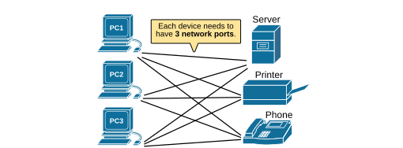

*Figure 2. Multiple connected devices.*

But now **several problems start to appear**. To make that setup work, you’d need 9 cables. And every device would need 3 network ports — one for each connection. But in real life, most devices (PCs, printers, etc.) **only have one network port**. You can’t just plug three cables into a single port.

And there's more. Every connection would need to be on its own IP subnet. So now you're managing multiple IP addresses and network settings — just to connect a few devices.

As the number of devices grows, **things get out of hand very quickly**. Imagine trying to connect 5 computers to 5 servers using this method. The number of cables and IP configurations becomes logarithmically high, as shown in the diagram below.

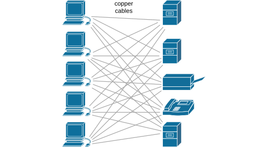

*Figure 3. Many connected devices.*

Now, imagine you run an office and have to connect tens or even hundreds of devices using this approach. Clearly, it is not feasible at all.

That’s why, even in the early days of networking, people realized they needed a better way — a single central device that could connect multiple devices into one shared network and let them communicate easily. This led **to the creation of the network hub**.

## What is a network hub (repeater)?

A hub is a simple network device that connects multiple devices in a local area network (LAN). When using a hub, each device **only needs one network port and one cable** to connect to the network. You don’t have to connect each device to every other device directly, as shown above.

Instead, all devices connect to the hub. **The hub acts like a central point**, making it much simpler to build a small network. You simply plug each device into the hub, allowing them to communicate, as shown in the diagram below.

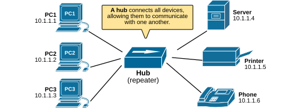

*Figure 4. Hub connecting multiple devices.*

The hub was the first step in creating the local LAN. It’s a Layer 1 device, which means it works only at the physical layer and **doesn’t really understand what data it's forwarding** — it just copies and sends out the electrical signals to every port.

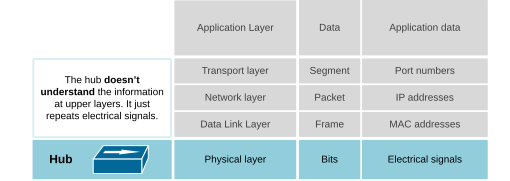

*Figure 5. Network hub and the OSI model.*

For small networks, hubs worked fine. But as networks grew and more devices got connected, new problems started to pop up. One of the main disadvantages of the hub is that it connects all devices into a single collision domain. A collision occurs when **two devices send data at the same time**, and their signals interfere with each other, as shown in the diagram below.

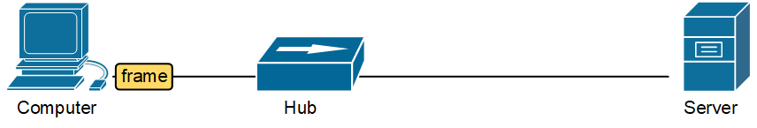

*Figure 6. Network Collision (animated).*

### What is a collision domain?

A collision domain is a part of a network where data collisions can happen. This means that if two devices in the same collision domain try to send data at the same time, their signals interfere with each other — ****a collision occurs****. When that happens, the devices stop, wait, and try again later. This slows down the network.

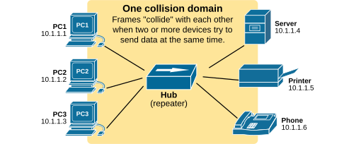

*Figure 7. Hub creates one collision domain.*

In one collision domain, **only one device could talk at a time**. The more devices you add, the worse the performance gets.

To understand the concept, imagine a collision domain **like a big dinner table** where everyone is sitting together and wants to talk. Since only one person can talk at a time without causing confusion, everyone has to take turns speaking. **If two people talk at the same time, no one understands anything** — it’s just noise. This is exactly how devices work in a collision domain using half-duplex communication.

Now, if there are just a few people at the table, taking turns works fine. Everyone gets a chance to speak, and the conversation flows. But what if there are tens of people at the same table? Each person’s turn becomes shorter and shorter. Some people may wait a long time to say anything, and if too many try to speak at once, the whole thing becomes a mess. The same happens in a network with a large collision domain. As more devices are added, performance drops significantly.

To solve this problem, engineers invented a more intelligent device called **a network bridge**.

## What is a Network Bridge?

Bridges were introduced to help solve the problem of **too many devices in one collision domain**. A bridge splits the local network into two collision domains (hence the name "bridge"). By splitting the network into two, each side had fewer devices competing to send data. This meant fewer collisions and better performance.

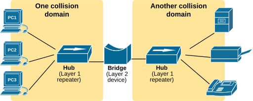

*Figure 8. Network bridge.*

A network bridge **works at Layer 2** (the Data Link) and reads the information in the frame header. It understands MAC addresses and builds a table of which devices are on which side. This allows bridges to perform selective frame forwarding and not only to repeat electrical signals as the hub does.

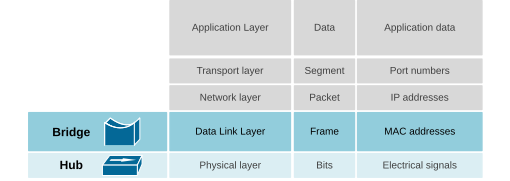

*Figure 9. Network bridge and the OSI model.*

However, bridges had their limitations. Most of them **had only two ports**, meaning they could only divide a network into two segments. This gave just a 2x improvement in performance. Still, bridges helped develop the logic that eventually led to the switch — a smarter, faster, and more scalable version of a bridge with many ports.

## Why do we need a network switch?

In the 1990s, networks continued to grow, and the required speeds continued to increase. **People needed to connect tens of devices in a local network** and enable them to communicate at high speed. The hub and the bridge were simply not able to provide the performance required to connect many devices. This led to the creation of the switch.

While bridges could only split a network into two collision domains, **each port of a switch is******a separate collision domain****, as shown in the diagram below.

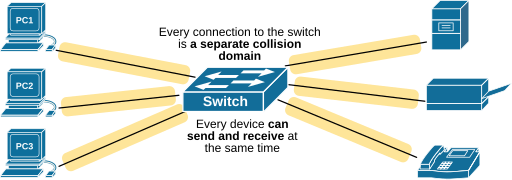

*Figure 10. Network LAN switch.*

Each device connected to a switch **gets its own collision domain**, so they don’t interfere with each other when sending data. This makes the network much more scalable and efficient, especially as more devices are added.

## What is a network switch?

A network switch works at Layer 2 of the OSI model and uses MAC addresses to decide where to send data. When a device sends data, the switch looks at the destination MAC address and forwards the data only to the correct device, not to everyone. This saves bandwidth and reduces unnecessary traffic.

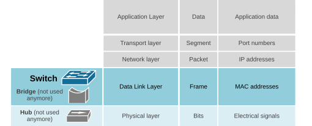

*Figure 11. Network switch and OSI model.*

Each device connected to a switch has its own collision domain, so multiple devices can send data at the same time without interfering with each other. This makes switches much faster and smarter than older devices like hubs.

The primary function of a network switch is **to connect multiple devices in a local network (LAN)** and forward data only to the specific device it’s meant for. It does this by reading the Ethernet header of frames, learning the MAC addresses of connected devices, and building a MAC address table. Then, it sends frames directly to the correct port according to the MAC address table. This improves speed, reduces collisions, and allows devices to communicate efficiently. We go into great detail about how switches work in our [Ethernet course](https://www.networkacademy.io/ccna/ethernet), part of our CCNA learning path.

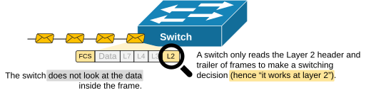

*Figure 12. What is a network switch?*

It is essential to understand that from the end devices' point of view, ****switches are invisible****. You can think of a switch like a power strip—it gives you more ports, but doesn’t interfere with the traffic itself. Devices like computers, printers, or IP phones don’t interact directly with the switch or **even know it’s there**. That's why in most high-level diagrams, switches are drawn as lines that represent a subnet, as shown in the diagram below.

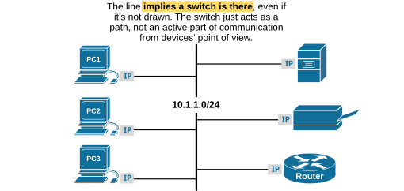

*Figure 13. Network switch function.*

From the device's perspective, it simply sends data to a remote IP address from its own IP address. The device doesn’t need to know how the data gets there — it just works. The switch does the job of receiving the frame, checking the MAC address, and forwarding it to the correct port, all behind the scenes.

KEY NOTE: To end devices, **switches are invisible**. An end device communicates from its IP address to a remote IP address.

Switches **don’t decapsulate and re-encapsulate frames**. They’re transparent in communication. This is why in many network diagrams, switches are not even shown. Instead, a single line labeled “Ethernet” or “VLAN” is used to represent the connection between devices, because the switch doesn’t affect the way the devices talk to each other at the IP layer.

### Where are switches used in modern networks?

Lastly, let's touch on the different roles a switch can take in a modern network design, especially in enterprise environments. Switches are used in three main layers: access, distribution, and core. Each layer has a different role and uses different types of switches depending on speed, features, and number of ports.

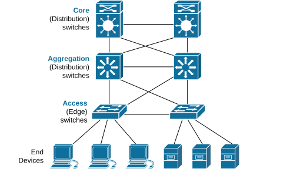

*Figure 14. Types of switches.*

**Access layer switches** are found at the edge of the network. They connect directly to end devices such as computers, printers, phones, and wireless access points. Their main job is to provide connectivity and enforce basic network policies like VLAN assignments or port security. These switches usually offer many ports and sometimes Power over Ethernet (PoE) to power connected devices.

**Distribution layer switches** sit between the access and core layers. They gather traffic from multiple access switches and make forwarding decisions based on policies. This is where functions like inter-VLAN routing, quality of service (QoS), and access control lists (ACLs) are commonly applied. These switches often support Layer 3 capabilities and are more powerful than access switches.

**Core layer switches** form the backbone of the network. Their main role is to move large amounts of data quickly and reliably across the network, such as between buildings, data centers, or campus locations. These switches are optimized for speed, high availability, and redundancy. They often operate at very high speeds (10G, 40G, or 100G) and support Layer 3 routing.

Each of these switch roles supports the scalability, performance, and manageability of large networks, with clear responsibilities at different layers of the network hierarchy.

## Key Takeaways

In this lesson, we explored how Layer 2 devices have evolved, starting from hubs, through bridges, and finally to modern switches.

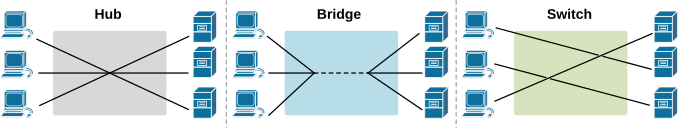

*Figure 15. Hub vs. Bridge vs. Switch.*

****Hubs****were the earliest way to connect multiple devices in a network, but they had major limitations. All devices shared the same collision domain, meaning only one device could send data at a time. As more devices were added, performance dropped. In summary:

- Works at **Layer 1** (Physical layer)
- Forwards all data to all ports
- Creates one big collision domain
- No intelligence; no MAC address learning
- Only **half-duplex** communication
- Not used anymore

****Bridges****improved this by splitting a network into two smaller collision domains, reducing traffic and collisions. They understood MAC addresses and forwarded data more intelligently than hubs, but were still limited to just two ports. In summary:

- Works at **Layer 2** (Data Link layer)
- Connects two network segments
- Reduces collisions by splitting the network
- Learns MAC addresses to forward frames selectively
- Limited to 2 ports (usually)
- Not used anymore - replaced by switches

****Switches****solved these problems by giving each connected device its own collision domain, eliminating collisions and improving speed and scalability. A switch uses MAC addresses to forward data only to the correct device, not to everyone, making communication much more efficient. In summary:

- Works at **Layer 2** (some also support Layer 3)
- Each port is **its own collision domain**
- **Learns MAC addresses** and forwards frames intelligently
- Supports **full-duplex** communication
- **Scalable, fast, and widely used** in modern networks

To end devices, **switches are invisible**. They don’t interfere with communication — they simply forward frames behind the scenes. This is why, in most network diagrams, switches are often shown as a line or are not shown at all.

---

<!-- nav -->
⬅ [Network Components](11-network-components.md) · [Course index](00_Index.md) · [Routers and L3 Switches](13-routers-layer3-switches.md) ➡
<!-- nav -->
