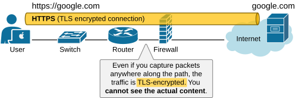
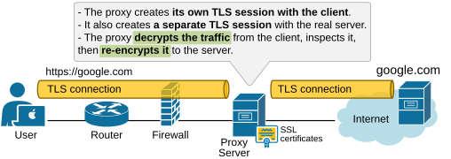
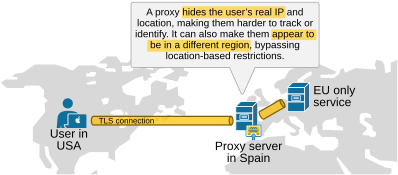
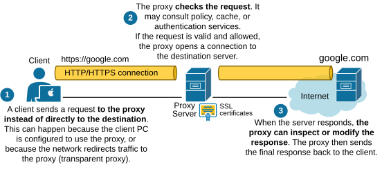
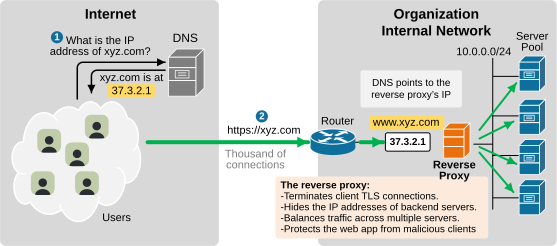
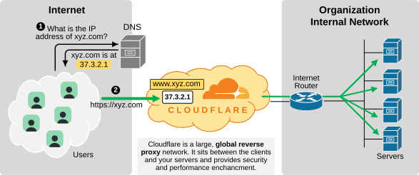

# Proxy Servers

<!-- nav -->
⬅ [Load Balancers](15-load-balancer.md) · [Course index](00_Index.md) · [Intrusion Prevention System (IPS)](17-intrusion-prevention-system-ips.md) ➡
<!-- nav -->

*Network Fundamentals · Lesson · Source: https://www.networkacademy.io/ccna/network-fundamentals/proxy-servers*

In this lesson, we explore another **specialized device** that often falls under the responsibility of the network or network security team in the organization. It is called a Proxy or Proxy Server. Let's see what it does and why we need it in the infrastructure.

## Why do we need a Proxy Server?

There are two main reasons people use a proxy. Let’s go through each one with a simple high-level example to make the concept clear.

### Security

Let’s use a simple example to see why a proxy server is needed. Imagine you manage a company’s infrastructure. Your job is **to protect sensitive data from being stolen**.

- Protecting against outside threats is straightforward — you can use firewalls **to block incoming connections** from unknown or unauthorized sources.
- But what about threats from the inside? How do you stop an employee from **secretly uploading sensitive data to an external server**?

To prevent that, you need a way to inspect user traffic and detect suspicious activity. The problem is that users connect to external servers **over encrypted TLS connections**. Even if you capture their traffic anywhere along the path,**you won’t be able to see what they’re doing.** The data is encrypted, so you can’t see the actual content, as shown in the diagram below.

*Figure 1. Why do we need a Proxy Server?*

Even if you capture packets, you will only see the source and destination IP addresses, ports, and TLS handshake messages. However, **you will not see the application payload** (such as website content and data) because TLS encryption obscures it.

The only way to see the decrypted content is if you have a device that **terminates the TLS session in the middle**. You need a middleman. One of the primary functions of proxy servers is to decrypt the TLS traffic, inspect it, and then re-encrypt it for transmission to the outside server, as shown in the diagram below. The proxy server **acts as the middleman** between clients and servers.

*Figure 2. Proxy Server terminating TLS connections.*

Proxies allow organizations **to enforce corporate security policies on TLS-encrypted connections.** They can block categories of websites and log user activity for audits.

### Privacy and Anonymity

Privacy and anonymity are also reasons to use proxies. A forward proxy **can hide client IP addresses from outside servers**.

Let's use the example shown in the diagram below. A client in the USA cannot connect to the EU-only service because it is only available in the European Union. The service provider checks the client IP addresses and **makes Geo-location restrictions** on IP addresses that are registered outside the EU.

*Figure 3. Proxy server providing privacy and anonymity.*

However, the client in the example connects to the EU-only service **via a proxy**that is located inside the EU. The proxy terminates the client's TLS connection and reestablishes another one with the service. The EU server then sees the incoming connection as originating from Europe and allows it.

### Perfromance

Finally, proxies help with performance as well. **A proxy can cache responses**. If many users request the same content, the proxy can serve it from cache. This reduces bandwidth use and speeds up user access. Caching is especially useful for large static files and popular web pages.

## How Does a Proxy Work?

The most important property of a proxy is that it always sits between the client and the server, relaying requests. The basic flow consists of several steps, as illustrated in the diagram below.

*Figure 4. How does a proxy work?*

- A client sends a request to the proxy instead of directly to the destination. This can happen because the client is configured with the proxy, or because the network redirects traffic to the proxy (transparent proxy).
- The proxy checks the request. It may consult policy, cache, or authentication services.
  - If the requested content is in cache and is valid, the proxy returns it immediately.
  - If not, the proxy opens a connection to the destination server and forwards the request.
- When the server responds, the proxy can inspect or modify the response. The proxy then sends the final response back to the client.

### Types of Proxy Servers

Additionally, proxies can be classified into different types depending on their role in the infrastructure.

- **A forward proxy**represents one or more CLIENTS to the outside world. **It handles outbound requests** and can enforce corporate policies.
- **A reverse proxy** represents one or more SERVERS to outside clients. **It handles inbound requests** and can provide load balancing, TLS termination, and web application security.

Also, proxies can be classified as explicit or transparent depending on whether clients know that the proxy exists or not:

- **In explicit mode**, clients are explicitly configured to use the proxy. **Clients know the proxy exists in the network path**. Every modern OS allows you to configure a proxy IP, and every modern web browser does.
- **In transparent mode**, the network redirects traffic to the proxy **without client configuration**. Transparent proxies are convenient but can complicate TLS inspection and client authentication.

## What is a reverse proxy?

Let's pay special attention to the type of proxy that handles inbound requests - the reverse proxy. It is a server that **sits in front of web servers** and forwards client requests to them, as shown in the diagram below.

*Figure 5. What is a reverse proxy?*

It hides the identity of backend servers from clients and can distribute traffic among multiple servers. Reverse proxies are often used for load balancing, security, and caching.

## Where Does a Proxy Fit in Modern Network Designs?

In modern networks, proxies appear in several places. The exact placement depends on the proxy type and the design goals.

- **A forward proxy** for web access typically sits at the network edge. It sits between the internal LAN and the Internet. **Traffic from corporate users goes to the proxy** before it reaches the internet. This placement allows control of outbound access. It also lets the proxy cache content to save internet bandwidth. In many designs, the forward proxy is in the same security zone as the Internet firewall. The proxy is reachable from user VLANs and has a controlled path to the internet through the firewall.
- **A reverse proxy** sits at the perimeter facing the internet. It often lives in the DMZ. The reverse proxy accepts external requests and forwards them to internal application servers. This placement **shields servers from direct exposure to the Internet**. It also allows TLS offload, web application firewall functions, and load balancing.

### Cloud Reverse Proxy

Most modern reverse proxy functionalities are now consumed as SaaS (Software as a Service). For example, Cloudflare is the most widely adopted global reverse proxy that lives in the cloud, as shown in the diagram below. It sits between a website and its visitors, acting as a shield and performance booster.

*Figure 6. Cloudflare - Global Reverse Proxy.*

A global reverse proxy helps solve problems that network and security teams often struggle with on their own. ****In today’s AI world******, most Internet traffic comes from bots and automated AI agents**, making it harder than ever to stop DDoS attacks and bot floods. By using Cloudflare (or another cloud-based reverse proxy), organizations can offload key security and performance tasks to a provider that specializes in them, including:

- Defending against attacks like DDoS
- Speeding up websites with caching and a global CDN
- Securing traffic with firewalls, SSL, and bot protection
- Boosting availability through smart traffic routing

If you expose your web servers directly to the Internet, how do you protect them? Bots and rogue AI agents will eat them alive.

Speaking of network design, it is essential to understand that network functions are converging. In many deployments, a proxy is part of a larger SASE architecture. Cloud-based proxy services act as the new edge in SASE. They inspect and secure all internet-bound traffic, even from remote users. For CCNA-level design thinking, remember that the proxy can be either on-prem or cloud-based. Both choices affect traffic flow and routing.

## Reverse Proxy vs. Load Balancer

Lastly, let's clear up a confusion that some students who follow the lessons in order may have. When students learn about load balancers and proxies, they often get confused about the difference between a reverse proxy and a load balancer. From a functionality point of view, it seems like both devices do the same - they act as a middleman between clients and servers, terminate TLS, and balance the traffic to back-end servers. This is actually correct; their functions partially overlap. But there are a lot of differences as well. Each one is specialized in its specific domain

- The load balancer specializes in **spreading the traffic to backend servers**.
- The reverse proxy specializes in **inspecting and protecting the backend servers** from rogue clients.

Think of them as a router and a firewall. Both a router and a firewall can do basic routing (static, OSPF, BGP, etc.), basic access control (ACLs), and NAT.

- A router doesn't have specialized firewalling capabilities like layer 7 inspection, stateful clustering, etc.
- A firewall doesn't have specialized routing capabilities like BGP inside VRFs and route-maps filtering of prefixes, etc.

## Key Takeaways

- A proxy is **a middleman** between clients and servers, relaying requests.
- Proxies improve security by decrypting and inspecting TLS traffic.
- They provide **privacy** by hiding client IPs and bypassing geo-restrictions.
- Proxies boost performance with caching to reduce bandwidth use.
- **Forward proxies** control outbound access.
- **Reverse proxies** protect inbound servers.
- Cloud-based reverse proxies (e.g., Cloudflare) **add global security and speed**.
- Reverse proxies and load balancers overlap but serve different specialized roles.

Proxies mainly work at the application layer. They understand the protocol being used. That lets them do things that simple routers and switches cannot do. For CCNA students, this means you can think of a proxy as a specialized network device that speaks HTTP, HTTPS, FTP, or other application protocols.

---

<!-- nav -->
⬅ [Load Balancers](15-load-balancer.md) · [Course index](00_Index.md) · [Intrusion Prevention System (IPS)](17-intrusion-prevention-system-ips.md) ➡
<!-- nav -->
