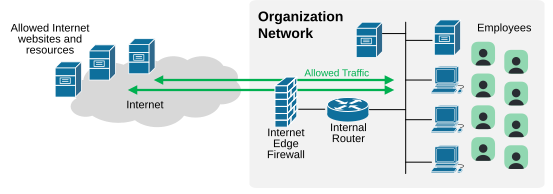
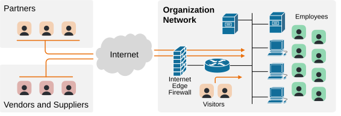
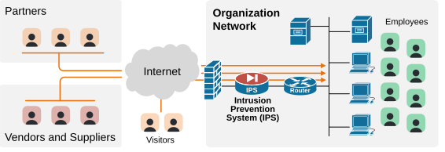
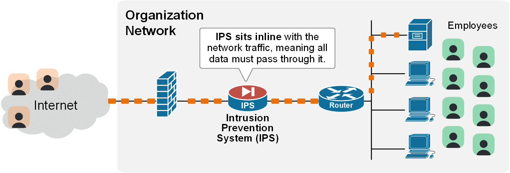
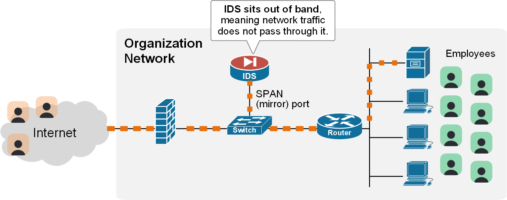
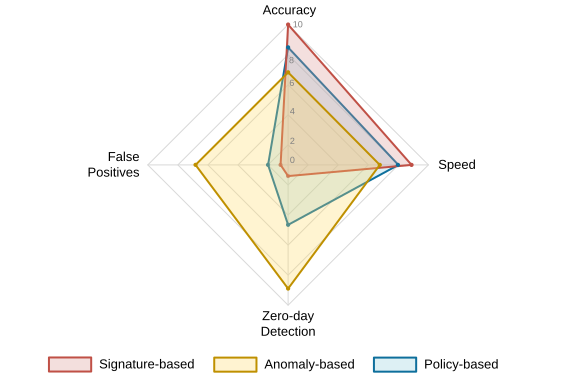

# Intrusion Prevention System (IPS)

<!-- nav -->
⬅ [Proxy Servers](16-proxy-servers.md) · [Course index](00_Index.md) · [Endpoints (End Devices)](18-end-devices.md) ➡
<!-- nav -->

*Network Fundamentals · Lesson · Source: https://www.networkacademy.io/ccna/network-fundamentals/intrusion-prevention-system-ips*

In this lesson, we are discussing a specialized network security device called an Intrusion Prevention System (IPS). It is part of the latest CCNA blueprint and crucial part of the modern network security portfolio.

## Why do we need an IPS?

When an organization is small, it typically has only a small number of internal employees accessing its infrastructure. In that case, protecting the business-critical infrastructure and data is simpler. You can probably get away with only a firewall that does inspection on the edge of the network.

*Figure 1. Small Organization.*

However, when the organization grows bigger, **so does the number of different people who access the infrastructure**. They are not only employees anymore - you have **partners, vendors, contractors, suppliers, visitors**, and so on. Obviously, the attack surface grows significantly because you have to provide network access to individuals that cannot be trusted, as they are not part of your organization.

The result of this larger attack surface is that the network security team pinches many holes in the edge firewall to allow connections from the outside, as shown in the diagram below.

*Figure 2. Large Orgnaization giving access to 3rd party.*

When you give network access to third-party organizations, you are **opening your infrastructure to several risks**. The reason is obvious: you can't control or guarantee the security of their systems or the identity of their personnel.

Third-party computers, laptops, and servers**may be infected with malware or viruses.** Additionally, you cannot be fully sure that the person logging in is actually the one you approved. **Credentials can be shared or stolen**. In other words, the login may belong to “*Peter the supplier,*” but it could actually be used by “*someone else entirely*.”

However, at the same time, your Internet-edge firewall has **no way of differentiating between legitimate and malicious login attempts**. The firewall **let all login attempts through**. Its job is to check if the traffic is "allowed," not to decide if the person sending it and their behavior is suspicious.

So the question here is: how do you protect your infrastructure from malicious third-party users (or even rogue internal employees)? You **explicitly allowed them access through the firewall**. Hence, you cannot expect the firewall to stop them from doing malicious things...

That's where the Intrusion Prevention System comes into play.

## What is an Intrusion Prevention System (IPS)?

First, let's emphasize that **networks nowadays are under constant attack**. Malware and bots are automated and operate 24/7. With the advancement of AI agents, it will only get worse.

Firewalls are effective at controlling traffic based on IP addresses, ports, and protocols, but **they are not designed to detect patterns of attacks that utilize****explicitly allowed connections**. For example, the firewall allows port 22 (for SSH). It cannot detect an attacker trying to infiltrate the SQL database through an SSH connection. From the firewall's perspective, SSH traffic is explicitly allowed by security administrators, and that's it.

An IPS fills this gap. An Intrusion Prevention System (IPS) is a network security device that sits inline with network traffic, as shown in the diagram below.

*Figure 3. What is an IPS?*

The IPS understands Layer 3, 4, and 7 packet headers, packet content, and traffic behavior. **It can automatically block malicious activity**in real-time if it detects that the user or connection behaves abnormally or matches a known attack pattern.

### Types of Intrusion Systems - IPS vs IDS

Typically, every modern security system that performs the functions we explained so far is actually called an IDPS (Intrusion Detection and Prevention System). That's because it can be configured to operate in two modes:

- IDS (Intrusion Detection System) mode.
- IPS (Intrusion Prevention System) mode.

To truly understand the differences and design aspects of both modes, you must know what a "false positive" is in a security context.

A false positive is when a security system (like IDS or IPS) wrongly identifies normal, legitimate traffic or activity as malicious. For example, if an IPS thinks a valid database query looks like an SQL injection attack and blocks it, that’s a false positive. **It’s a mistake in detection**.

#### IPS mode

In IPS mode, the device becomes what we call an IPS. It sits inline with the traffic, so **all packets pass through it**, as shown in the animated diagram below.

*Figure 4. What is an Intrusion Prevention System (IPS)?*

If an IPS detects an attack, it blocks the traffic right away. Hence, it is most useful in places**where security outweighs the risk of false positives**. For example, at the network edge, in data centers, or in environments with strict compliance requirements, such as financial and government institutions.

However, the other side of the coin is that an IPS will inevitably block some legitimate connections. The algorithm will always have some percentage of false positive alarms that will eventually block legitimate traffic.

#### IDS mode

On the other hand, an IDS (Intrusion Detection System) **only monitors traffic**. It sits out of the way of network traffic, reads a traffic copy, and alerts security admins when it sees suspicious activity. It does not stop the traffic itself.

*Figure 5. What is an Intrusion Detection System (IDS)?*

IDS is useful in cases where you want visibility but **don’t want the risk of blocking legitimate traffic** because of false positives. Since IDS only alerts and doesn’t sit in line, it won’t affect production traffic. This makes it valuable in environments **where uptime and reliability are critical**, like healthcare networks and air traffic control, where dropping a good connection could disrupt vital services.

## How does an IPS work?

Now, let's shift the focus to how IDPS works. An IPS uses several methods to identify and block threats. The goal is to recognize bad traffic and stop it before it reaches its target. It typically uses three different methods to detect malisious activities. Each method has its pros and cons, as you can see in the following diagram.

*Figure 6. IPS Pillars of detection.*

- **1. Signature-Based Detection**This is the most common detection method. Imagine an IPS has a huge database of IDs for known bad guys. Each ID is a signature, which is a unique pattern of data that represents a specific attack.For example, a signature might be specific text used in a common web attack. The IPS constantly inspects every packet of data. If a packet's content matches a known signature, the IPS immediately flags it as malicious and takes action.The most significant benefit of signature-based detection is that **it is very accurate and fast**. However, it can't stop a "zero-day" attack that hasn't been seen before because there's no existing signature for it.
- **2. Anomaly-Based Detection**This method is smarter and more flexible. Instead of looking for specific signatures, the IPS first spends time learning what normal network behavior looks like. **It builds a baseline of typical traffic patterns**, such as the usual amount of data transferred, the types of protocols used, and the sources and destinations of traffic.Once it understands the baseline, it can then identify any behavior that deviates from this norm. For instance, if a user's computer suddenly starts sending hundreds of GB of data to an unknown server at 3 a.m., the IPS will flag this as an anomaly and block it. This method i**s excellent for catching zero-day threats** because it doesn’t need a pre-existing signature.The downside is that it can have many false positives, meaning it flags a legitimate activity as a threat because it’s unusual.
- **3. Policy-Based Detection**This method is all about the rules security admins set. A policy is a rule that defines what traffic is allowed or not allowed based on the organization's security policies. For example, a policy might state, "No traffic from outside the network is allowed to reach the main database server on port 3389." If any traffic tries to do this, the IPS will block it, even if it doesn't match a known signature or an anomaly. This is about **enforcing corporate security policies**.

As you can see, each detection method has its pros and cons as shown in the diagram above. Usually, the IPS system uses all three to detect abnormal activities in the network.

### What Actions Can an IPS Take?

Once an IPS identifies a threat, it doesn't just sit there. It takes immediate action. Here are some of the most common responses:

- ****Alert and Log:**** This is the most basic action. The device creates a syslog entry and sends an alert to the network team. Basically, the device runs in IDS mode.
- ****Drop the Packet:****This is the most direct form of prevention. The IPS simply discards the malicious packet, preventing it from ever reaching its destination. This is often referred to as "denial" or "drop."
- ****Reset the Connection:**** The IPS can send a TCP "reset" packet to both the source and the destination of the suspicious connection. This immediately breaks the connection and ends the communication, preventing any further attack.
- ****Block the Source (Quarantine):****This is a more aggressive action. The IPS can add the source IP address of the attacker to a block list, effectively stopping all future traffic from that address for a specified period. This is a very effective way to shut down an ongoing attack. In more advanced systems, the IPS can integrate with other security tools to "quarantine" an infected host or user. It can force an infected computer into a restricted network segment where it can't harm other systems.

## Why is an IPS important?

Firewalls are still essential, **but they are no longer enough**. The IDPS system is a crucial component of the network security portfolio for any organization today.

- **Stops Zero-Day attacks:** A modern IPS can provide crucial protection against attacks that have never been seen before (which a firewall cannot).
- **Stop insider threats:**Anomaly detection can also spot a compromised user account (which a firewall cannot).
- **Ensures compliance:** Many regulatory requirements, like PCI DSS and HIPAA, require organizations to have intrusion detection and prevention systems (IDPS) in place to protect sensitive data.

## Key Takeaways

As a CCNA student, understanding the IDPS role is a key step towards becoming a skilled network professional. The topic is also part of the latest CCNA blueprint. The key points to remember are as follows:

- An IPS is a proactive security tool that sits inline with traffic and **actively stops threats**.
- On the other hand, IDS sits out of the traffic way and **only detects attacks**.
- The three IDPS primary detection methods are:
  - Signature-based.
  - Anomaly-based.
  - Policy-based.
- Common IPS actions include dropping packets, resetting connections, and blocking source IP addresses.
- An IPS provides a crucial layer of defense, especially against zero-day attacks, and is usually **required for regulatory compliance**.

---

<!-- nav -->
⬅ [Proxy Servers](16-proxy-servers.md) · [Course index](00_Index.md) · [Endpoints (End Devices)](18-end-devices.md) ➡
<!-- nav -->
