# Generic topologies - Ring, Star, Bus

<!-- nav -->
⬅ [Network Topology Architectures](19-network-topology-architectures.md) · [Course index](00_Index.md) · [Small Office Home Office (SOHO)](21-soho.md) ➡
<!-- nav -->

*Network Fundamentals · Lesson · Source: https://www.networkacademy.io/ccna/network-fundamentals/generic-topologies-ring-star-bus*

What are the generic network topologies, like Ring, Star, Bus, Tree, etc? Are they really a thing? Well, the short answer is yes, they are a thing, but practically speaking, they are not really a thing. **They are just context**. They are contextual phrases that were used in the old days to describe how several devices are interconnected. For example, you can hear network engineers talk like this:

- *What is the **physical**topology of the second floor?* - It is a physical star.
- *What is the **logical**topology of Office X?* - It is a bus.

I personally have never used those in my work (and I have 15+ years of experience in the field). So, in short, knowing these terms is not that important. However, they appear occasionally in the CCNA documentation and in exam environments. Therefore, we must cover them. But let's make it as useful as it can be for a network engineer..

## Generic Topologies — Ring, Star, and Bus

Before we dive in, let's first clear the term "topology" for those who may not be familiar with it. Topology means how nodes in a network connect to each other — the network topology. Topology simply means **the way things are connected**. In networking, it describes how computers, switches, routers, and other devices are arranged and how data flows between them. You can think of topology as a map of relationships — **who can directly talk to whom**.

### Physical vs Logical Topology

In networking, especially in modern days, we separate the networking topology into physical and logical ones, as shown in the diagram below.

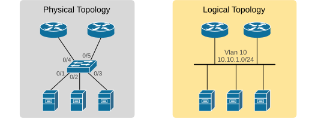

*Figure 1. Physical vs. Logical Topology.*

- **Physical topology** is what you can see — **the cables, switches, routers**, and how they are physically connected. It’s the actual layout you could draw by following the wires.
- **Logical topology**, on the other hand, is about **how data actually flows** between devices. Sometimes, the logical path doesn’t match the physical connections at all.

For example, let's look at the diagram above, where all servers and routers connect to a central switch. That, in CCNA terms, can be classified as a star physical topology. But because the servers communicate in a shared Ethernet VLAN (10.10.1.0/24), the traffic logically behaves like a bus topology, as shown in yellow.

In modern networks, **we often have one physical topology and a completely different logical one**. For instance, a data center might physically use a [leaf-spine design](https://www.networkacademy.io/ccna/network-fundamentals/leaf-spine-architecture), but logically, traffic could be routed in a hub-and-spoke pattern because of how routing is configured.

When you read “*topology*” in the Cisco exam environment, always ask yourself — are they talking about the physical connections (cables, port numbers) or the logical flow of traffic (VLANs, subnets, etc.)?

### Network Topology Types

Now let's walk through the most fundamental topology types with an example. Let's say we have six nodes numbered 1 through 6, as shown in the diagram below. How many different ways of interconnecting them can you come up with?

*Figure 2. Six nodes to interconnect.*

Well, you can probably come up with a lot of different variants of interconnecting the nodes. However, the terms: Ring, Star, and Bus refer to the most fundamental ones, as shown in the diagram below.

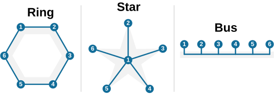

*Figure 3. Ring, Start and Bus topologies.*

Let's dive into each one in more detail and see what its properties are and where you can see such topology in the real world.

### Ring

In a ring topology, each device connects **to exactly two others** — forming a closed loop or ring. Data travels in both directions from one device to the next until it reaches its destination. For example, if node 3 wants to reach node 6, it must pass through nodes 4 and 5, as shown in the diagram below.

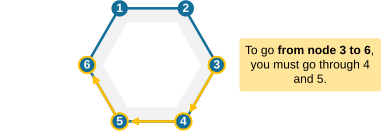

*Figure 4. Ring topology traffic path.*

Ring topologies first appeared with the [Token Ring](https://en.wikipedia.org/wiki/Token_Ring), an old IBM technology from the 1980s. In Token Ring, a special “token” circulates around the ring, and **only the device holding the token can send data**. This prevented collisions. However, **Token Ring is a thing of the past**. It was replaced by modern network technologies such as Ethernet and 802.11 WiFi that have more modern collision detection and collision avoidance techniques.

#### Ring topologies in modern networks

At this point, you may be wondering - where can I encounter a ring topology in the modern world? Are they completely gone?

Well, there are a few use cases that still use physical ring topology - **Oil and Gas pipes** over vast distances and underground tunnels of mines. For example, when oil and gas pipelines are built across long distances, **a fiber-optic cable is usually installed along with the pipeline**. This is done during construction because it’s cheaper to lay the cable at the same time. The fiber cable is used for monitoring and control of pipeline operations, such as leak detection and pressure monitoring.

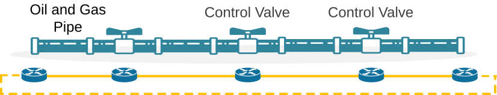

*Figure 5. Oil Pipe.*

Because of the availability of only a single fiber cable, **you cannot really connect the routers in any other way** other than a ring topology, as shown in the diagram below.

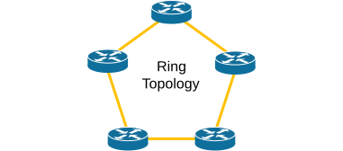

*Figure 6. Ring - real world example.*

However, this ring topology has some significant challenges. For example, it is harder to reconfigure or scale compared to other toolgies. Depending on the scale of the ring, the fault detection can be pretty slow because the event must propagate around the ring. A single fiber cut can break the ring if both cable directions use the same physical path. Additionally, adding and removing devices causes interruption of the entire ring.

### Star

The star topology is **by far the most common in modern LANs**. Every device connects to a central device, like an aggregation switch. The central device acts as the connection point for all communications, as shown in the diagram below. For example, to go from node 3 to node, the traffic always goes via node 1.

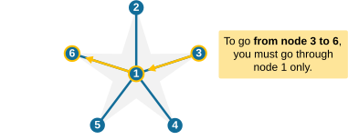

*Figure 7. A start topology example.*

If one device fails, it doesn’t affect others. However, if the central switch fails, the whole network is down — that’s the single point of failure (SPOF).

Ethernet switched networks today are essentially star topologies. Each computer has a dedicated link to a switch, and the switch handles forwarding traffic intelligently, as shown in the diagram below.

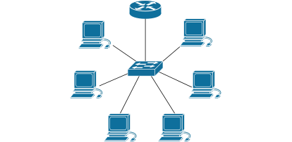

*Figure 8. Example of a start topology.*

The advantages of the star over the ring are that **you can easily add or remove devices** without interrupting other connected nodes. Additionally, one link failure **affects only one device**, compared to the ring, where one link failure affects all devices.

The only downside of the star is that **it requires more cables**, which makes it inappropriate for places where laying down cables is hard and expensive.

### Bus

In a bus network, all devices share a single communication line — the “bus.” It is a thing of the past when coaxial cables and hubs connected multiple devices.

The main property of the bus is that every node can communicate with every other "*directly*", without passing through any intermediate node, as shown in the diagram below.

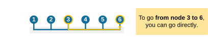

*Figure 9. Bus.*

Today, we don’t use bus topology in modern LANs. Switches have replaced that shared medium with dedicated collision domains per port.

Bus topology nowadays refers to what we call the shared segment. It is used to describe logical topologies where every host can communicate with every other directly.

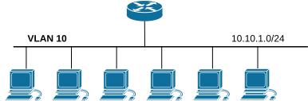

*Figure 10. Bus example.*

Nowadays, the term "bus topology" **refers only to the logical Ethernet/VLAN topologies**. There is no physical bus that connects multiple devices together.

## More complex topologies

We cannot finish the topic of topologies without quickly going through a few more complex ones that are much more applicable to today's networks.

### Tree

The tree topology (also called a hierarchical topology) combines characteristics of multiple stars. Think of it like an upside-down tree: there’s a “root” device (maybe a core switch), branches, and leaves.

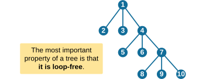

*Figure 11. Tree topology.*

Each branch can have its own star-like structure, connected to the layer above it. This design makes it scalable —**you can keep adding branches**as your network grows. It’s also easy to manage since the hierarchy helps you organize traffic and control broadcast domains.

The tree topology is found everywhere in today's networks - from spanning-tree loop-free topology to the multicast loop-free distribution tree (MDT).

### Mesh

The mesh topology takes reliability to the next level. In a mesh network, every device is connected to every other device, providing several possible paths for data to travel.

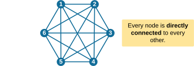

*Figure 12. Full-mesh.*

There are two main types: full mesh and partial mesh.

- **Full Mesh** means every device is connected directly to every other device. This creates complete redundancy — if any single link fails, there are many alternate routes. However, the number of links increases rapidly as you add devices. For n devices, you need n(n–1)/2 links. The only downside is that **it gets expensive fast**.
- **Partial Mesh** means only some devices have multiple connections. Typically, critical nodes (like routers or servers) have redundant links, while less essential nodes connect through just one or two. This **saves cost while still improving reliability**.

Mesh topologies are common in WANs and data centers. For example, the Internet itself is a massive partial mesh. Data can reach a destination **through many possible routes**, depending on routing tables and link states.

## Key Takeaways

Cisco wants you to study and remember these topologies so that **you have a context** when you see a real network. You memorize and recognize these shapes and their fundamental properties. They want to train you so next time you see a network diagram, you ask yourself:

- What happens **if a link fails**?
- **How many hops** does data take to reach its destination?
- Is there **a single point of failure**?
- How easy is it **to scale** this network?

Most real-world networks combine multiple topologies. A campus network might have a tree topology inside each building, star links at the access layer, and a hub-and-spoke WAN connecting remote sites.

Modern data centers use leaf-spine, which is really just a special type of mesh optimized for predictable latency and scalability. The principles you learn from basic topologies apply directly to these advanced designs.

Network topologies are the foundation of how data moves. Even though technologies evolve, the core ideas stay the same.

- **Bus:** One shared segment (in the past shared cable)—each hop can communicate directly with the others.
- **Ring:**Closed loop — predictable but fragile. Useful for environments where it is hard and expensive to lay down cables. Hard to add and remove devices. One link failure affects all devices.
- **Star:** Central device — simple and reliable for LANs. Easy to add and remove devices. One link failure affects only the connected device.
- **Tree:** Hierarchical — scalable and organized. Loop-free.
- **Mesh:** Redundant — great for reliability, expensive to scale.
- **Physical vs Logical:** One shows cables, ports, connections; the other shows logical data flow.

When you understand these topologies, **you start seeing patterns** in every network you work on — from home setups to enterprise infrastructure.

Next time you look at a diagram, don’t just see switches and routers. **See the structure** that defines how information travels. That’s what topology is all about — **the invisible framework that makes every network work**.

---

<!-- nav -->
⬅ [Network Topology Architectures](19-network-topology-architectures.md) · [Course index](00_Index.md) · [Small Office Home Office (SOHO)](21-soho.md) ➡
<!-- nav -->
