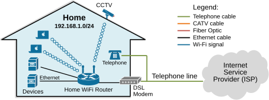
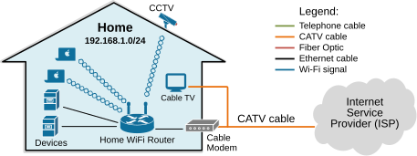
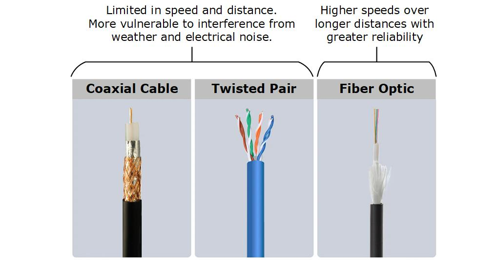
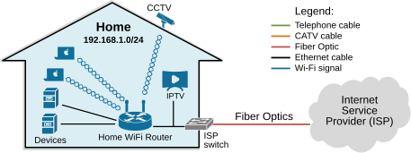
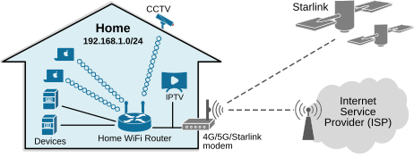
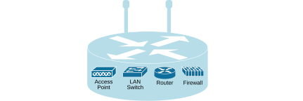
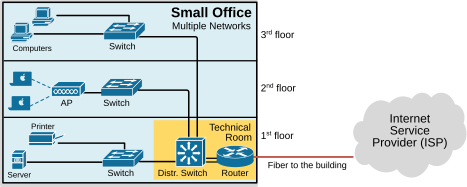
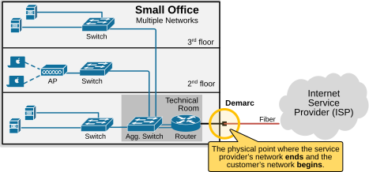

# Small Office Home Office (SOHO)

<!-- nav -->
⬅ [Generic topologies - Ring, Star, Bus](20-generic-topologies-ring-star-bus.md) · [Course index](00_Index.md) · [Three-Tier Architecture](22-three-tier-architecture.md) ➡
<!-- nav -->

*Network Fundamentals · Lesson · Source: https://www.networkacademy.io/ccna/network-fundamentals/soho*

In this lesson, we will explore the various technologies and devices utilized by Small Office Home Office (SOHO) networks. We focus on the big picture without getting into great detail. The focus of the lesson is to give you an introduction to the different types of networks.

## The Home Network

For some people, the home network is synonymous with their home Wi-Fi router. Others don’t even think about the network at all. They simply use the services it provides—Facebook, Google, and YouTube—without caring how their device connects. However, as a CCNA candidate, it is important to start noticing the different types of home networks through the eyes of a network engineer. So let's walk through the most common home Internet setups.

### Legacy Home Internet Technologies

Let's examine the most common home Internet setups that are widely used across the world. You can relate to which one you have had at home over the years.

#### DSL (Digital Subscriber Line)

Imagine we are back in the 1990s, and **you run a local Internet Service Provider (ISP)**. When someone wants home Internet, there’s one big problem—you need to get a cable from your nearest point of presence (PoP) to their house. In most places in the world, that’s a big deal. **You can’t just dig up streets and lay cables as you like**. It requires permits, planning, a significant amount of time, and money.

Eventually, people realized something important. In the 1990s, we already had a cable network in place—**the home telephone network**. Almost every house had a phone line and a telephone. This allowed Internet providers to leverage this existing infrastructure to deliver the Internet. That’s how DSL technology was created.

DSL is a technology that provides Internet access using the existing telephone line in a house, as shown in the diagram below.

*Figure 1. DSL Home Internet.*

DSL works using **a modem** that connects to the telephone jack in the house. On the other end of the telephone line, at the service provider’s location, special equipment separates the voice and data traffic as follows:

- **Voice**traffic uses **the lower frequencies** on the line.
- **Data**traffic uses **the higher frequencies** on the line.

This means you can talk on the telephone and use the Internet at the same time without interference.

DSL is still widely used today in some parts of the world. However, as Internet speeds continue to increase, it will eventually be replaced by more modern, faster technologies.

#### Cable Internet

Another legacy Internet technology that was very popular in some parts of the world is the Cable Internet. It uses the same idea - instead of the Internet Service Provider digging up streets to your home to lay a new cable, **why not use the existing cable infrastructure** for cable TV - **the coaxial cable to your home**. Unlike DSL, which uses telephone lines, cable Internet relies on the TV cable infrastructure to provide high-speed Internet.

*Figure 2. CATV Home Internet.*

The coaxial cable is plugged into a device called **a cable modem**. The modem separates the TV signals from the data signals. The data part is then sent to the home router, which shares the Internet with the home devices, as shown in the diagram above.

On the provider’s side, the coaxial cable connects to a Cable Modem Termination System (CMTS) located at a local hub. This system manages Internet traffic for many houses in the neighborhood. Because of this shared setup, Internet speeds can sometimes slow down during peak hours when many people are online at the same time.

Cable Internet is **usually much faster than DSL**, with speeds of up to 1-2 Gbps. In short, it delivers a reliable and high-speed connection through the same cable that powers the cable TV. It is still widely adopted in many parts of the world.

### Modern Home Internet Technologies

Both DSL and Cable Internet rely on copper cables to bring the service to the house. However, **there are two problems**: **copper is sensitive to outside conditions and has a distance limitation**. During storms, the cables can pick up electrical noise, weakening the signal and slowing down the Internet. Water can also seep into cable connectors, leading to service drops. Lightning is another risk, since copper conducts electricity, and a lightning strike can damage cables and the devices connected to them.

The distance issue is even more serious - it is not only technical but also financial. The shorter distance limit means the provider must build more points of presence (PoP) to keep customers within range. Each PoP costs money to install, maintain, and power. That means distance **directly affects how much it costs** the provider to deliver Internet service.

*Figure 3. Copper vs. Fiber cables.*

Fiber, on the other hand, has many advantages. It uses glass instead of copper. This makes it immune to electrical interference, storms, and lightning. Fiber can also carry data over much greater distances without losing signal quality. That’s why fiber is both **more reliable and faster** for modern home Internet.

#### Fiber to the home (FTTH).

Fiber Internet is the most advanced form of home Internet today because **it uses fiber-optic cables** instead of copper wires.

With Fiber to the Home (FTTH), the fiber-optic line runs all the way from the provider directly into your home, as shown in the diagram below. This gives you the full benefit of fiber speeds, often in the range of gigabits per second. It is the fastest and most reliable type of home Internet connection.

*Figure 4. Fiber-to-the-home (FTTH) Internet.*

The fiber can terminate on an ISP-owned switch or media converter, or can connect directly to your home Wi-Fi router.

#### 5G and LEO Satellites

Some of the latest home Internet technologies go beyond cables and fiber. Two popular examples are Starlink and 5G home Internet.

Starlink is a satellite Internet service created by SpaceX. Unlike older satellite Internet that used satellites far away in space, Starlink uses thousands of small satellites in low Earth orbit (LEO). Hence, the connection has much lower delay and faster speeds, often similar to cable internet in some areas.

*Figure 5. Wireless Modern Home Internet.*

5G Internet uses the same 5G mobile technology that powers modern smartphones, but it is designed to provide Internet for an entire home. The service utilizes a special 5G router, which connects to the mobile network and then shares the Internet inside the house via Wi-Fi. It can offer remarkably high speeds, sometimes reaching gigabit levels, but performance depends on coverage and the number of users in the local area.

Both technologies are a great alternative to the stationary cable Internet and fit into the modern home office trend of **working from everywhere**.

### The Home Wi-Fi Router

Lastly, let's bring our focus to the number of network devices that a typical home office network has - usually just one main device: **the home Wi-Fi router**. This single box works as a switch, router, firewall, and wireless access point all in one, as shown in the diagram below.

*Figure 6. Home Wi-Fi routers.*

However, office networks usually have more devices, **each serving a specific function**. For example, they often use separate switches, routers, firewalls, and access points instead of combining everything into one box.

## Small Office network

Office networks are similar to home ones, but they work on a bigger scale. For example, in an office building, the LANs usually start with switches placed in wiring closets that are locked for security. From there, Ethernet cables run from the closet to cubicles and meeting rooms, allowing devices to connect. At the same time, most offices also set up wireless LANs in the same spaces. This lets employees move around while staying connected and supports modern devices that don’t even have Ethernet ports.

The following diagram shows a simple example of a small office in a three-story building. Each floor has its own LAN switch. To connect all floors together, each floor’s switch links **to one central distribution switch**. So, if a computer on the third floor wants to send data to a printer on the first floor, the data goes through the 3rd floor's local switch, down to the distribution switch, and then through the 1st floor's local switch to reach the printer.

*Figure 7. Small Office.*

The diagram above also shows how a LAN connects to a WAN using a router. Switches and wireless access points create the LAN, while the router connects the LAN to the wider network.

- On the LAN side, the router uses a regular Ethernet copper cable.
- On the WAN side, the router uses fiber to connect to the Internet Service Provider (ISP).

### What is a Demarcation Point?

One important thing that we must cover when talking about Small Office Home Office (SOHO) is the term - Demarcation Point.

The demarcation point (or demarc) is the physical point where **the service provider’s network ends and the customer’s network begins**. In homes, it’s usually where the provider’s cable, fiber, or telephone line enters the building, and from there, the homeowner’s equipment (like a router) takes over.

*Figure 8. What is a demarcation point?*

In an office, the provider might bring in a fiber or copper line to a technical room, and from that **demarc**point, the company’s IT team connects it to their own routers, switches, and LAN infrastructure.

## Key Takeaways

The goal of this lesson is to give you **an introduction to the different types of small networks**. At this stage, the focus is not on details, but on **understanding the big picture**—what kinds of networks exist, what devices they use, and how responsibilities are divided between them (e.g., the demarcation point).

Think about the home networks you’ve used in the different places you’ve lived. Each one probably relied on a different technology—maybe DSL in one place, cable Internet in another, or even fiber or mobile networks. Start making a habit of noticing what kind of network is around you when you visit new places. This shift in perspective will help you begin to see networks not just as a user, but **through the eyes of a network engineer**.

---

<!-- nav -->
⬅ [Generic topologies - Ring, Star, Bus](20-generic-topologies-ring-star-bus.md) · [Course index](00_Index.md) · [Three-Tier Architecture](22-three-tier-architecture.md) ➡
<!-- nav -->
