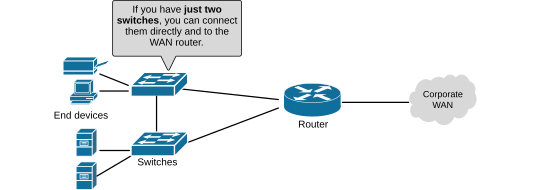
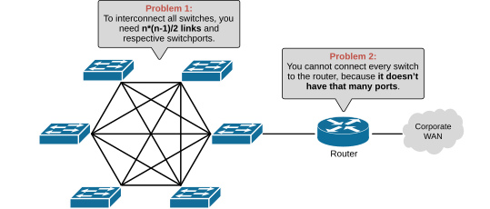
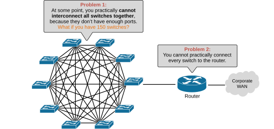
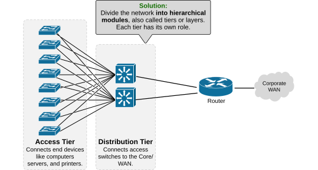
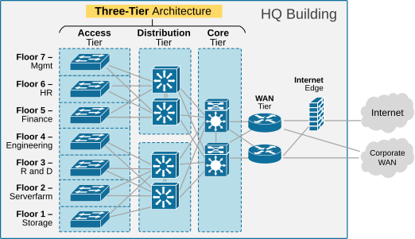
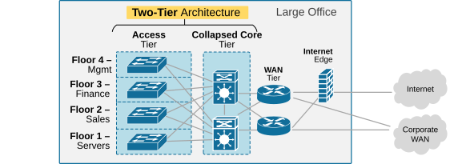

# Three-Tier Architecture

<!-- nav -->
⬅ [Small Office Home Office (SOHO)](21-soho.md) · [Course index](00_Index.md) · [Leaf-Spine Architecture](23-leaf-spine-architecture.md) ➡
<!-- nav -->

*Network Fundamentals · Lesson · Source: https://www.networkacademy.io/ccna/network-fundamentals/three-tier-architecture*

In this lesson, we explore the network design of Enterprise local area networks (LANs). We cover only the high-level fundamentals of the network structure. We don't dive into the specifics of how all technologies integrate. We focus on understanding why the network is divided into layers.

## Why do we need Hierarchical (Modular) Network Designs?

To understand modular network designs, you first need to understand the problems they solve before delving into the details.

### Different problems at different scales

The network architecture has one property that is very important to remember from a very early stage in your career. Some problems **only show up at a specific scale**. First, let's clear something: In networking, **there is no universal standard** for "small, medium, large, and very large" network sizes. Vendors and industry bodies define them differently. But here’s a practical breakdown that we can use in this lesson:

- ****Small-scale**** (Small office home office): up to 50 devices.
- ****Medium-scale**** (Average company): 50–500 devices.
- ****Large-scale**** (Enterprise): 500–5,000 devices.
- ****Very large-scale**** (Service Provider): 5,000–50,000+ devices.
- ****Hyperscalers**** (AWS, Azure, Google): Millions of devices across global data centers, highly automated and distributed.

These ranges are approximate. But they will serve us a context for this and the following two lessons on the different network architectures.

Let's start with some fundamental concepts. Let's look at the most basic network architecture that one can have.

#### Network with two switches

Suppose you are responsible for designing **a network with one or two switches** and one router connected to the Internet. You must connect multiple end devices and provide them with access to the global web. How would you connect the devices?

*Figure 1. Network with two switches.*

Well, the point is, you can connect them however you want, and the network will work just fine. **You can use ANY design you want** - the scale is so small that you will probably never encounter any design problem.

#### Network with six switches

Let's introduce several more devices. Say you have six switches and a router. How would you connect the network devices together?

*Figure 2. Network with six switches.*

Even though we only increased the number of devices by a few, some problems started to show up. For example, if you interconnected all the switches as shown in the diagram above, you would need 15 links and 5 ports on each switch. Additionally, you cannot connect each switch to the router, because a router typically only has a few ports.

However, the scale is so small that you can get away with connecting all devices in a full mesh.

#### Network with ten switches

If we continue to increase the number of network devices, we start to reach the practical limits of the full-mesh designs. If you have 10 switches, we can calculate with the formula n*((n-1)/2) that you need 10*9/2=45 links to interconnect them, as shown in the diagram below. However, what if you have 150 switches?

*Figure 3. Network with ten switches.*

If you have 150 switches and want to connect them in a full mesh, you will need 150*149/2=11,175 links and 149 ports on each switch. Obviously, it is impossible. You need to find another more efficient way to connect the switches.

**KEY NOTE:** Some network problems **only show up at a particular scale**. If you have only a few devices, you can get away with almost ANY design. However, as the network grows, problems become much more serious, and a proper network design is a must.

#### The solution

When you connect every switch to every other switch in a full mesh, **the number of links grows very quickly**. For a small number of switches, it might work, but as soon as you add more, t**he design becomes wasteful and practically impossible**.

The solution to this problem is to use a modular (hierarchical) network design. Instead of building a giant mesh, the network is broken into layers (also called tiers or modules). For example, if you want to connect 10 switches in a full mesh, you need 45 links and 9 ports on each switch. However, if you connect them in a layered way, you need 16 links and **only two ports per access switch,** as shown in the diagram below.

*Figure 4. Network Tiers (Layers).*

This structure means each access switch only needs two uplinks to connect to the distribution layer, **no matter how many access switches you add**. The design grows in an organized way, making it easier to expand the network, manage it more efficiently, and reduce costs.

In short, modular network design **solves the scalability and manageability problem** of a full mesh by organizing the network into layers, which keeps it simple and efficient even as the number of switches increases.

### Three-Tier Architecture

The Cisco three-tier architecture is a way of designing networks that makes them easier to manage and expand. It divides the full-mesh network into district layers (also called tiers or modules), as shown in the diagram below.

*Figure 5. Three-Tier Hierarchical Architecture.*

As the name implies, the three-tier architecture has three layers: **access**, **distribution**, and **core**.

- **The access layer**is where end devices like computers, servers, and printers connect to the network.
- **The distribution layer** sits in the middle and **connects all the access switches together**. It is also where routing, VLAN communication, and security policies are usually handled.
- **The core layer** is the backbone of the network. It links multiple distribution switches, often spread across buildings. Its main job is **to move traffic very quickly and reliably** between different parts of the network.

This design is more efficient than connecting every switch to every other switch in a full mesh. In a full mesh, the number of connections grows very fast as you add more switches. That makes it expensive and wasteful.

In the three-tier design, each switch only needs two uplinks, **so cabling and switchport costs are much lower**. The layout is clear and structured, which makes it easier to design and maintain. When a problem occurs, it typically affects only one part of the network, rather than spreading throughout.

The three-tier architecture works much better because it divides the whole full mesh network into smaller and simpler blocks. And in networking, simple is always better and easier to manage. There is an excellent saying that you should remember and use when possible.

**Complex fails, simple scales.**

### Two-Tier Architecture

The three-tier architecture works great and is battle-proven over the years. However, there is a middle ground where a network has many network devices, but at the same time is not big enough to be designed in a three-tier structure. That's how the two-tier was introduced.

The two-tier architecture, also called ****a collapsed core******,** is a simpler version of the three-tier design, where the distribution layer and the core layer are combined into one. That means you only have two layers: the **access layer** and the **collapsed core layer**, as shown in the diagram below.

*Figure 6. Two-Tier Hierarchical Architecture.*

- **The access layer**is still where devices like computers, servers, and printers connect.
- **The collapsed core layer**then handles both roles of distribution and core. It connects all the access switches together, provides routing between VLANs, and also acts as the high-speed backbone for the network.

This design is usually used in small and medium-sized networks where the cost and complexity of a separate core layer are not needed. It offers good performance and is easier to manage due to its fewer devices and layers to configure. However, in very large networks with many switches and high traffic, a three-tier design is still better because it provides more scalability and resilience.

## Key Takeaways

- At a small scale, **any design works**, but as the number of switches grows, **a full mesh becomes wasteful and unmanageable**.
- Hierarchical (modular) network design solves the scalability issues of a full mesh network by dividing it into two or three layers.
- The **two-tier** (collapsed core) architecture simplifies the design for smaller networks by combining distribution and core into one layer.
- The **three-tier** architecture separates access, distribution, and core layers, making networks scalable, efficient, and easier to troubleshoot.

---

<!-- nav -->
⬅ [Small Office Home Office (SOHO)](21-soho.md) · [Course index](00_Index.md) · [Leaf-Spine Architecture](23-leaf-spine-architecture.md) ➡
<!-- nav -->
