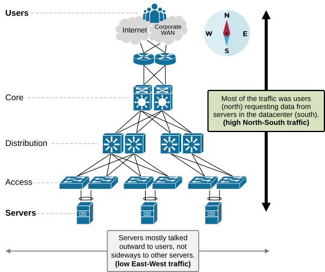
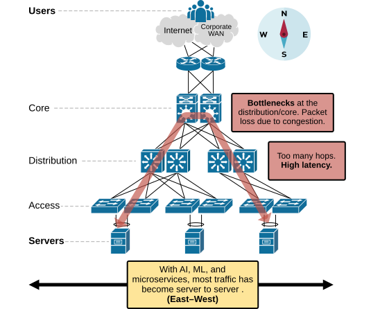
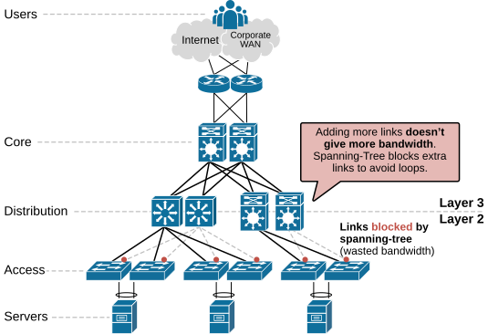
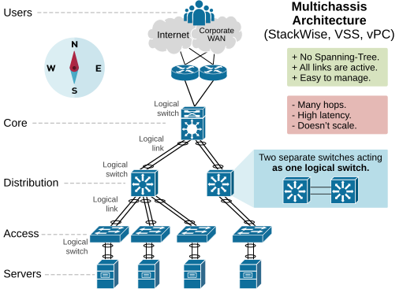
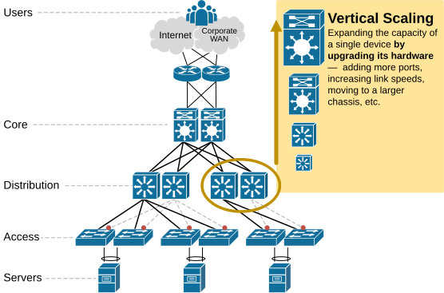
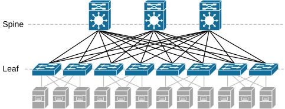
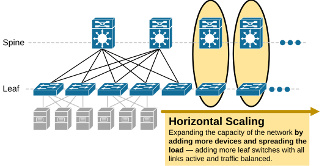
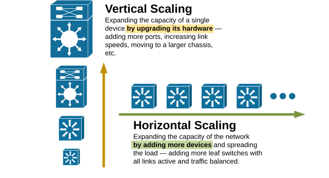

# Leaf-Spine Architecture

<!-- nav -->
⬅ [Three-Tier Architecture](22-three-tier-architecture.md) · [Course index](00_Index.md) · [On-prem and Cloud](24-on-prem-and-cloud.md) ➡
<!-- nav -->

*Network Fundamentals · Lesson · Source: https://www.networkacademy.io/ccna/network-fundamentals/leaf-spine-architecture*

In this lesson, we explore **the most modern data center network design** called the Leaf-Spine architecture. It is currently the most widely adopted data center LAN topology. We cover only the high-level fundamentals of the network structure. We don't dive into the specifics of all the technologies it uses. We focus on understanding why the three-tier design is collapsed into only two layers - Leaf and Spine.

## Different problems at different scales

Let's continue where we left off in the previous lesson. One key thing to remember about network architecture is that **some problems only appear at certain scales**. It is important to remember and understand this from the very beginning of your network journey. When you learn a new technology or design, always ask yourself - **How does this technology scale?**

First, let’s make something clear: there’s no universal definition of what counts as a “small,” “medium,” “large”, or "very large" network. Different vendors define these terms differently. For our lesson, we’ll use the following practical numbers:

- ****Small-scale**** (SOHO): up to 50 devices.
- ****Medium-scale**** (average company): 50–500 devices.
- ****Large-scale**** (enterprise): 500–5,000 devices.
- ****Very large-scale**** (service provider): 5,000–50,000+ devices.
- ****Hyperscalers**** (AWS, Azure, Google): millions of devices across the globe, automated data centers.

Now consider the following example: When you study OSPF, you learn that it forms adjacencies, keeps an LSDB database, and runs the SPF algorithm whenever the topology changes. That’s the foundation. But what really makes you stand out as a network engineer is **to make the habit of always thinking about scale**.

A flat OSPF design works fine in a small network with 1-100 devices. But what happens if you have 200 routers? Suddenly, a flat design won’t work—you need to break the network into OSPF areas. Then what if you have 10,000 routers? Does OSPF support that many areas?

To re-emphasize, **some network problems show up only at a certain scale**. That is the context of this lesson. Now, let's see what the leaf-spine architecture is and why data centers moved away from the three-tier architecture.

## Why do we need Leaf-Spine architecture?

Let's first answer the most fundamental question - why was the leaf-spine design introduced?

### The three-tier design at scale

In short, the leaf-spine architecture was introduced**because the three-tier design doesn't scale** in the modern data center. Two main factors contribute to that and can be summarized as follows:

- **The traffic pattern within the modern data center has changed** with the widespread adoption of microservices, machine learning, and AI.
- In modern data centers, **growth must be both fast and flexible**, which a three-tier network cannot offer.

#### The modern datacenter traffic pattern

In the past, before the advent of virtualization, cloud computing, ML, and AI, **most business applications were monolithic**. One set of servers handled the whole workload. **This was the client-server era**. A client sent a request to the server in the data center. The server responded back. Almost all traffic went in and out of the data center (not between servers). This is the North–South traffic pattern, as shown in the diagram below.

*Figure 1. Three-Tier architecture typical traffic.*

Because most traffic passed between end users and servers, **the three-tier model was a good fit**. Core and distribution switches handled north–south flows efficiently (client-to-server). In contrast, east–west traffic (server-to-server) was small. Perhaps a backup server synced data overnight, or a few servers exchanged small amounts of information. It wasn’t constant or high-volume.

Then, **cloud and microservices arrived**. Business applications have evolved from a single, monolithic block of code to a set of microservices, each hosted on a separate server. These microservices **began communicating with each other** within the data center. This shift altered the traffic pattern **from mostly****North–South****to mostly****East–West**, as illustrated in the diagram below.

*Figure 2. Three-Tier architecture inefficiencies.*

Three-tier was built for North–South flows (client to server), not high-volume of server-to-server traffic. As East–West traffic increases, the uplinks and core/distribution switches quickly become oversubscribed, making the design inefficient. For example, let's look at the following example shown in the diagram above:

- A server in the access layer on the left wants to talk to a server in the access layer on the right.
- The traffic goes up from Access → Distribution → Core → back down to the other Distribution → Access.
- **This adds multiple extra hops**, more latency, and possible bottlenecks at the distribution or core layers.

#### Bandwidth Efficiency and Growth Speed

Another problem of the three-tier design is **its inability to use all available bandwidth**. The access tier connects to the distribution at layer 2. This means it uses the [Spanning Tree Protocol (STP)](https://www.networkacademy.io/ccna/spanning-tree/why-do-we-need-stp) to prevent loops. However, in doing so, STP blocks some of the redundant links. As a result, not all physical links carry traffic at the same time, as shown in the diagram below.

*Figure 3. Three-Tier architecture, STP problem.*

Part of the available bandwidth stays unused and only becomes active if the primary link fails. **This leads to wasted bandwidth**, since uplinks are installed but not fully utilized.

Additionally, it makes scaling harder because as more access switches and uplinks are added, **the spanning tree blocks even more links**. As the network grows larger, this design becomes increasingly inefficient. For this reason, newer approaches to the three-tier architecture were developed that utilize a concept called multichassis to hide the redundancy from Spanning-Tree.

### Modern Three-Tier (Multichassis architecture)

In a multichassis three-tier design, **every pair of switches is combined into a single logical switch** using technologies like VSS or StackWise Virtual. Every access switch connects to both distribution switches simultaneously using a port channel. From a Spanning-Tree point of view, this appears to be a single uplink bundle to one device, even though it physically connects to two.

Because every pair of switches and cables appears as one logical system, the spanning tree does not need to block any of the links. **All links stay active and forward traffic**. This resolves the wasted bandwidth issue typically found in a standard three-tier design. It also improves resiliency, because if one distribution switch fails, traffic still flows through the other without requiring spanning tree reconvergence.

*Figure 4. Multichassis architecture.*

The multichassis approach solved the wasted bandwidth problem. However, one significant inefficiency still remained - the three-tier design doesn't scale easily, especially at pace.

The problem is that **the three-tier architecture scales only vertically**. This means that when traffic demands rise, you typically need to upgrade (or replace) the chassis switches at the distribution and core layers with larger, more powerful platforms, which is a slow and expensive process.

## What is Scalability?

We used the term scale too many times in this lesson. Let's explain what it means a bit more thoroughly.

Scalability is **the ability of a network to handle more traffic as demand grows**. As a business grows, it needs to prevent downtime and maintain fast performance. To do this, you scale your resources — things like network bandwidth, CPU, memory, and storage. Virtualization and Public Cloud made the computing part of the infrastructure (CPU, memory, storage) scale very fast. However, the network was the infrastructure element that was hard to expand fast because it is very hardware-centric.

There are two main ways to scale: vertical scaling and horizontal scaling. Both involve expanding the network capacity, but they work very differently.

### Vertical Scaling (Scaling Up)

Vertical scaling means making a single switch more powerful. For example, you can have a pair of distribution switches that are capable of forwarding 100Gbps. However, at some point, you want your network to handle 500Gbps. To allow that, you must replace them with more powerful ones capable of such performance, as shown in the diagram below.

*Figure 5. What is Vertical Scaling?*

This approach is simple, but it has limits. Hardware can **only be upgraded until you reach the top-of-the-line platform**, and high-end devices get expensive. At some point, one switch cannot keep up, no matter how powerful it is.

## Leaf-Spine Architecture

The leaf–spine design solves the inefficiencies of the three-tier design by incorporating three significant design changes:

- It collapses the three tiers (access, distribution, and core) into two tiers (leaf and spine), as depicted in the diagram below.
- It removes Spanning-Tree (STP) by using IP routing on all links.
- It uses a horizontal scaling approach (scale-out) instead of vertical (scale-up).

*Figure 6. Leaf-Spine Architecture.*

At the cabling level, there is another essential difference - **every Leaf switch connects to every Spine switch**. This makes the path between two servers predictable - always two hops - at the expense of more cabling and a higher interconnection count.

### Horizontal Scaling (Scaling Out)

The Leaf-Spine architecture can scale horizontally, which is one of the most significant improvements compared to a three-tier network, which only scales vertically.

Horizontal scaling involves increasing network capacity**by adding more switches rather than upgrading existing platforms**. The load is spread across multiple devices and links. This makes the network not only scalable but also more reliable, since you now have redundancy.

*Figure 7. What is Horizontal Scaling?*

- **Vertical scaling** = to increase the network capacity, you upgrade some switches to more powerful platforms.
- **Horizontal scaling** = to increase the network capacity, you add more leaf switches.

In modern data center networks, horizontal scaling is usually preferred because it offers flexibility, high availability, and no hard limit on growth.

## Key Takeaways

- Leaf-Spine is the leading modern data center design for high-speed east–west traffic.
- It replaces the three-tier architecture, which struggles with server-to-server communication and bandwidth inefficiency.
- Three-tier **relies on vertical scaling and Spanning Tree**, causing bottlenecks and blocked links.
- Leaf-Spine collapses core, distribution, and access into two tiers and removes STP using IP routing.
- **Every leaf switch connects to every spine switch**, ensuring predictable two-hop paths.

*Figure 8. Comparing horizontal and vertical scaling.*

- Horizontal scaling allows adding more leaf switches for growth, redundancy, and efficient bandwidth use.
- Ideal for modern data centers with microservices, cloud computing, and AI workloads.

---

<!-- nav -->
⬅ [Three-Tier Architecture](22-three-tier-architecture.md) · [Course index](00_Index.md) · [On-prem and Cloud](24-on-prem-and-cloud.md) ➡
<!-- nav -->
