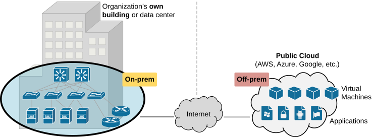
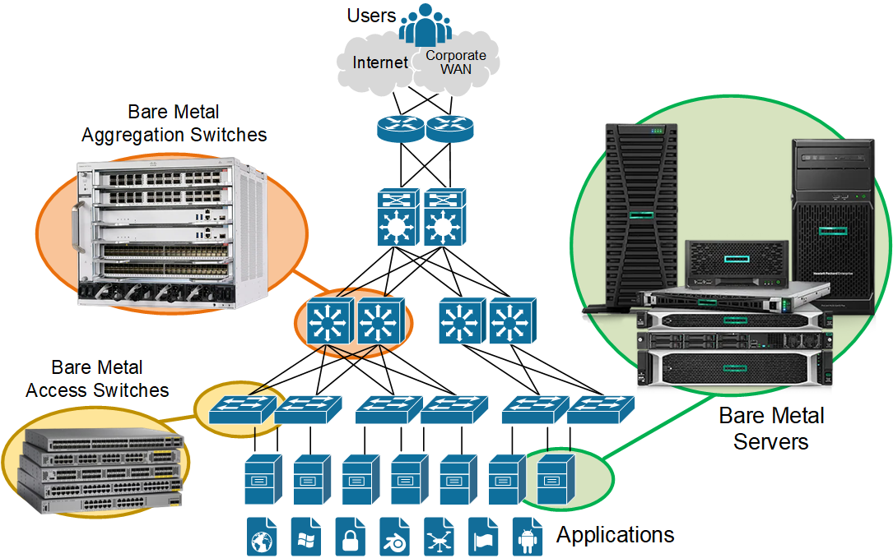
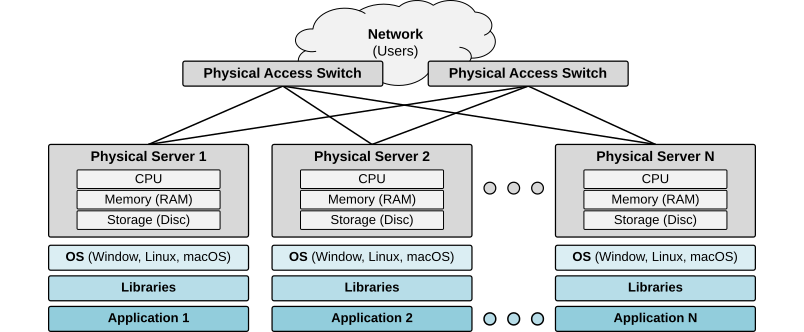
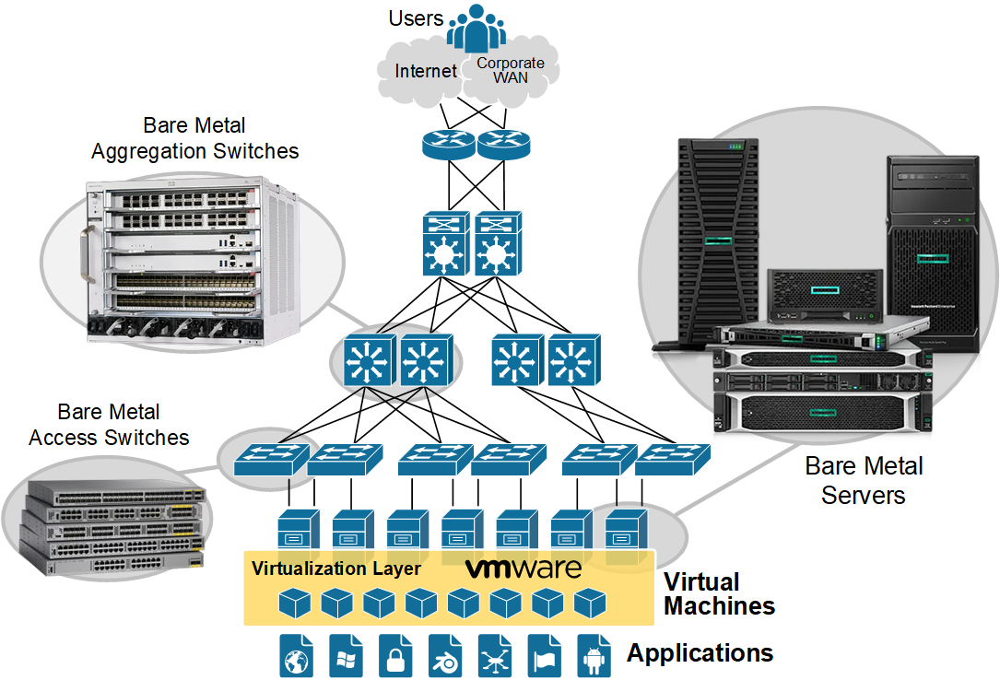
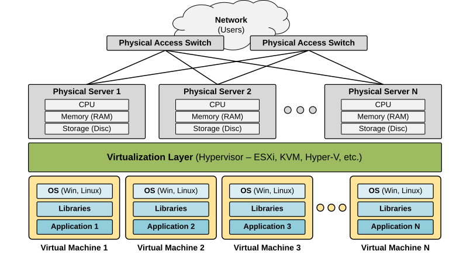
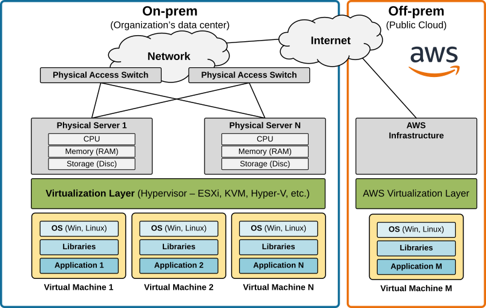
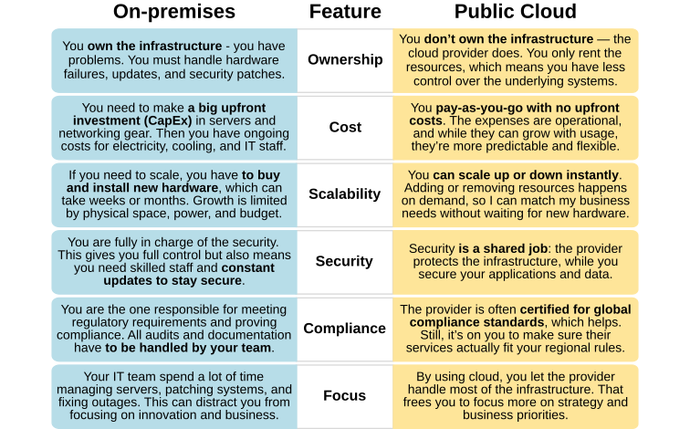
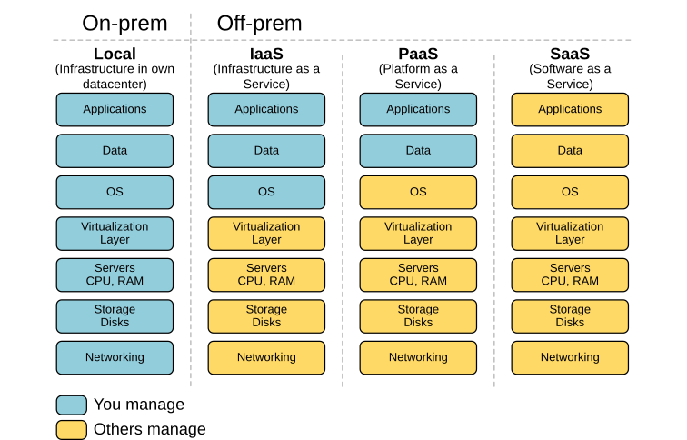
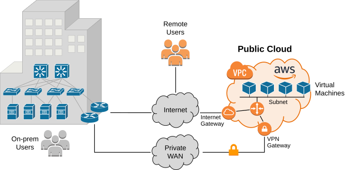

# On-prem and Cloud

<!-- nav -->
⬅ [Leaf-Spine Architecture](23-leaf-spine-architecture.md) · [Course index](00_Index.md) · [Build your CCNA homelab](25-build-your-ccna-homelab.md) ➡
<!-- nav -->

*Network Fundamentals · Lesson · Source: https://www.networkacademy.io/ccna/network-fundamentals/on-prem-and-cloud*

In this final lesson of this section, we will discuss what the public cloud is and how it fits into an organization's network and computing infrastructure.

## What is On-prem?

First, let's clear the term on-prem (short for on-premises). It means IT infrastructure, like servers, storage, networking, and software, that is **installed and managed locally** inside an organization’s own building or data center. Think of it like infrastructure that is "at home". Your home router is on-prem. Your personal computer is on-prem, and so on.

*Figure 1. On-prem vs. Off-prem.*

On the other hand, the term off-prem means that the equipment or service **is not located** on the organization’s own premises. For example, instead of hosting servers or applications inside your building, they are hosted in a provider’s data center or public cloud.

Basically, the term off-prem means that infrastructure is external, **delivered from outside your physical site**, usually over the Internet or a private WAN.

### What is Bare Metal?

Bare metal refers to the actual, physical hardware of a computer or server that runs **without any virtualization layer in between**. In other words, the operating system is installed directly on the hardware itself, rather than on top of a virtualization layer (e.g., a hypervisor like ESXi or KVM). Your personal computer or laptop is a good example of a bare-metal machine, as it typically runs the operating system **directly on its processor, memory, and storage**.

In an enterprise infrastructure, bare-metal refers to physical machines, meaning that all devices and servers are not virtualized. Applications are installed directly on physical servers, which in turn connect to physical access switches. The access layer then connects to physical distribution switches, which in turn connect to the WAN or the core network. In such a setup, there is no virtualization or abstraction.

*Figure 2. On-Prem Infrastructure.*

For example, look at the diagram above. The organization's apps are installed directly **on physical servers that connect to physical switches**. If you want to move an application to another floor, building, or data center, you must either move the physical server or redeploy the app on another physical server—a tedious, slow, and time-consuming process.

In short, every component you see on the diagram—servers, switches, and routers—**is a dedicated, tangible device** doing its specific job.

In the 1990s and 2000s, all business applications were installed on bare metal. If an organization needed to run a new app, it often had to buy and deploy multiple additional servers. Back then, **it was normal to take months** for the deployment or relocation of a single app. But people realized that speed is essential - at the end of the day, time is also money.

### Virtualization

At some point, organizations recognized a significant issue with bare metal servers. **An app is bound to its physical server or servers**. Additionally, each physical server typically ran a single application, with its CPU and memory usage often remaining very low—below 10%. This meant most of the server’s resources were sitting idle, yet companies still had to pay for the hardware, electricity, cooling, and rack space. In other words, a significant amount of resources was wasted. So people realized that **bare-metal is inflexible and expensive**.

For example, let's look at the diagram below. Notice that App_1 is installed on Server_1, App_2 is installed on Server_2, and so on. If you want to relocate Application_1 to another location, you must either move the server or manually redeploy the app to a different physical server. If you want to deploy a brand new application, you cannot use your existing servers. You must buy and install new servers and then deploy the app - this could take months to plan, procure, install, and deploy.

*Figure 3. Bare Metal Infrastructure.*

This challenge triggered the development of virtualization. A virtualization layer, called a hypervisor, was introduced **to separate the operating system from the physical hardware**. Instead of running just one OS on one server, the hypervisor made it possible to run multiple virtual machines (VMs) on the same hardware. Each VM could have its own operating system and applications, all sharing the underlying CPU, memory, and storage, as shown in the diagram below.

*Figure 4. On-prem Virtualization.*

This abstraction solved the resource waste problem, allowing companies to use their servers more efficiently, cut costs, and improve flexibility.

For example, let's look at the diagram below. Note that with virtualization, **an application no longer runs directly on physical hardware.** Instead, it runs inside a virtual machine (VM). A VM is completely software-defined. This means the whole system — the operating system, the application, and all its resources — **is just software**.

*Figure 5. What is virtualization?*

Because a VM, with the app deployed inside, **is software**, you can back it up like a file, move it between servers, or copy it easily. You can also give it more CPU, memory, or storage, or reduce them if not needed. This flexibility is much greater compared to bare-metal servers, where hardware limits and manual changes make scaling or moving applications difficult.

## What is Public Cloud?

Virtualization was the key step that made the public cloud possible. Once applications and operating systems **no longer had to run directly on bare metal**, they became much easier to move around. An app could be packaged inside a virtual machine (VM), which is independent of the underlying hardware.

This meant that instead of running only on servers in a company’s data center, applications could be migrated to a cloud provider’s infrastructure. Cloud providers built massive virtualized environments where many customers could run their VMs on shared hardware, each isolated and secure.

For example, let's look at the following diagram. The organization migrated App_M from their on-prem virtualized infrastructure **to Amazon AWS**. They can still reach the application via the Internet. However, they are not responsible for the virtualized infrastructure on which the application runs.

*Figure 6. Migrating Workloads to the Public Cloud.*

With one sentence, **virtualization made applications portable**. It allowed organizations to shift some of their servers and applications from local physical machines to the public cloud. But why would someone do that?

### Why would someone migrate applications to the cloud?

It is an interesting question for people who still do not have much experience in the IT industry. Let's discuss the cloud from a different context. Why would someone want to take a business-critical application and migrate it to somebody else's infrastructure (the public cloud)? Doesn't it make more sense to manage the app locally in your own data center, where you have more control?

The answer to all these questions is the usual - **it depends**. For some applications, it may be more beneficial to be hosted on-prem, while for others, it makes more sense to be migrated to the public cloud. The following diagram shows some perspectives of the most essential features of an application in the context of on-prem and cloud.

*Figure 7. On-premises vs. Public Cloud.*

Some applications work better on-prem, while others are a better fit for the cloud. Having the table as a context, let's walk through an example. Let's say you have a web platform that sells products:

- You'd rather keep your payment system on-premises. You have full ownership and control, and you can make sure security and compliance are managed directly by my team. Since payment data is sensitive and highly regulated, it makes sense for you to host it in your own environment, even if it costs more and requires more effort.
- On the other hand, your web platform, where customers browse products, is a perfect candidate for the cloud. Traffic goes up and down depending on promotions, holidays, or the time of year. In the cloud, you can scale resources instantly. Instead of buying more hardware that might sit idle most of the time, you just pay for what you use. This flexibility helps you keep costs predictable while ensuring your users always get a smooth experience.

### IaaS vs PaaS vs SaaS

Migrating an application to the cloud doesn’t always mean the same thing, because **the term “cloud” can be used in different ways** depending on the service model:

- ****IaaS (Infrastructure as a Service)****: Here, you move your servers and applications into a provider’s virtual machines and storage. Think Amazon EC2. You still manage the operating system, middleware, and the application itself. It feels close to on-prem, **just without you owning the hardware**. For example, you could run your payment system in IaaS if you want to keep full control but avoid managing physical servers.
- ****PaaS (Platform as a Service)****: In this case, you don’t worry about servers or the operating system. Think Amazon Serverless Computing. The provider gives you **a ready-made environment to deploy your applications**. You focus only on development and scaling, while the provider takes care of updates, runtime, and infrastructure. Your web platform could fit here, since you just want it to run smoothly and scale without caring about the underlying servers.
- ****SaaS (Software as a Service)****: Here, you don’t manage the application at all — you just use it. Think Microsoft Office 365, Google Workspace, or Salesforce. The provider **handles everything from infrastructure to the application**, and you pay for access. Instead of running your own solution, you could adopt a SaaS product if it meets your needs.

*Figure 8. IaaS vs. PaaS vs. SaaS.*

So, when someone says “*I’m migrating to the cloud,*” it can mean very different things. In one case, he might just be moving his existing servers into IaaS. In another, he might be re-architecting the application to use PaaS for better scalability. Or he might decide not to host the application at all and just subscribe to a SaaS product like Salesforce.

## Connectivity to the cloud

Lastly, let's look at the different connectivity options that a company has to connect to the public cloud. Most commonly, the connectivity to the cloud **happens over the Internet**, as shown in the diagram below.

*Figure 9. Connectivity to the cloud (simplified).*

However, some companies migrate some business-critical apps and want to have a reliable and secure connection to the cloud. For such scenarios, the cloud providers allow you to build a dedicated private link from your data center or office to the cloud. It bypasses the public internet and provides lower latency and more stable bandwidth.

Often, companies use both, as shown in the diagram above. The Internet is used for quick access or backup, while a private WAN link is used for heavy or critical workloads.

## Key Takeaways

- On-prem means IT infrastructure is hosted locally and fully managed by the organization.
- Off-prem and public cloud shift infrastructure to external providers.
- Bare metal servers run apps directly on hardware but are costly and inflexible.
- Virtualization improved efficiency by running multiple VMs on the same hardware.
- Public cloud leverages virtualization to move apps outside the data center.
- Some apps fit better on-prem (e.g., payment systems), while others scale better in the cloud (e.g., web platforms).
- IaaS gives control of virtual servers, PaaS provides a ready-to-use platform, SaaS delivers complete applications.
- Cloud connectivity can be via the internet or private links for reliability and performance.

---

<!-- nav -->
⬅ [Leaf-Spine Architecture](23-leaf-spine-architecture.md) · [Course index](00_Index.md) · [Build your CCNA homelab](25-build-your-ccna-homelab.md) ➡
<!-- nav -->
