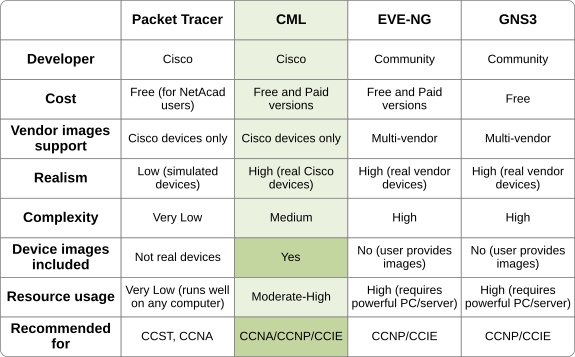

# Build your CCNA homelab

<!-- nav -->
⬅ [On-prem and Cloud](24-on-prem-and-cloud.md) · [Course index](00_Index.md) · [Cisco Modeling Labs (CML) on Hyper-V](26-cml-on-hyperv.md) ➡
<!-- nav -->

*Network Fundamentals · Section overview · Source: https://www.networkacademy.io/ccna/network-fundamentals/build-your-ccna-homelab*

Building your own CCNA home lab is one of the best ways **to truly understand networking**. Reading about routing, switching, and network design gives you theory, but **hands-on practice is what makes it all click**. In this section, we’ll go through several ways to set up your own lab environment using Cisco’s popular simulation and emulation tools. You’ll learn how to build and run network topologies in Cisco Modeling Labs (CML), EVE-NG, and Packet Tracer, and even how to install CML on Hyper-V for a complete local setup.

Each of these platforms lets you practice Cisco technologies in slightly different ways. The goal here isn’t to compare them, but to help you understand how to use **whichever one fits your learning style, hardware, and budget**.

**Cisco Modeling Labs (CML) is Cisco’s official network emulation platform**. It runs real Cisco IOS images, meaning the behavior you see is almost identical to what you’d experience on physical routers and switches. You can design complex topologies, test configurations, and even connect your virtual lab to the internet or real devices. CML is perfect if you want the most realistic CCNA lab possible. The main limitation is that **it requires a paid license for full-scale labs**and relatively strong hardware to run smoothly.

In the **Build a Homelab with CML** lesson, you’ll see how to install CML, create your first project **using the CML free version**, and connect your devices. You’ll also learn how to configure nodes, use console connections, and save your lab projects for future practice.

The **Build a Homelab with EVE-NG** lesson focuses on another popular tool that many network engineers use for both Cisco and multi-vendor setups. EVE-NG (Emulated Virtual Environment Next Generation) is flexible and can run many different network images — Cisco IOS, Juniper, Palo Alto, and more. It runs on a virtual machine and offers a web interface for managing topologies. EVE-NG is great if you want a broader, vendor-neutral environment that still supports Cisco devices for CCNA practice. However, it has one significant disadvantage - **you must bring Cisco images on your own**, which can be hard for most people.

Next, in the **Build a Homelab with Packet Tracer** lesson, we’ll cover Cisco’s beginner-friendly simulator. Packet Tracer is free, light, and perfect for CCNA students who want quick and easy labs. It doesn’t use real IOS images, so some commands or behaviors differ from real routers and switches. However, it’s fast, runs on almost any computer, and is excellent for building small networks, testing concepts, or doing CCNA lab exercises without much setup.

Finally, in the Cisco Modeling Labs (CML) on Hyper-V lesson, you’ll learn how to install and run CML **locally on a Windows machine using Microsoft Hyper-V**. This setup is perfect if you don’t want to rely on external servers or cloud installations. You’ll see how to import the CML virtual machine, adjust networking settings, and connect to the lab interface. Once it’s running, you can create and manage labs just like in the standalone version.

This section doesn’t include a quiz because it’s more about getting your hands dirty and learning by doing. Follow along with each lesson, try the examples, and build small labs that test your understanding of switching, routing, and network services. By the end, you’ll have your own working CCNA home lab — a safe place to break, fix, and rebuild networks until you fully understand how they work.

The following table compares the tools that we are going to discuss in the following lessons. Notice that CML is highlighted in green because, for me personally, it is currently the best tool for practicing Cisco networking for CCNA/CCNP preparation.

*Figure 1. CML vs other alternatives.*

Whether you choose CML, EVE-NG, or Packet Tracer, the key is consistency. **Spend time experimenting**, exploring new configurations, and testing what you learn in each course section. A home lab gives you confidence and experience that no amount of reading can replace. Once you’ve built your lab, you’ll be ready to tackle real-world scenarios — and the CCNA exam — with much more confidence.

---

<!-- nav -->
⬅ [On-prem and Cloud](24-on-prem-and-cloud.md) · [Course index](00_Index.md) · [Cisco Modeling Labs (CML) on Hyper-V](26-cml-on-hyperv.md) ➡
<!-- nav -->
