# Cisco Modeling Labs (CML) on Hyper-V

<!-- nav -->
⬅ [Build your CCNA homelab](25-build-your-ccna-homelab.md) · [Course index](00_Index.md)
<!-- nav -->

*Network Fundamentals · Lesson · Source: https://www.networkacademy.io/ccna/network-fundamentals/cml-on-hyperv*

In this lesson, we’ll show you how to set up a CCNA/CCNP homelab for practicing networking using the free version of Cisco Modeling Labs running on Hyper-V.

Why run CML on Hyper-V, you might immediately wonder? Well, there are two very good reasons to do so:

- First, Hyper-V **comes built into Windows**, so you don’t need to purchase or install third-party software like VMware Workstation Pro.
- Second, even if you want to run CML on VMware, many users **report issues enabling Intel VT-x/EPT** on VMware on newer Windows versions because of recent OS security features

## What is Cisco Modeling Labs (CML)?

If you are new to Cisco networking, you may not have heard of Cisco Modeling Labs. CML is a software tool that lets you build real networks **in a virtual environment using virtual devices**. This makes it **easier and cheaper to practice networking** without needing physical equipment. It is a must-have tool for students and network engineers who prepare for certifications like the CCNA and CCNP. There are a few alternative solutions that can also be used, such as EVE-NG, GNS3, and PNETlab. However, I find Cisco CML to be the best option, especially for entry-level students, since it is Cisco-made, offers a free version, and is under active development.

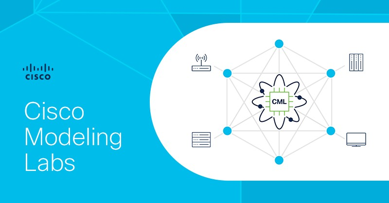

*Figure 1. Cisco CML.*

Cisco Modeling Labs software typically **runs inside a virtual machine**, which means you need some kind of virtualization hypervisor to run it. There are a few options, the most common ones being the VMware Workstation Pro, VMware Player, or VMware Fusion. However, this lesson focuses on a less popular option to run CML - on Microsoft Hyper-V, which is the Windows built-in hypervisor.

## Why run CML on Hyper-V and not VMware?

Well, there are many reasons to do so.

- First and foremost, Hyper-V on Windows is considered **a Type 1 (bare-metal) hypervisor**, which means it runs directly on the hardware. Even though it is packaged inside Windows, when you enable Hyper-V, the Windows OS itself starts running on top of the Hyper-V hypervisor. This gives better performance and more stability for virtual machines like CML.
- VMware Workstation Pro and VMware Player are Type 2 hypervisors. **They run on top of the host operating system** (on top of Windows), which **adds an extra software layer** between the VM and the hardware. This provides lower performance and less reliability compared to a type 1 hypervisor. So, using Hyper-V will give CML faster and more stable operation than using VMware Workstation or Player.

Additionally, Hyper-V is available on any modern Windows OS edition by default. Technically, the Home edition doesn't have it, but you can find videos online on how to enable it even on Windows 11 Home. If you are running Windows, **you don't need to buy and download any 3rd party software**; the hypervisor is already available.

There is one more thing. Many people report having problems running CML on VMware Workstation Pro. They often **cannot enable Intel VT-x/EPT** on the CML virtual machine. This happens because newer Windows editions sometimes reserve nested hardware virtualization (VT-x) for their own features, like Windows Subsystem for Linux (WSL2).

## CML vs the other alternatives

Before we proceed to the CML setup portion of the lesson, let's address one more thing. Let's explain that Cisco Modeling Labs is not the only available platform for practicing networking at home. There are quite a few other alternatives that we compare in the following table.

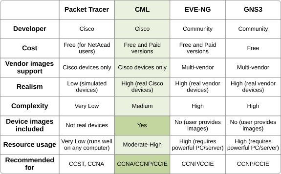

*Table 1. Comparison between CML, Packet Tracer, EVE-NG and GNS3.*

For me personally, CML is currently the best tool for practicing Cisco networking. It is developed by Cisco itself and **includes official Cisco images**, which other emulators do not provide. For example, if you want to use EVE-NG, **you have to provide all images yourself**, which can be challenging for students who do not have access to company accounts or Cisco sales teams.

CML also has the best and most user-friendly GUI. In addition, **it supports containers**, allowing you to set up DNS, TACACS, web server, and web browser nodes for more advanced lab environments.

Last but not least,**it now offers a free version** that allows you to run up to five devices simultaneously, which is more than enough for CCST and CCNA students.

## Set up CML on Hyper-V

Now, let's walk through the process of setting up a Cisco Modeling Labs instance at home using Windows 11 Pro.

### Enable Hyper-V on Windows

First, we need to enable the Hyper-V hypervisor on Windows. It is turned off by default.

You go to the Start menu and type "Windows Features". The Turn Windows Features on or off window will appear, as shown in the screenshot below.

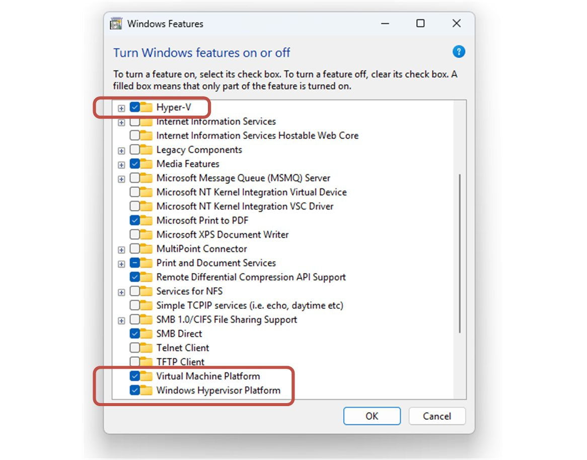

*Figure 2. Enable Hyper-V on Windows 11 Pro.*

You need to enable the Hyper-V, Virtual Machine Platform, and Windows Hypervisor Platform options as shown above. After that, you need to restart your computer and wait for the OS to set up everything.

### Downloading CML files

The next step is to download the required CML files. You go to the Cisco Software download page and download the **bare metal** deployment file and the **refplat ISO** file, as shown in the screenshot below.

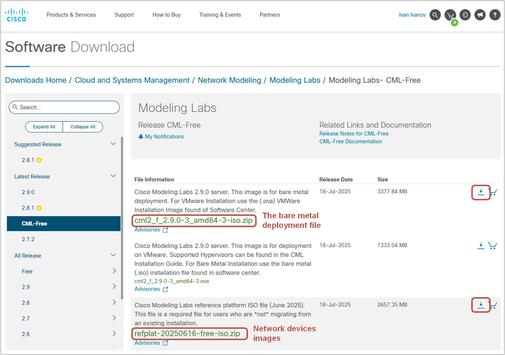

*Figure 3. Downloading CML files.*

Notice that you need to have a Cisco account to download the required CML files. However, **creating a Cisco account is free** and only takes a few minutes. Once you register and log in, you can access the download page and get the files.

Also, notice that the files are ZIP archives. Once you download it, you must extract the ISO files from the archive.

### Create a new Hyper-V virtual machine.

Once you have the files, you need to create a new Virtual Machine in the Hyper-V manager. You click **New > Virtual Machine** and enter the New Virtual Machine Wizard.

Then you need to specify a name and location for the VM. It is recommended to save the virtual machine on your fastest computer hard drive (if you have multiple).

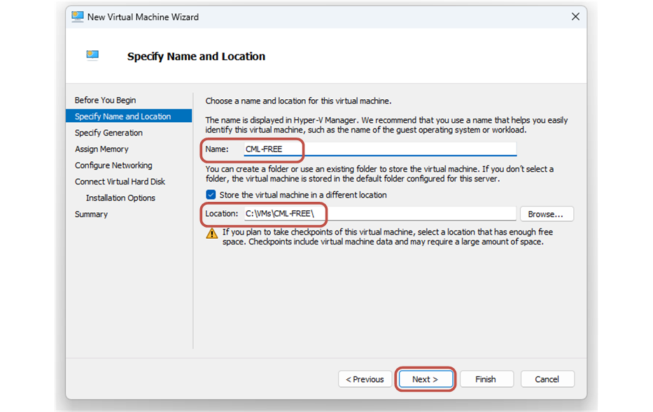

*Figure 4. Specify Name and Location.*

Then you go to Specify Generation and select Generation 2. You click Next.

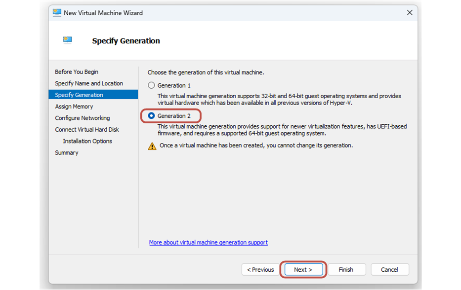

*Figure 5. Specify Generation.*

Next, you go to the Assign Memory tab and assign as much memory as you can. The more RAM available to CML, the better, because each device you run wants RAM. You also disable the Dynamic Memory option, as shown in the screenshot below.

Next, you go to the Configure Networking tab. You select the network adapter to use the Default Switch as shown in the screenshot below.

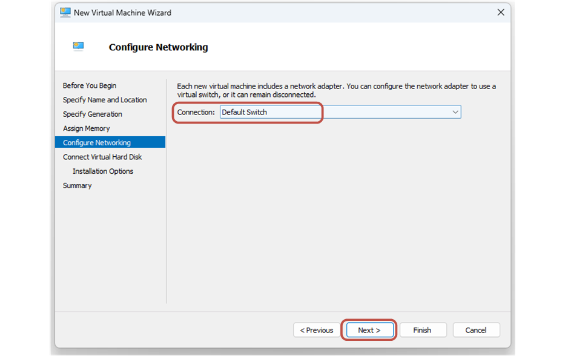

*Figure 6. Configure Networking.*

Lastly, you go to the Connect Virtual Hard Disk tab and give the VM's hard drive as much disk space as you want (at least 100GB is recommended). Then you click finish, as shown in the screenshot below.

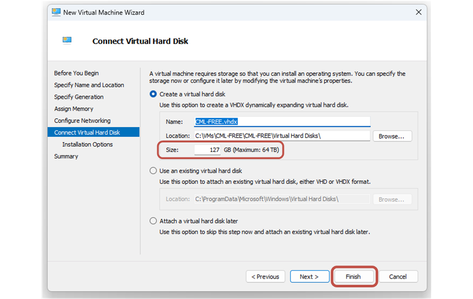

*Figure 7. Configure Virtual Hard Disk.*

At this point, the virtual machine that will host the Cisco Modeling Labs software is created. However, before you power it up for the first time, you need to set up a few more things.

### VM Settings

You right-click on the VM in the Hyper-V manager and go to Settings. The first thing you need **to change is the Secure Boot setting**, as shown in the screenshot below. You need to set it up with the **Microsoft UEFI Certificate Authority** or to disable it completely.

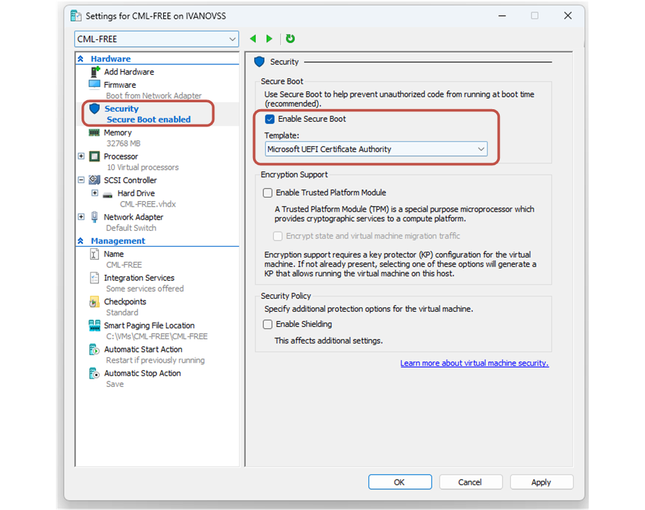

*Figure 8. Configure Secure Boot.*

Next, you need to add two additional DVD drives to the virtual machine. You go to the **SCSI Controller tab** and click **Add DVD Drive**, as shown in the screenshot below.

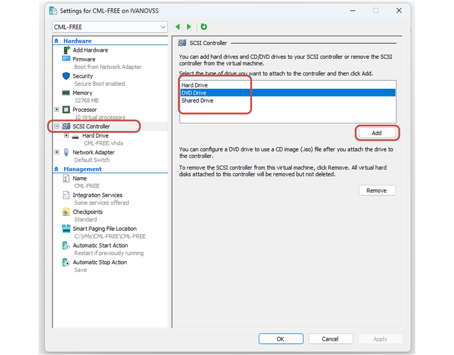

*Figure 9. Add the first DVD Drive.*

Then, you mount the CML ISO file that you downloaded from the Cisco.com software page, as shown below. This file contains the CML software that will be installed on the virtual machine.

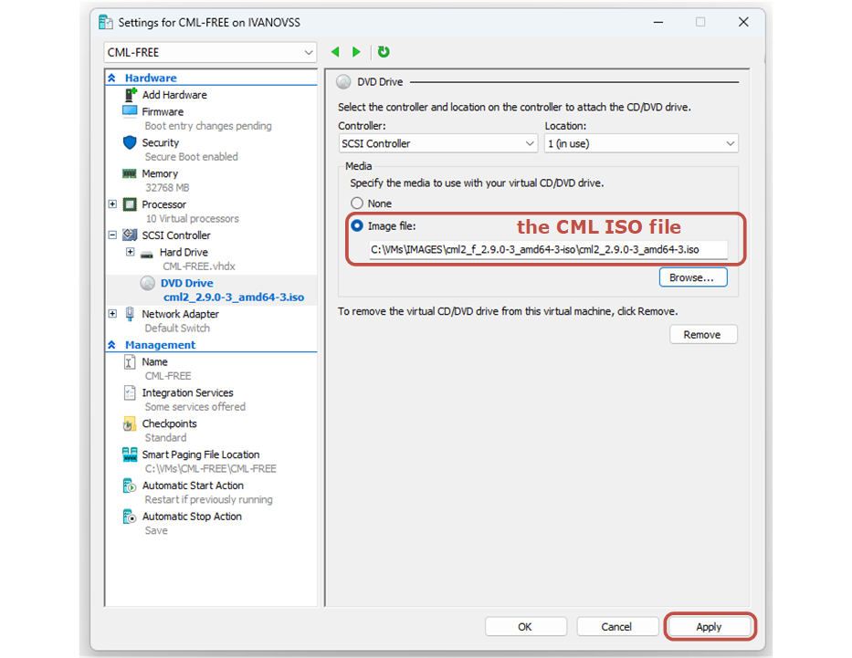

*Figure 10. Add the bootable CML ISO file.*

Then, you need to add one more DVD drive and mount **the RefPlat image** that you downloaded from Cisco, as shown in the screenshot below. It contains the network device images - routers, switches, and containers.

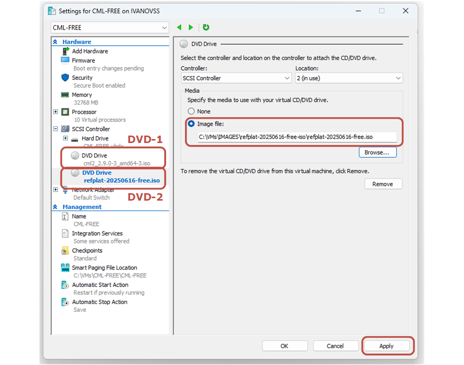

*Figure 11. Add a second DVD drive.*

The last thing you need to set up is to change the Boot order, as shown in the screenshot below. The topmost bootable device must be the CML ISO file that you downloaded from Cisco.com.

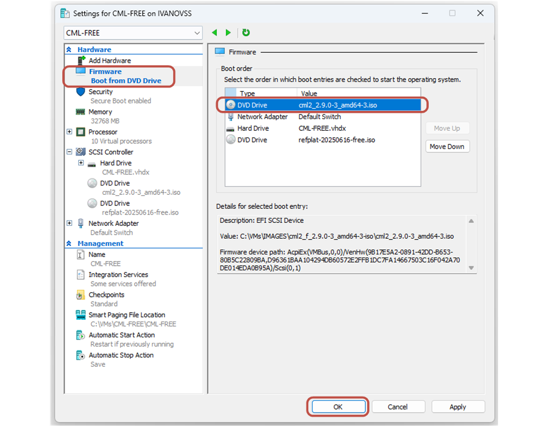

*Figure 12. Set boot order.*

At this point, the new virtual machine is ready. However, **you must set up a few more things** before powering it up for the first time.

#### Enable Nested Virtualization and MAC spoofing

Before you run the virtual machine for the first time, you need **to enable nested virtualization**. This means that inside your CML virtual machine (Hyper-V), there will be other virtual machines (each network device is a KVM virtual machine, represented by a qcow2 file). Hence, the virtualization is nested.

To enable nested virtualization, you must open PowerShell as an administrator and run the following command on your computer:

```text
Set-VMProcessor -VMName <VMName> -ExposeVirtualizationExtensions $true
```

Additionally, to route network packets from the CML virtual machine through the Windows OS, you need to enable MAC address spoofing on the first (L1) virtual switch. Use the following PowerShell command to enable it.

```text
Get-VMNetworkAdapter -VMName <VMName> | Set-VMNetworkAdapter -MacAddressSpoofing On
```

In our example, we open PowerShell and run the following commands as an administrator.

```text
Windows PowerShell
Copyright (C) Microsoft Corporation. All rights reserved.

Install the latest PowerShell for new features and improvements! https://aka.ms/PSWindows

PS C:\> Set-VMProcessor -VMName CML-FREE -ExposeVirtualizationExtensions $true
PS C:\> Get-VMNetworkAdapter -VMName CML-FREE | Set-VMNetworkAdapter -MacAddressSpoofing On
PS C:\>
```

Now everything is ready to power up the VM.

### Power up the CML VM

At this point, you can power up the virtual machine for the first time. It will immediately start the initial installation process, as shown in the screenshot below. It might take a few minutes to complete.

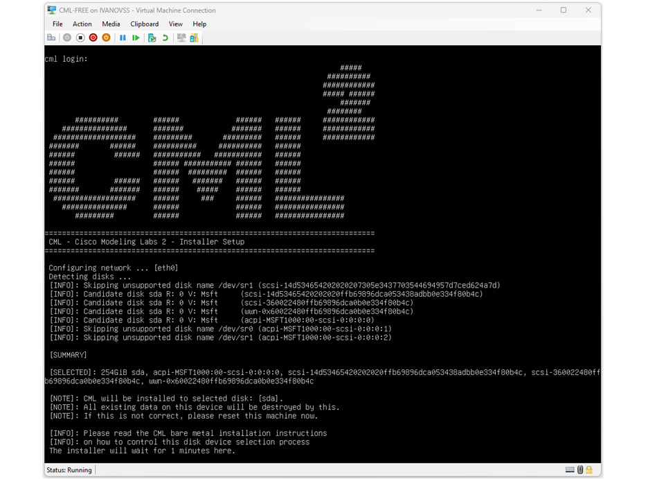

*Figure 13. Start the CML VM.*

After the initial installation completes, the VM will reboot and try to enter the initial CML configuration wizard. However, for some unknown reason, on Hyper-V, the virtual machine can't properly start the configuration wizard and **gets stuck at the initial screen**.

At this point, you must turn off the VM manually by clicking the turn-off button as highlighted below. Then you need to power it on manually.

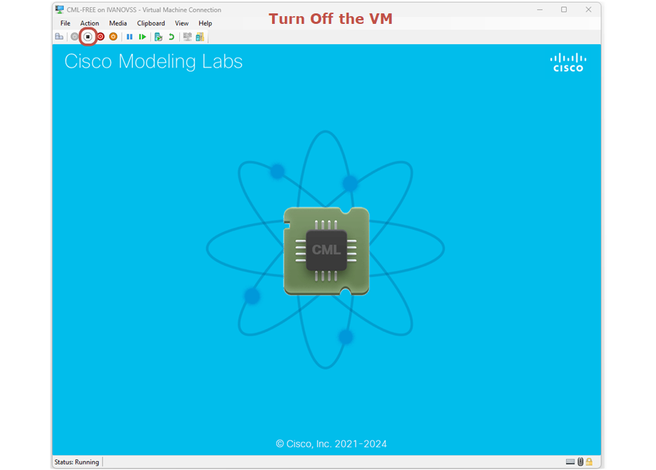

*Figure 14. CML stuck at boot screen.*

After the VM reboot, you must enter the "Advanced options for CML2 -- GNU/Linux" as shown in the screenshot below.

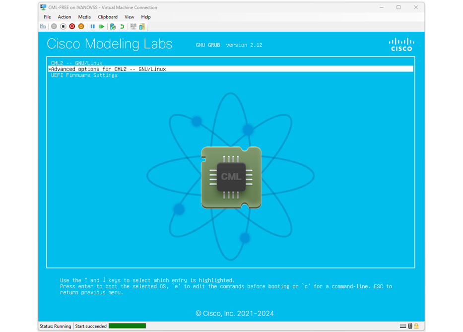

*Figure 15. Advanced options for CML.*

Once you enter the advanced menu, you must select **one of the recovery mode options**, as shown in the screenshot below. In our example, we select "CML2 -- GNU/Linux, with Linux 6.8.0.60-generic (recovery mode)", but in your instance, it might be different

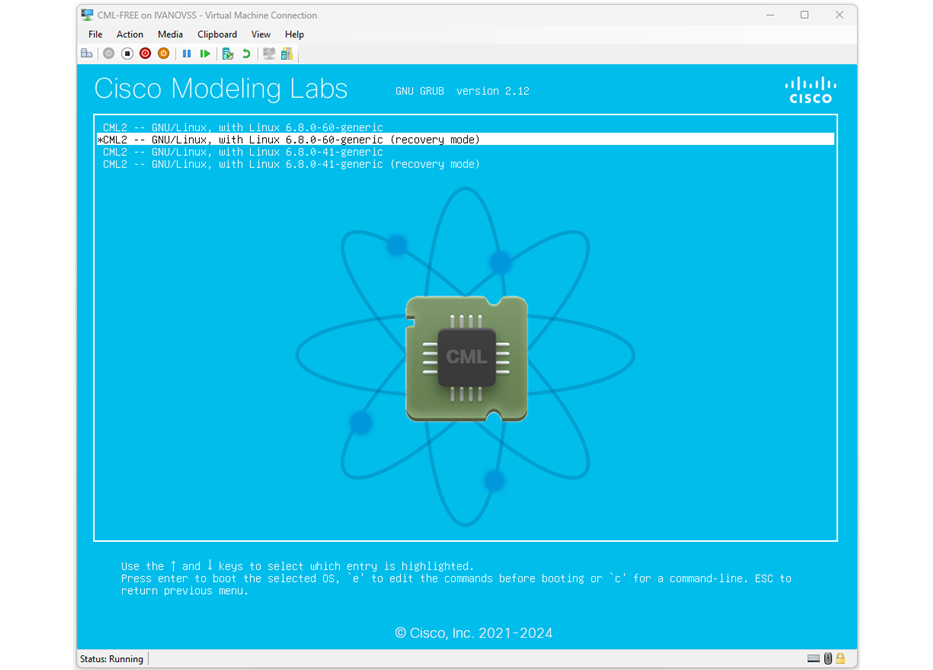

*Figure 16. Boot in Recovery Mode.*

Now the virtual machine must be able to boot correctly and enter the initial CML configuration wizard. We won't walk through each step of the wizard because it is pretty straightforward and self-explanatory. You basically need to accept their EULA and set up new admin and user passwords. If there is any setting you don't understand, always go with the default option.

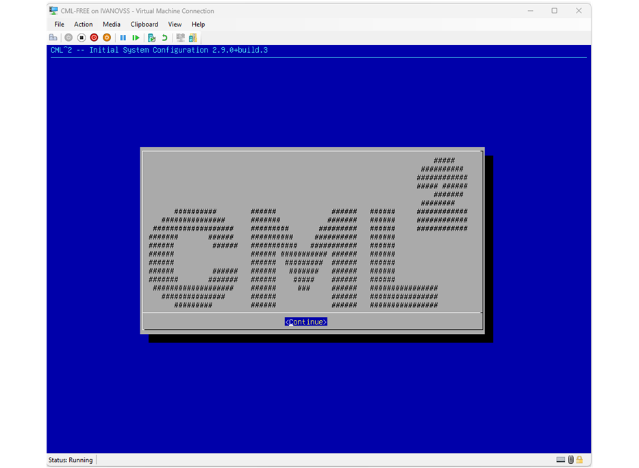

*Figure 17. Enter CML initial configuration wizard.*

After you complete the initial wizard, the VM must end up on a screen similar to the one below. It must tell you the IP address it acquired via DHCP. You will use this IP address to access the CML software via your Internet browser.

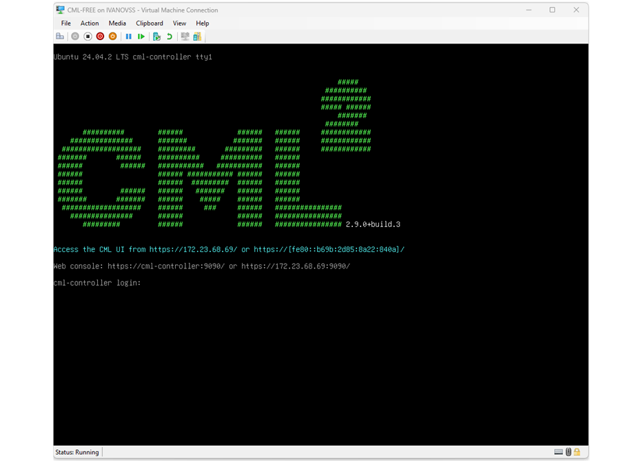

*Figure 18. CML installed successfully.*

If every step described so far completes successfully, you must be able to access the Cisco Modeling Labs initial webpage using the IP address provided via DHCP, as shown in the screenshot above.

You log in with the username and password you specified during the CML initial configuration wizard.

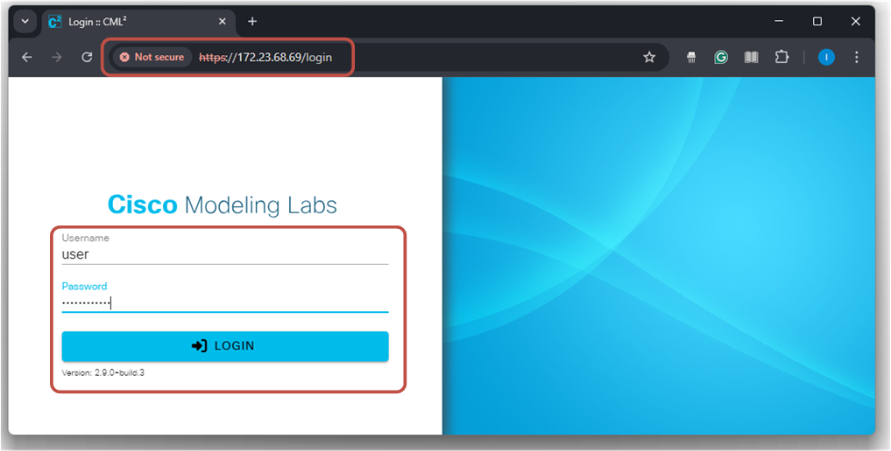

*Figure 19. Login to CML via browser.*

Now it is up to you to discover the tool and spend as much time as you can learning and testing network technologies.

## Key Takeaways

The following diagram shows the "big picture" of the overall setup we created by following the steps in this lesson.

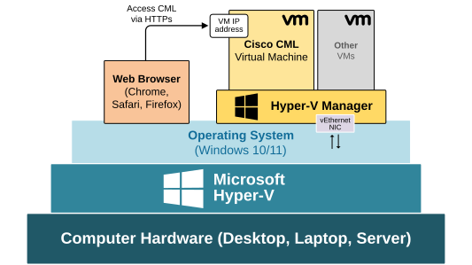

*Figure 20. CML on Hyper-V Overview.*

- Cisco Modeling Labs lets you build real virtual Cisco networks for CCNA and CCNP practice.
- Running it on Hyper-V avoids VMware VT-x/EPT issues on newer Windows versions.
- Hyper-V is built into Windows and gives better performance than VMware Workstation.
- The lesson shows how to enable Hyper-V, create a CML VM, configure settings, and complete installation.
- After setup, you can access it through your browser and start building network topologies.

---

<!-- nav -->
⬅ [Build your CCNA homelab](25-build-your-ccna-homelab.md) · [Course index](00_Index.md)
<!-- nav -->
