# EtherChannel (Port-Channel)

<!-- nav -->
⬅ [LAN Switching with Redundant Links](11-an-switching-redundant-links.md) · [Course index](00_Index.md) · [Switching modes: Store-and-Forward vs Cut-Through](13-store-and-forward-vs-cut-through-switching.md) ➡
<!-- nav -->

*Ethernet Fundamentals · Lesson · Source: https://www.networkacademy.io/ccna/ethernet/etherchannel-port-channel*

In this lesson, we will discuss what EtherChannel (also called Port-Channel) and Link Aggregation Control Protocol (LACP) are. To understand these two concepts, let's start with the basics and move on gradually.

Everybody wants their network to be reliable. Nobody wants a network that fails if someone unplugs a cable. But this is exactly what happens if you have two switches and a single cable between them, as shown in the diagram below.

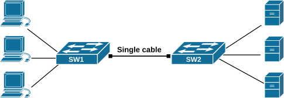

*Figure 1. Two switches connected with a single cable.*

If that single cable between the switches fails, connectivity between the clients and servers **is lost**, as shown in the diagram below.

Additionally, **this single cable becomes a bottleneck** for a high volume of traffic crossing back and forth between the users and applications on both sides. If the link is 1 Gbps, for example, the maximum capacity between the two sides is 1 Gbps.

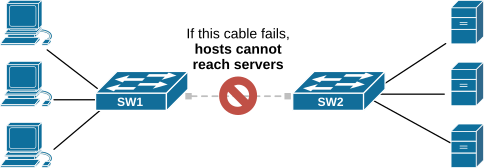

*Figure 2. The cable between switches fails.*

So what can you do? The obvious solution is simple - just **add one or more additional cables between the switches**, as shown in the diagram below. This simultaneously increases the bandwidth capacity between the switches and eliminates the single point of failure (SPOF) problem. But does it?

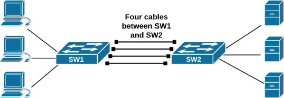

*Figure 3. Two switches interconnected with four cables.*

Well, it turns out, this method does not solve all problems automatically. If we connect two switches with multiple Layer 2 links, **we create a Layer 2 loop topology**, as discussed in the previous lesson about [LAN switching with redundant links](https://www.networkacademy.io/ccna/ethernet/an-switching-redundant-links). Recall the important takeaway from the previous lesson.

An Ethernet switched network **cannot work in a loop topology**. A protocol like Spanning Tree must break the loop topology into a loop-free one.

Why? Because broadcast frames could circulate indefinitely between the switches. Why indefinitely? Because broadcast frames don't have a built-in expiration mechanism like the TTL field in an IP packet.

So let's go back to the example. What happens when we connect the switches with four cables instead of one? We create a loop topology, and the Spanning Tree Protocol **immediately blocks all redundant links**. In the end, the traffic still goes over a single link, as shown in the animated diagram below.

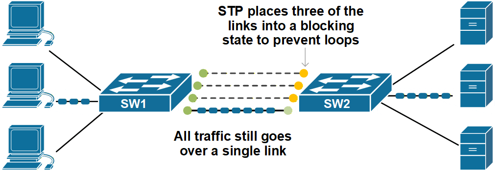

*Figure 4. Four cables between two switches.*

Even though we installed four physical links, each 1 Gbps each, we can use only one at a time, **so the total capacity between the user and the network is still 1 Gbps**. So we solved the resiliency problem but haven't solved the capacity problem. So here is the first important fact to remember:

Spanning Tree Protocol (STP) breaks a loop topology into a loop-free one and provides redundancy at the physical layer (more physical links between switches can be installed). However, **STP does not allow any redundant links to be used for traffic forwarding**. Redundant links stay blocked and can only become active when the current forwarding path fails.

At some point, the industry realized it would be much better to provide redundancy at the physical layer through multiple physical links **and be able to use these redundant links all the time for greater capacity**. And this is exactly what EtherChannel allows us to do.

## What is EtherChannel (Port-Channel)?

EtherChannel is a link aggregation technology that **combines multiple physical Ethernet links into a single logical link (Port-Channel)**. For example, once we connect the switches with four physical links, the physical topology between SW1 and SW2 looks like it is shown on the left side of the diagram below.

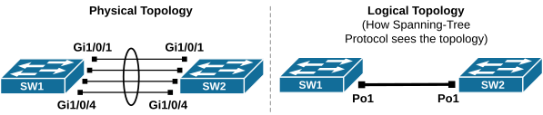

*Figure 5. Physical vs. Logical Topology.*

Physically, there are four separate Ethernet connections between the switches. However, when these interfaces are bundled into an EtherChannel, the logical topology looks like it is shown on the right side of the diagram.

From STP's perspective, the EtherChannel is a single logical link (Port-Channel 1). **STP does not see four parallel connections** between SW1 and SW2. It sees only the Port-Channel interface. Therefore, from STP's point of view, there is no loop in the topology. The switches are connected by a single logical cable. Hence, **there is no need to block any port to prevent loops**.

In the data plane, traffic can be distributed across all four physical links that belong to the Port-Channel, as shown in the animated diagram below.

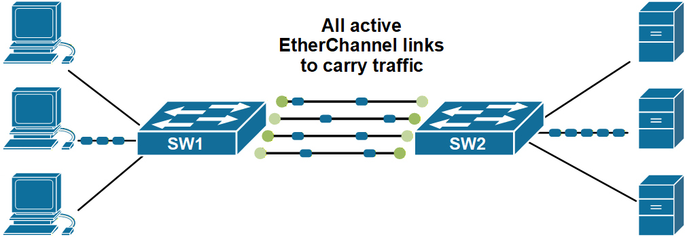

*Figure 6. Two switches connected via EtherChannel (Port-channel).*

This gives us two major benefits at the same time:

- ****Redundancy****– if one physical link fails, the Port-Channel can remain operational using the remaining links.
- ****Increased bandwidth**** – traffic can use multiple physical links instead of being limited to a single link.

This combination of higher capacity and link redundancy is the primary reason we use EtherChannels. Now let's look at how EtherChannels work in more detail.

## How does EtherChannel work?

The basic EtherChannel process is quite simple. It works in two steps, as follows:

- First, we select several compatible physical Ethernet interfaces.
- Then, we place those interfaces into the same EtherChannel group.

The switch creates a logical port-channel interface representing the entire group.

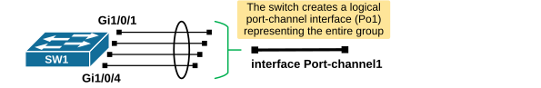

*Figure 7. EtherChannel Process.*

Higher-level functions such as VLAN trunking and Spanning Tree can then operate on Port-channel1 instead of treating each physical link separately. Frames sent through the EtherChannel are distributed across its physical member links. The receiving switch performs the reverse process. From the control plane point of view, however, the bundle behaves as a single connection.

### What Is LACP?

**Link Aggregation Control Protocol (LACP)**is an IEEE standard protocol that allows multiple physical links to be bundled into a single logical link, called a Port-Channel, EtherChannel, or Link Aggregation Group (LAG). Basically, all terms mean the same thing. Multiple physical links bundled into one logical link.

**KEY NOTE:** The terms EtherChannel, Port-channel, and Link Aggregation Group **practically mean the same thing,** and we often use them interchangeably. However, strictly speaking, they are not technically identical. EtherChannel is Cisco’s term for link aggregation, Port-Channel is the logical interface created by bundling the physical links, and LAG is the generic multi-vendor industry term for the group of bundled links.

LACP allows two devices ****to negotiate dynamically**** which physical links can safely become members of the same logical Port-Channel.

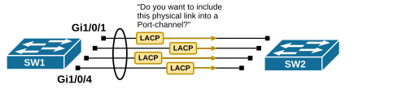

*Figure 8. What is LACP?*

Instead of simply assuming that all four links belong together, the switches exchange LACP Data Units (LACPDUs) over each physical interface. These messages allow each switch to learn information about the device and port on the other side. Based on that information, LACP determines whether the links are compatible and can be placed into the same Port-Channel.

### LACP Active and Passive Modes

LACP interfaces can operate in one of two negotiation modes:

- ****Active****– the interface actively sends LACP messages and tries to form a Port-Channel.

```text
SW1
interface range Gi1/0/1-4
channel-group 1 mode active
```

- ****Passive****– the interface listens for LACP messages and responds to them **but does not initiate the negotiation**.

```text
SW2
interface range Gi1/0/1-4
channel-group 1 mode passive
```

Therefore, these combinations work as shown in the following table. It is very important to remember then (which is pretty straightforward) because there are at least a few questions related to LACP modes in the CCNA exam.

| **SW1** | **SW2** | **Port-channe Form?** |
|---|---|---|
| Active | Active | **Yes** |
| Active | Passive | **Yes** |
| Passive | Active | **Yes** |
| Passive | Passive | **No** |

Pay close attention to the following combination of LACP modes on both sides. If you configure both groups of interfaces to work in passive mode, a port-channel won't form, as shown in the diagram below.

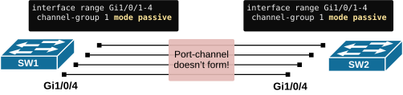

*Figure 9. LACP Passive mode.*

### Why do we need LACP, and what does it actually check?

LACP does more than simply ask, "Do you want to include this link in a port-channel?"

Each device identifies itself and its interfaces using information such as its **LACP System ID** and **Port ID**. The System ID is based on the device's LACP system priority and MAC address, as shown below.

```text
SW1# show lacp sys-id
32768, aabb.cc81.3000
```

At this point, someone may ask: "*I still can't understand why we need a dynamic protocol for this?*" Let's examine the following example. You want to make a port-channel between SW1 and SW2 that includes physical links Gi1/0/1 through Gi1/0/4. However, you mistakenly patched the Gi1/0/4's cable to another switch. What would happen?

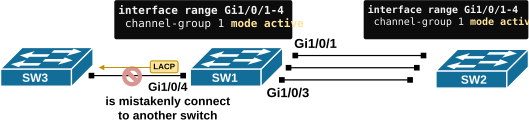

*Figure 10. Why do we need LACP?*

Without a negotiation mechanism, ****SW1 has no simple way to know that the fourth physical link goes to a different switch****. You configured **Gi1/0/1** through **Gi1/0/4** as members of the same channel, so from the local configuration alone, they appear to belong together. This is where LACP becomes extremely useful.

Every LACP-enabled interface exchanges LACP Data Units (LACPDUs) with the device on the other end of the link. These messages contain information about both the local device and the neighboring devices. For example, SW1 may learn the following:

```text
SW1 Interface    Partner System ID
------------------------------------------
Gi1/0/1          32768, 2222.2222.2222
Gi1/0/2          32768, 2222.2222.2222
Gi1/0/3          32768, 2222.2222.2222
Gi1/0/4          32768, 3333.3333.3333
```

The first three interfaces report the same remote System ID, meaning they are connected to the same neighboring switch, SW2. Gi1/0/4 reports a different remote System ID because it is connected to SW3. LACP can therefore determine that Gi1/0/4 does not belong in the same port-channel as the other three interfaces. **It will not allow that link to forward traffic as an active member of the Port-Channel**.

This illustrates one of the most important reasons for using LACP: **it verifies that the physical links you are trying to aggregate actually connect the correct devices** and belong to the same logical bundle.

### LACP monitor links

LACP continues operating after the Port-Channel has been formed. The switches periodically exchange LACPDUs, which means **LACP can detect when a member link is no longer communicating correctly** with the remote device.

Suppose all four links initially form port-channel 1, as shown in the CLI block below:

```text
Port-Channel1
Gi1/0/1   Active
Gi1/0/2   Active
Gi1/0/3   Active
Gi1/0/4   Active
```

If the LACP relationship on Gi1/0/4 is lost, that interface can be removed from the active bundle, as shown below:

```text
Port-Channel1
Gi1/0/1   Active
Gi1/0/2   Active
Gi1/0/3   Active
Gi1/0/4   Not bundled
```

The Port-Channel can continue forwarding traffic through the remaining three links. This gives LACP another major advantage over a manually forced EtherChannel. **Physical link participation in the bundle is dynamically negotiated and monitored**.

## Configuring EtherChannel

Now let's quickly show a simple EtherChannel configuration example. We will use the physical links e0/0 and e0/1 between SW1 and SW2, as shown in the diagram below. We will bundle these two physical links into a single logical link, **port-channel1**, using LACP active mode.

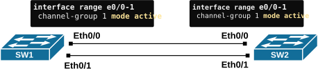

*Figure 11. EtherChannel configuration topology.*

The first step is to select both physical interfaces and assign them to the same channel group. On SW1, we configure:

```text
SW1(config)# interface range e0/0-1
SW1(config-if-range)# shutdown
SW1(config-if-range)# channel-group 1 mode active
```

We then configure the same thing on SW2:

```text
SW2(config)# interface range e0/0-1
SW2(config-if-range)# shutdown
SW2(config-if-range)# channel-group 1 mode active
```

When building a new EtherChannel, **it is good practice to shut down the physical member interfaces before configuring the bundle**. It prevents the physical interfaces from temporarily forwarding as independent links while the EtherChannel configuration is incomplete. Otherwise, you could briefly create an unwanted Layer 2 topology, cause STP changes, or introduce inconsistent forwarding while one side of the Port-Channel is still being configured.

Notice that the number 1 identifies the channel group and creates the logical **interface Port-Channel1**. The keyword **active** enables LACP and tells the switch to actively send LACP messages on the interfaces.

At this point, we unshut the physical links; both links connect the same two switches, and their EtherChannel parameters are compatible, so LACP bundles them into Port-Channel1.

```text
SW1# show ip int brief
Interface              IP-Address      OK? Method Status                Protocol
Ethernet0/0            unassigned      YES unset  up                    up
Ethernet0/1            unassigned      YES unset  up                    up
Ethernet0/2            unassigned      YES unset  up                    up
Ethernet0/3            unassigned      YES unset  up                    up
Ethernet1/0            10.1.0.5        YES NVRAM  up                    up
Ethernet1/1            10.1.0.9        YES NVRAM  up                    up
Ethernet1/2            unassigned      YES unset  up                    up
Ethernet1/3            unassigned      YES unset  up                    up
Loopback0              10.1.255.1      YES NVRAM  up                    up
Port-channel1          unassigned      YES unset  up                    up
```

Although there are two physical links underneath, **protocols such as STP treat the Port-Channel as a single logical link**, as shown in the output below.

```text
SW1# show spanning-tree

VLAN4000
  Spanning tree enabled protocol rstp
  Root ID    Priority    36768
             Address     aabb.cc01.2000
             Cost        56
             Port        65 (Port-channel1)
             Hello Time   2 sec  Max Age 20 sec  Forward Delay 15 sec

  Bridge ID  Priority    36768  (priority 32768 sys-id-ext 4000)
             Address     aabb.cc01.3000
             Hello Time   2 sec  Max Age 20 sec  Forward Delay 15 sec
             Aging Time  300 sec

Interface           Role Sts Cost      Prio.Nbr Type
------------------- ---- --- --------- -------- --------------------------------
Po1                 Root FWD 56        128.65   P2p
```

Once the Port-Channel is created, you should treat it as the primary logical interface. Configuration that applies to the entire bundle **should be placed under the Port-Channel interface, not under the individual physical member links**. For example, if Port-Channel1 must operate as a trunk, the trunk settings go under the port-channel, as shown below:

```text
SW1(config)# interface port-channel 1
SW1(config-if)# switchport mode trunk
SW1(config-if)# switchport trunk allowed vlan 10,20,4000
```

You should not configure these settings independently under **e0/0** and **e0/1**. The physical interfaces are now members of the logical Port-Channel, so common Layer 2 settings should be applied to the Port-Channel itself.

**KEY NOTE:**Configure the physical interfaces to join the EtherChannel. Configure the Port-Channel for everything the logical link should do (act as trunk, access, etc.).

Now let's quickly see how we verify if the EtherChannel is operational.

## Verifying EtherChannel

Once the configuration is complete, one of the most useful verification commands is:

```text
SW1# show etherchannel summary

A successful EtherChannel may look similar to this:
Group  Port-channel  Protocol    Ports
------+-------------+-----------+--------------------------------
1      Po1(SU)         LACP      Et0/0(P) Et0/1(P)
```

There is a lot of useful information in this short output. First, we can see that Port-Channel1 (Po1) exists. The flags next to it are also important: **(SU)**. **S** means that the Port-Channel is operating as a Layer 2 interface, while **U** means that it is in use.

We can also see that both physical interfaces have the **P** flag: **Et0/0(P)**, **Et0/1(P)**. The P stands for bundled in Port-Channel. In other words, both interfaces are successfully participating in the EtherChannel.

We can also verify the LACP neighbors using the following command:

```text
DSW1# show lacp neighbor
Flags:  S - Device is requesting Slow LACPDUs
        F - Device is requesting Fast LACPDUs
        A - Device is in Active mode       P - Device is in Passive mode

Channel group 1 neighbors

                     LACP port                      Admin  Oper   Port    Port
Port          Flags  Priority  Dev ID          Age  key    Key    Number  State
Et0/0         SA     32768     aabb.cc81.2000   0s  0x0    0x1    0x1     0x3D
Et0/1         SA     32768     aabb.cc81.2000  23s  0x0    0x1    0x2     0x3D
```

This command displays the LACP partner detected on each member interface. It allows us to confirm that SW1 is receiving LACP messages from SW2 over both physical links.

This is especially useful when troubleshooting an EtherChannel. For example, if one interface does not appear as expected, you can determine whether LACP is actually communicating with the device on the other side.

Let's stop here for now. We are going to discuss EtherChannel in much more detail in the configuration and troubleshooting sections of our CCNA course, so see you there.

---

<!-- nav -->
⬅ [LAN Switching with Redundant Links](11-an-switching-redundant-links.md) · [Course index](00_Index.md) · [Switching modes: Store-and-Forward vs Cut-Through](13-store-and-forward-vs-cut-through-switching.md) ➡
<!-- nav -->
