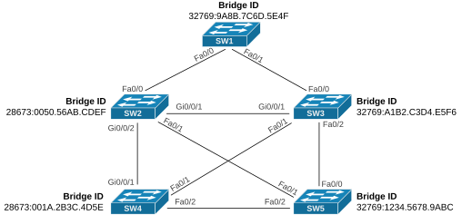
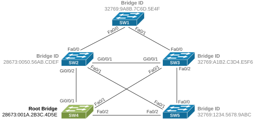
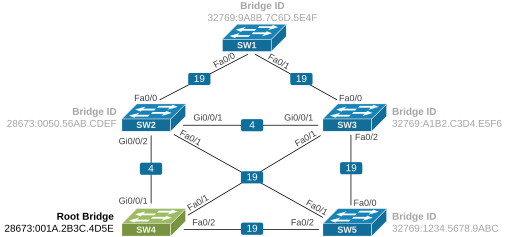
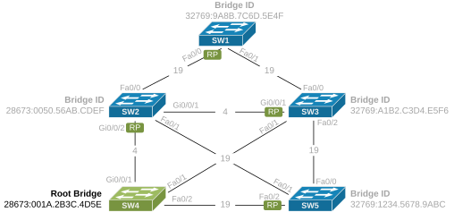
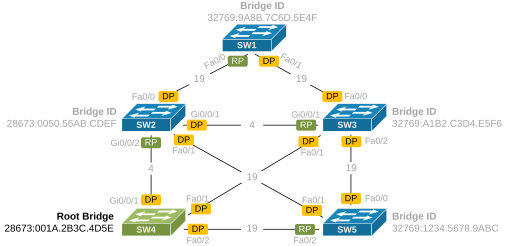
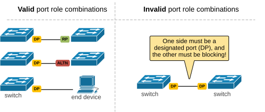
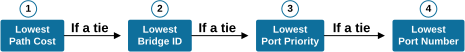
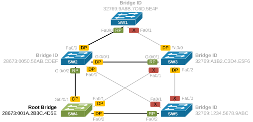
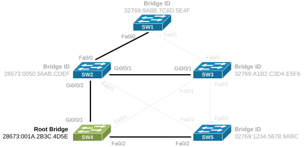

# Lab #2.1 - Manual STP computation

<!-- nav -->
⬅ [STP Topology Changes (TCN)](10-stp-topology-changes.md) · [Course index](00_Index.md) · [Test #2.1 - CST Fundamentals](12-test-cst-fundamentals.md) ➡
<!-- nav -->

*Spanning Tree Protocol (STP) Fundamentals · Lesson · Source: https://www.networkacademy.io/ccna/spanning-tree/lab-manual-stp-computation*

The lessons so far should be enough for you to understand how the original Spanning Tree protocol works (IEEE 802.1d). However, to really have a deep understanding that will stick with you for a long time, you must practice!

This lesson provides a step-by-step lab guide on how to manually calculate a spanning-tree topology using a network diagram. This exercise is very useful, especially for people preparing for the CCNA exam.

## STP Initial Topology

For this lab example, we are going to use the network topology shown in the diagram below. It has five switches interconnected with multiple redundant links. Notice that some of the links are FastEthernet, while others are GigabitEthernet (hence the speeds 100Mbps and 1Gbps).

*Figure 1. Lab initial topology.*

The goal is to manually calculate how the topology will look after the spanning tree process fully converges. The diagram above presents all the information you need to do that.

### Manual STP calculation steps

Let's walk through the steps that you need to perform to compute the STP topology.

| **Action** | **Scope** | **Description** |
|---|---|---|
| 1. Identify the Root Bridge | 1 per topology | Find the switch with the lower Bridge ID (BID) in the network. Mark it on the diagram as the Root Bridge. |
| 2. Identify link costs | per link | Write down the path cost for each link in the network. |
| 3. Select root ports | 1 per switch | Determine the port on each switch with the lowest total cost to the Root Bridge. Label it as RP (root port). |
| 4. Select designated ports | 1 per segment (link) | For each switch-to-switch link, choose the end with the lowest path cost to the root bridge as the designated port. If two ports have the same cost, you the tiebreakers. Label it as DP (designated port). |
| 5. Identify blocked ports | 1 per redudant link | Set all ports that are not root or designated as Alternate (blocking state). Label them with X. |

If you know what the protocol does at each step, you should be able to figure out the root bridge and all port roles. First, **try to do it on your own on a list on paper**. After you finish, come back and walk through our explanation of each step and cross-check if your solution is correct.

### Step 1. Identify the Root Bridge

You must know by now that everything in the STP process starts with the election of the Root Bridge. To manually find which switch becomes the root bridge in a network, you need **to compare the Bridge IDs of all switches**.

The Bridge ID is made of two parts: the bridge priority and the MAC address. Lower values are better. First, check the priority. If one switch has a lower priority than the others, it becomes the root bridge. If two or more switches have the same priority, then the switch with the lowest MAC address becomes the root. The one with the overall lowest Bridge ID is selected as the root bridge.

In our instance, let's first compare the priorities of all switches. It is obvious that SW2 and SW4 have lower priorities than the other switches: 28673. However, only one can become the root, so let's compare the second part of their bridge IDs. It is obvious that SW4's MAC address is lower than SW2's. Therefore, SW4 becomes the Root Bridge, as shown in the diagram below.

*Figure 2. dentifying the root switch.*

Some people find it hard to compare MAC addresses. However, it is pretty simple. Yoy compare each hex digit from left to right. The first difference determines which is lower. In our example, the third hex digit of SW4's MAC address is lower than SW2's. Hence, SW4's MAC address is lower than SW2's, and it becomes the root bridge, as shown in the diagram above.

#### Step 2. Identify link costs

The next step in the process is identifying the cost of each link in the topology. This is required because the STP process uses the link costs to calculate the best paths to the root from each switch's perspective.

*Figure 3. Identifying port costs.*

**Each link has a cost based on its speed**. Faster links have a lower cost because they are better. The following table shows the cost of the most common interface speeds.

| **Interface Name** | **Interface speed** | **STP cost** |
|---|---|---|
| Ethernet | 10 Mbps | 100 |
| FastEthernet | 100 Mbps | 19 |
| GigabitEthernet | 1 Gbps | 4 |
| TenGigabitEthernet | 10 Gbps | 2 |

The spanning-tree protocol uses these values to compute the total cost to the root from each switch's perspective. The algorithm is as follows:

- STP adds up the costs of all links from a switch to the root bridge. This total is called the path cost.
- The switch chooses the path with the lowest total cost to reach the root bridge.

For example, if one path uses one FastEthernet (100Mbps) link and another path uses two GigabitEthernet (1Gbps) links, the switch will compare the total cost.

- One 100 Mbps links have a cost of 19.
- Two 1 Gbps links have a cost of 4 each, a total of 8.

Since 8 is less than 19, the switch chooses the two 1 Gbps links as the best path to the root instead of the direct FastEthernet interface.

### Step 3. Select root ports

The next step in the STP process is selecting the root ports. Each switch has **only one root port** at any given time—the port with the lowest cost to the root bridge. Let's walk through the process from each switch's perspective.

*Figure 4. Selecing root ports.*

- SW1 selects port **Fa0/0**as RP because it has a total cost of 19+4=23. The other port, Fa0/1, has a total cost of 19+4+4=27.
- SW2 selects **Gi0/0/2** as RP because it has a total cost of 4. The other ports have way larger total values.
- SW3 selects **Gi0/0/1** as RP because it has a total cost of 4+4=8. Fa0/1 has 19, while Fa0/2 has 19+19=38.
- SW4 is the root and doesn't have an RP.
- SW5 selects **Fa0/2** as RP because it has a cost of 19. Fa0/1 has 19+4=23, while Fa0/0 has 19+19=38.

On the diagram above, you can see each root port labeled with "RP".

#### Step 4. Select designated ports

Once each switch has selected a root port, it initially assumes **all other ports are designated ports**, as shown in the diagram below. A designated port is allowed to forward BPDUs and send/receive traffic.

*Figure 5. Selecting Designated ports.*

However, the spanning tree process allows **only one designated port per segment** (per link). If two switches are connected on their designated ports, one of those ports must be set to a blocking state to prevent a forwarding loop, as shown in the diagram below.

*Figure 6. Designated port combinations.*

If you look at Figure 5, there are multiple links with two designated ports. The STP process must select only one of the ports as DP and block the other.

When deciding which ports to block between two switches connected on their DP ports, STP follows this process:

- First, the switch with the lower path cost to the root bridge gets to forward traffic and becomes the designated port (DP). The other side of the link is blocked.
- If both switches have the same path cost to the root, STP compares other values to break the tie, as shown below.

*Figure 7. STP port selection algorithm.*

For example, the link between SW1's Fa0/1 and SW3's Fa0/0 must have only one DP. SW3's Fa0/0 will be selected as DP because SW3 has a lower path cost to the root (8) than SW1 (23).

Let's see another example: the link between SW3's Fa0/2 and SW5's Fa0/0 must have only one DP. SW3's Fa0/2 will be selected as DP because SW3 has a lower path cost to the root (8) than SW5 (19).

Okay, let's see how the final topology will look after the STP selects all DP ports.

#### Step 5. Identify blocked ports

The last step that STP performs is to block all ports that are not selected as either root or designated role. The following diagram shows how the STP topology looks like after the protocol fully converges.

*Figure 8. Identifying blocking ports.*

Notice that every switch has only one root port and that there is only one designated port per link. The following diagram shows the loop-free topology that the STP protocol computed (and you as well).

*Figure 9. Converged STP loop-free toology.*

I hope you enjoyed this lesson. If it was easy and straightforward for you, check out the next lab example, which will challenge you with a more complex switched topology.

---

<!-- nav -->
⬅ [STP Topology Changes (TCN)](10-stp-topology-changes.md) · [Course index](00_Index.md) · [Test #2.1 - CST Fundamentals](12-test-cst-fundamentals.md) ➡
<!-- nav -->
