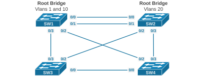
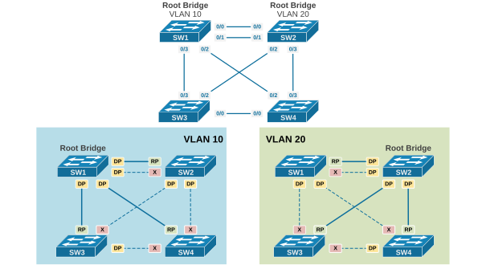
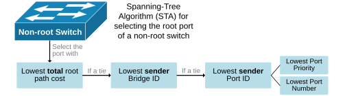
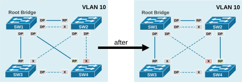
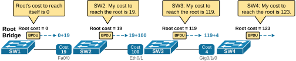
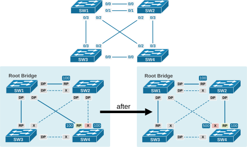
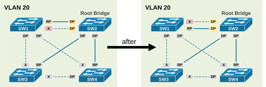

# Lab #3.1 - Spanning-Tree Customization

<!-- nav -->
⬅ [Configuring Per-VLAN STP (PVST)](15-configuring-pvst.md) · [Course index](00_Index.md) · [STP Portfast](17-portfast.md) ➡
<!-- nav -->

*Spanning Tree Protocol (STP) Fundamentals · Lesson · Source: https://www.networkacademy.io/ccna/spanning-tree/lab-spanning-tree-customization*

In this lab, we discuss how we customize the spanning-tree loop-free topology. Typically, most real-world switching environments only select the placement of the root bridge and leave all other settings at their default values. However, in some special circumstances or in CCNA/CCNP/CCIE exams, you might need to customize the STP topology based on specific requirements. This lesson demonstrates such a situation.

At the end of the lesson, in the download section, you can get both the EVE-NG and the CML files so that you can practice the lab and play around on your own.

## Lab Initial Topology

We will use the topology shown in the diagram below. We have four switches, allowing the topology to be run in the Cisco CML Free edition, which supports up to five devices.



*Figure 1. Lab Initial Topology.*

Notice that we have two VLANs, 10 and 20, in addition to the default VLAN 1. SW1 is configured as the root bridge for VLAN 10, while SW2 is configured as the root for VLAN 20. All links are 10 Mbps Ethernet with a default STP cost of 100. The following diagram shows the loop-free paths for each VLAN.



*Figure 2. Lab Loop-free Topologies.*

Note that the topologies are not customized, and everything defaults to the standard settings. The links with dashed lines are blocked by spanning trees to prevent loops.

## Lab Requirements

An engineer configured the customer's network but was unable to complete all tasks. The customer has contacted you to customize the STP topology based on the following requirements:

- Requirements for VLAN 10 (database):
  - The traffic from SW4 to SW1 must go via SW2. However, the SW4's link to SW2 is currently in a blocking state.
- Requirements for VLAN 20 (web):
  - The traffic from SW1 to SW2 must go via port 0/1. The port is currently in a blocking state. You are not allowed to change the STP cost of SW1's interfaces.
  - Tune the STP timers so that the root bridge generates configuration BPDUs every second.
  - If a switch in VLAN 20 does not receive a BPDU on its root port, it must wait 10 seconds before invalidating the best BPDU.

Reconfigure the STP protocol to ensure all requirements are met. First, download the CML file from the section below and try to configure and verify the topology on your own. Then, come back and cross-check if you used the same approach.

## STP Customization

The most important part of the STP design is **the placement of the root bridge**. It influences the building of the entire loop-free tree. Once the root placement is chosen, the STP automatically constructs a loop-free path through the network. In 99 percent of real-world cases, you won’t need to make any additional changes to the tree. However, in some special situations or exams, you may need to fine-tune the loop-free path, which should be done very carefully.

Let's recall that the Spanning-Tree Algorithm (STA) uses four steps to calculate the topology and select the root port on each switch:

1. The lowest bridge ID
2. The lowest total cost to reach the root
3. The lowest sender bridge ID
4. The lowest sender port ID



*Figure 3. STA for selecting the root port.*

In the previous lessons, we saw how we could change a switch’s bridge ID to make it the root bridge. You can also adjust the bridge priority to affect how that switch is seen by others when it sends BPDUs (Bridge Protocol Data Units). In this lesson, we will see how we can manipulate the loop-free path using the next three steps in the STP algorithm, as shown in the diagram above.

### Solving the VLAN 10's requirements

Now, let's see how we can reconfigure the spanning-tree topology for vlan 10 in such a way that the traffic from SW4 to SW1 goes via SW2, as shown below.



*Figure 4. Changing SW4's root port.*

Notice that in the current topology on the left, SW4's root port is 0/2, which directly connects to the root (SW1). To satisfy the requirements, we must make port 0/3, which connects to SW2, the root port.

#### Influencing the Root Path Cost

Each active switch port has a root path cost. This cost is **the total cost**a BPDU collects as it moves through the network. When a switch receives a BPDU, it adds the port cost of the receiving port to the BPDU’s root path cost.



*Figure 5. STP port cost.*

A port’s cost depends on its bandwidth — higher bandwidth means lower cost. The following table lists the default STP cost for various interface types.

| **Interface Name** | **Speed** | **STP cost** |
|---|---|---|
| Ethernet | 10Mbps | 100 |
| FastEthernet | 100Mbps | 19 |
| GigabitEthernet | 1Gbps | 4 |
| TenGigabitEthernet | 10Gbps | 2 |
| FourtyGigabitEthernet | 40Gbps | 1 |

You can change a port’s cost if needed instead of using the default value. To set a port’s path cost, use this command in interface configuration mode:

```text
Switch(config-if)# spanning-tree [vlan-id] cost [cost]
```

For example, a FastEthernet port usually has a cost of 19. To change the cost to 4 for VLAN 10, use this command:

```text
Switch(config)# interface FastEthernet0/0/1
Switch(config-if)# spanning-tree vlan 10 cost 4
```

Keep in mind that the root path cost is **a cumulative metric**. Therefore, when changing the cost of a port, you affect all downstream switches. For example, if you examine Figure 5 above, changing the port cost of SW2's Fa0/0 affects the total root path cost of switches 3 and 4.

**Important**: Before changing a port's cost, you should first **calculate the new root path costs of all paths** in the topology. Switched networks are not that large, typically consisting of only a few switches. Hence, it is recommended to draw the topology on a list of paper and write down all new root path costs. Careful planning is crucial in Layer 2 networks, ensuring the network chooses the path you want.

#### Verify the current root path

Now, let's see the current root port of SW4. The most commonly used command to do so is the show spanning-tree vlan command, as shown in the output below.

```text
SW4# show spanning-tree vlan 10

VLAN0010
  Spanning tree enabled protocol ieee
  Root ID    Priority    24586
             Address     aabb.cc00.1100
             Cost        100
             Port        3 (Ethernet0/2)
             Hello Time   2 sec  Max Age 20 sec  Forward Delay 15 sec

  Bridge ID  Priority    32778  (priority 32768 sys-id-ext 10)
             Address     aabb.cc00.1600
             Hello Time   2 sec  Max Age 20 sec  Forward Delay 15 sec
             Aging Time  300 sec

Interface           Role Sts Cost      Prio.Nbr Type
------------------- ---- --- --------- -------- ---------------------
Et0/0               Altn BLK 100       128.1    P2p 
Et0/2               Root FWD 100       128.3    P2p 
Et0/3               Altn BLK 100       128.4    P2p 
```

However, it does not show the total cost of the root path. That's why there is an additional command that displays the root path cost, as shown below.

```text
SW4# show spanning-tree vlan 10 root 

                                        Root    Hello Max Fwd
Vlan                   Root ID          Cost    Time  Age Dly  Root Port
---------------- -------------------- --------- ----- --- ---  ---------
VLAN0010         24586 aabb.cc00.1100       100    2   20  15  Et0/2 
```

#### Changing a port's STP cost

There are two approaches to influence the root path in a spanning tree:

- You can **decrease the STP cost** on the port or path you want to become active (lower cost is better).
- You can **increase the STP cost** on a port or path that you want to be unused.

The preferred approach depends on the specific use case. In our example, we want to make SW4's port 0/3 the root port. The easiest way to do it is to increase the cost of the current root port (Eth0/2) so that the STP algorithm chooses port 0/3 as best. Let's configure the STP cost to 500 on port Eth0/2, as shown below.

```text
SW4# conf t
Enter configuration commands, one per line.  End with CNTL/Z.
SW4(config)# interface eth0/2
SW4(config-if)# spanning-tree vlan 10 cost 500
SW4(config-if)# end
```

Now, if we check which port is in the root, we can see that interface Eth0/3 has been selected as the root with a total cost of 200.

```text
SW4# show spanning-tree vlan 10 root 

                                        Root    Hello Max Fwd
Vlan                   Root ID          Cost    Time  Age Dly  Root Port
---------------- -------------------- --------- ----- --- ---  ------------
VLAN0010         24586 aabb.cc00.1100       200    2   20  15  Et0/3  
```

The following diagram shows illustrates the state of VLAN10's topology before and after the change. Before the change, SW4's interface Eth0/2 was the lowest cost path to the root, with a total cost of 100.



*Figure 6. Vlan 10's topology after the change.*

After the change, SW4's lowest-cost path to the root is via interface Eth0/3, with a total cost of 200. Notice that the path via interface Eth0/0 also has a total cost of 200. However, since switch SW2 has a lower Bridge ID than SW3, interface 0/3 is selected as root.

### Solving VLAN20's requirements

Now, let's see how we can reconfigure the spanning-tree topology for vlan 20 in such a way that it satisfies the following requirements:

- SW1's root port must be Eth0/1. The port is currently in a blocking state.
- VLAN20's root bridge must generate configuration BPDUs every second. Currently, it does so every 2 seconds.
- Switches must wait 10 seconds before invalidating the best BPDU. Currently, they wait 20 seconds.



*Figure 7. Changing SW1's root port.*

#### Influencing the port ID

The fourth factor in an STP algorithm is the port ID. The port ID is a 16-bit value that has two components: 8 bits for port priority and 8 bits for the port number.


*Figure 8. STP port ID.*

Port priority can be a value from 0 to 255, with a default of 128. The port number also ranges from 0 to 255 and represents the physical port on the switch. For example, SW1's interface Eth0/0 has port-id 128.1, as highlighted in green in the output below.

```text
SW1# show spanning-tree vlan 20 interface e0/0

Vlan                Role Sts Cost      Prio.Nbr Type
------------------- ---- --- --------- -------- -------
VLAN0020            Root FWD 100       128.1    p2p 
```

Usually, port numbers start with 1 for port 0/0 and go up as you move across modules and stack members. However, they are not always simple or consecutive because each module or member gets a specific range. Also, ports that are part of an EtherChannel (port channel) always have a higher port ID than if they were not bundled.

---

<!-- nav -->
⬅ [Configuring Per-VLAN STP (PVST)](15-configuring-pvst.md) · [Course index](00_Index.md) · [STP Portfast](17-portfast.md) ➡
<!-- nav -->
