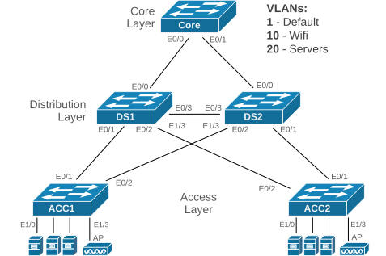

# Final Configuration Lab

<!-- nav -->
⬅ [Course Summary](27-course-summary.md) · [Course index](00_Index.md) · [Final Troubleshooting Lab](29-final-troubleshooting-lab.md) ➡
<!-- nav -->

*Spanning Tree Protocol (STP) Fundamentals · Lesson · Source: https://www.networkacademy.io/ccna/spanning-tree/final-configuration-lab*

This is the final configuration lab, designed to check whether you have understood all the Spanning Tree concepts we have covered in the course. If you complete all configuration tasks correctly, you are fully ready for the Spanning Tree portion of the CCNA exam.

At the end of this lesson, you’ll find two links to download the initial CML or EVE-NG file. You can then complete all the tasks yourself at your home lab before reviewing our solution.

## Lab Initial State

A customer is setting up a redundant switching infrastructure using five devices, as shown in the topology below. The network includes several redundant paths between switches to ensure high availability.

*Figure 1. Initial Topology.*

The network is a greenfield environment. The switches are running Rapid PVST+ by default and have default spanning-tree configurations. Only the VLANs and the trunking between the switches have been configured.

## Lab Objectives

An engineer started configuring the Spanning Tree features but didn’t finish. You’ve been hired to complete the remaining tasks as follows:

**Setup the Root Bridge for each Vlan:**

- ****Task 1****: The core switch must be the root bridge for the default VLAN 1 and must have priority 0.
- ****Task 2****: DS1 must be the root for VLAN 10. The switch must automatically choose the appropriate priority value based on the current root. DS2 must be the secondary root for that Vlan.
- ****Task 3****: DS2 must be the root for VLAN 20. The switch must automatically choose the appropriate priority value based on the current root. DS1 must be the secondary root for that Vlan.

**Optimize the STP convergence:**

- ****Task 4****: To prevent unnecessary topology recalculations when a workstation is plugged into an access port, configure all access ports so they transition immediately to the forwarding state when an end device is connected.
- ****Task 5****: The ports toward the wireless access points (APs) are trunks. Ensure they also transition immediately to the forwarding state.
- ****Task 6****: Change the STP timers of Vlan 1 so that the hello time is 1 second, the forward delay is 7 seconds, and the max-age is 10 seconds.

**Protect the STP domain:**

- ****Task 7******:** Protect edge ports by err-disabling them if they receive BPDUs.
- ****Task 8****: Prevent access switches from becoming the root bridge, even if they send superior BPDUs.
- ****Task 9****: Ensure that switch ports detect and shut down in case of unidirectional communication preventing loops.

**Traffic Engineering (TE):**

- ****Task 10****: ACC1 must use uplink Eth0/1 when sending and receiving traffic in Vlan 1. However, all other Vlans must use uplink Eth0/1.
- ****Task 11****: DS2's Eth1/3 interface must be in the Forwarding state for VLAN 10.

Notice that the objectives are written as customer requirements instead of naming the exact commands. This is to help you think through the task and decide which spanning tree feature to use. It will test your understanding, not just your memory.

## Lab Solution

If you plan to do the configuration lab independently, you must stop here, do it yourself, and then return to check the solution.

---

<!-- nav -->
⬅ [Course Summary](27-course-summary.md) · [Course index](00_Index.md) · [Final Troubleshooting Lab](29-final-troubleshooting-lab.md) ➡
<!-- nav -->
