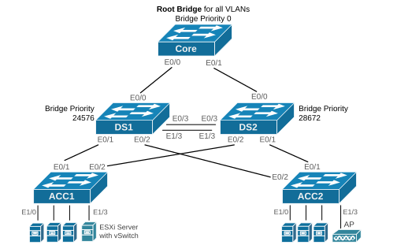
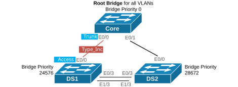
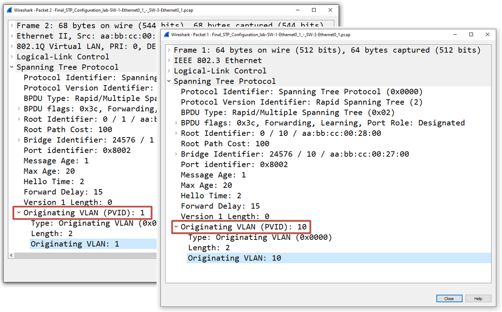
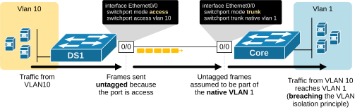
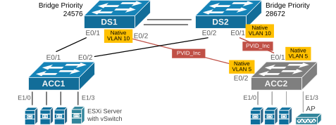

# Final Troubleshooting Lab

<!-- nav -->
⬅ [Final Configuration Lab](28-final-configuration-lab.md) · [Course index](00_Index.md)
<!-- nav -->

*Spanning Tree Protocol (STP) Fundamentals · Lesson · Source: https://www.networkacademy.io/ccna/spanning-tree/final-troubleshooting-lab*

Troubleshooting is one of the hardest parts of networking, especially in real environments. The truth is, **you can't fully learn how to troubleshoot** just by reading books or watching a video tutorial. It takes hands-on practice and real-world experience. However, this lesson can give you two key things to help you become better: a solid scenario and a downloadable file to practice it yourself at home.

As with any Cisco exam, the show run command might be blocked—even though it's often the quickest way to find problems. So, we strongly recommend applying the “no show run” rule when practicing troubleshooting. This will force you to rely on deeper protocol understanding using more specific IOS commands.

## Initial Topology

A customer's switching network consists of five switches arranged in a three-tier topology. The design includes one core switch, two distribution layer switches, and two access switches, as shown in the diagram below.



*Figure 1. Initial Topology.*

The access layer connects several end-user devices, such as PCs, printers, servers, and access points (APs). The network's main goal is to provide users with resilient network access at any given moment.

## Troubleshooting Tickets

The customer has reported ongoing network issues that require attention. Several support tickets have been opened and escalated to you for investigation and resolution.

- **Ticket 1**: The customer reports seeing one of the distribution switches not forwarding traffic on the link to the Core. They also report noticing some STP errors in the logs but are unsure what’s causing them.
- **Ticket 2**: After replacing an access switch, the customer reports connectivity issues between ACC2 and the distribution layer. No traffic passes over the trunk link, and they noticed some VLAN-related errors in the logs. The link has been checked and is physically up.
- **Ticket 3**: The customer recently added a new switch to the network, and users are now reporting increased latency in the WiFi Vlan (Vlan 10).
- **Ticket 4**: The customer reports that access switch ACC2 takes between 30 and 60 seconds to begin forwarding traffic to the distribution layer after a reboot.
- **Ticket 5:** The customer reports that the VMware server connected to ACC1's Eth1/3 port suddenly lost network connectivity. Reconnecting the cable does not help, and the port appears to remain disabled.
- **Ticket 6:** The customer reports that some desktop PCs and IP phones take unusually long to connect to the network after being powered on or restarted. Users report that it takes 30–60 seconds before they get a working network connection. This delay is consistent every time the device is rebooted. The issue seems to be happening only on certain ports on ACC2.

Notice that the lab presents all troubleshooting tickets as customer complaints. The goal is to encourage you **to analyze the symptoms**, think critically, and identify the underlying root cause based on your knowledge of the Spanning Tree and switching behavior.

At the end of the lesson, we provide downloadable files (EVE-NG and CML) containing the initial network configuration. You can download it and try to troubleshoot and resolve all the tickets on your own. Once you're done, you can return to the lesson and review our suggested solutions.

## Solutions

In this section, we will solve each of the tickets. Notice that since the lab topology consists of only five switches (to run on CML Free), the problems might be related. Therefore, it is recommended that they be solved in sequential order.

### Ticket #1

The customer reports seeing one of the distribution switches not forwarding traffic on the link to the Core. They also report noticing some STP errors in the logs but are unsure what’s causing them.

If we execute the show spanning-tree command on both distribution switches, we can immediately see that DS1's link toward the Core is blocked, as shown in red in the output below.

```text
DS1# show spanning-tree

VLAN0010
  Spanning tree enabled protocol rstp
  Root ID    Priority    1
             Address     aabb.cc00.2800
             Cost        200
             Port        4 (Ethernet0/3)
             Hello Time   2 sec  Max Age 20 sec  Forward Delay 15 sec

  Bridge ID  Priority    24577  (priority 24576 sys-id-ext 1)
             Address     aabb.cc00.2500
             Hello Time   2 sec  Max Age 20 sec  Forward Delay 15 sec
             Aging Time  300 sec

Interface           Role Sts Cost      Prio.Nbr Type
------------------- ---- --- --------- -------- --------------------------------
Et0/0               Desg BKN*100       128.1    P2p *TYPE_Inc 
Et0/1               Desg FWD 100       128.2    P2p 
Et0/2               Desg FWD 100       128.3    P2p 
Et0/3               Root FWD 100       128.4    P2p 
Et1/3               Altn BLK 100       128.8    P2p 
```

Additionally, the Root port (in orange) is not the one we expected it to be. According to the lab diagram, DS1 is directly connected to the Core via e0/0. However, its root port is the link to the other distribution switch, DS2, which is not the lowest-cost path.

We can check the port inconsistency status using the following command. The switch reports that the port is "*broken*" due to "*Port Type Inconsistent*". But what is the Port Type?

```text
DS1# show spanning-tree interface ethernet 0/0 detail 
 Port 1 (Ethernet0/0) of VLAN0010 is broken  (Port Type Inconsistent)
   Port path cost 100, Port priority 128, Port Identifier 128.1.
   Designated root has priority 1, address aabb.cc00.2800
   Designated bridge has priority 24577, address aabb.cc00.2500
   Designated port id is 128.1, designated path cost 200
   Timers: message age 0, forward delay 14, hold 0
   Number of transitions to forwarding state: 0
   Link type is point-to-point by default
   BPDU: sent 168, received 166
```

A switchport can be an **Access port** or a **Trunk port**. In that context, port type inconsistency means that one side of the link is configured as access and the other side as a trunk, causing a spanning-tree inconsistency, as shown in the diagram below.



*Figure 2. Spanning-Tree Type_Inc.*

#### What happens?

The STP expects both sides of a link to agree on the type of connection (trunk or access). Each type has different behavior in the context of the spanning tree:

- **Access port**: Sends BPDUs **untagged**and expects to receive untagged BPDUs.
- **Trunk port**: Sends BPDUs **tagged**with the VLAN ID of the STP instance and expects tagged BPDUs.

For example, below are two BPDUs captured on a trunk link between two switches. The one on the left is tagged with VLAN 1, while the one on the right is tagged with VLAN 10.



*Figure 3. Two BPDUs screenshot.*

If a BPDU is untagged, the "Originating VLAN (PVID)" field is absent.

#### The Result

When there is a part type mismatch, the access port receives tagged BPDUs with VLANs it does not expect. The STP immediately puts the interface into the **Type_Inc** state to protect the network from **VLAN leakage**.

**But what is VLAN leakage?**

VLAN leakage occurs when traffic from one VLAN accidentally ends up in another VLAN, **violating VLAN isolation**. For example, let's imagine that STP is disabled. What would happen is that switch DS1 sends untagged traffic (VLAN 10) via its access port to the core. The core switchport is a trunk that sees the untagged traffic as part of its native VLAN (Vlan 1), as shown in the diagram below.



*Figure 4. VLAN Leakage scenario (if STP is disabled).*

What happens is that a device in VLAN 10 can ping a device in VLAN 1 and vice-versa. This breaks the VLAN security and isolation principles and can cause many unexpected behaviors of other protocols. It is a troubleshooting nightmare. That is why Spanning Tree detects port type mismatches and **immediately blocks the ports** to prevent VLAN leakage.

#### How to fix it

Let's first verify the mismatch by checking the operational status on both sides of the link.

```text
DS1# show interfaces e0/0 switchport 
Name: Et0/0
Switchport: Enabled
Administrative Mode: static access
Operational Mode: static access
Administrative Trunking Encapsulation: dot1q
Operational Trunking Encapsulation: native
Negotiation of Trunking: Off
Access Mode VLAN: 1 (default)
Trunking Native Mode VLAN: 1 (default)
Administrative Native VLAN tagging: disabled
...
```

We can see that DS1's e0/0 port is an access port, while the core's e0/0 port is a trunk.

```text
Core# show interfaces e0/0 switchport 
Name: Et0/0
Switchport: Enabled
Administrative Mode: trunk
Operational Mode: trunk
Administrative Trunking Encapsulation: dot1q
Operational Trunking Encapsulation: dot1q
Negotiation of Trunking: On
Access Mode VLAN: 1 (default)
Trunking Native Mode VLAN: 1 (default)
Administrative Native VLAN tagging: disabled
Voice VLAN: none
...
```

We fix the problem by changing the two sides of the link to either both trunk or both access. Typically, the link between switches is a trunk link carrying multiple VLANs. Therefore, let's change the distribution switch DS1's port to type trunk.

```text
DS1# conf t
Enter configuration commands, one per line.  End with CNTL/Z.
DS1(config)# interface e0/0
DS1(config-if)# switchport mode trunk 
DS1(config-if)# end
DS1#
```

Now, if we check the DS1's ports, we can see that port e0/0 is now the root port in a forwarding state.

```text
DS1# show spanning-tree

VLAN0010
  Spanning tree enabled protocol rstp
  Root ID    Priority    1
             Address     aabb.cc00.2800
             Cost        100
             Port        1 (Ethernet0/0)
             Hello Time   2 sec  Max Age 20 sec  Forward Delay 15 sec

  Bridge ID  Priority    24577  (priority 24576 sys-id-ext 1)
             Address     aabb.cc00.2500
             Hello Time   2 sec  Max Age 20 sec  Forward Delay 15 sec
             Aging Time  300 sec

Interface           Role Sts Cost      Prio.Nbr Type
------------------- ---- --- --------- -------- --------------------------------
Et0/0               Root FWD 100       128.1    P2p 
Et0/1               Desg FWD 100       128.2    P2p 
Et0/2               Desg FWD 100       128.3    P2p 
Et0/3               Desg FWD 100       128.4    P2p 
Et1/3               Desg FWD 100       128.8    P2p 
```

With that, the first ticket is resolved. Now, let's go ahead and tackle the next one.

### Ticket #2

After replacing an access switch, the customer reports connectivity issues between ACC2 and the distribution layer. No traffic passes over the trunk link, and they noticed some VLAN-related errors in the logs. The link has been checked and is physically up.

If we execute the show spanning-tree command on switch ACC2, we can immediately see that both its uplinks are in the blocking state with the reason "PVID_Inc." Additionally, the switch assumes it is the root.

```text
ACC2# show spanning-tree 

VLAN0010
  Spanning tree enabled protocol rstp
  Root ID    Priority    32778
             Address     aabb.cc00.2c00
             This bridge is the root
             Hello Time   2 sec  Max Age 20 sec  Forward Delay 15 sec

  Bridge ID  Priority    32778  (priority 32768 sys-id-ext 10)
             Address     aabb.cc00.2c00
             Hello Time   2 sec  Max Age 20 sec  Forward Delay 15 sec
             Aging Time  300 sec

Interface           Role Sts Cost      Prio.Nbr Type
------------------- ---- --- --------- -------- --------------------------------
Et0/0               Desg FWD 100       128.1    P2p 
Et0/1               Desg BKN*100       128.2    P2p *PVID_Inc Et0/2               Desg BKN*100       128.3    P2p *PVID_Inc 
Et0/3               Desg FWD 100       128.4    P2p 
Et1/3               Desg FWD 100       128.8    P2p 
```

If we check the detailed interface parameters using the following command, we can see that the port is "*broken*" due to a "*Port VLAN ID Mismatch*."

```text
ACC2# show spanning-tree interface ethernet 0/2 detail 
 Port 3 (Ethernet0/2) of VLAN0010 is broken  (Port VLAN ID Mismatch)
   Port path cost 100, Port priority 128, Port Identifier 128.3.
   Designated root has priority 1, address aabb.cc00.2800
   Designated bridge has priority 32769, address aabb.cc00.2c00
   Designated port id is 128.3, designated path cost 200
   Timers: message age 0, forward delay 13, hold 0
   Number of transitions to forwarding state: 0
   Link type is point-to-point by default
   BPDU: sent 65, received 204
```

What does the Port VLAN ID Mismatch mean? Port VLAN ID Mismatch means that two connected trunk ports **have different native VLANs** configured.

When two switches are connected using a trunk link, they must agree on the native VLAN—the VLAN used for untagged traffic. If one side uses VLAN 5 as native and the other uses VLAN 10, the spanning-tree protocol detects this and blocks the link to prevent VLAN leakage.

In our instance, obviously, the newly replaced switch ACC2 has been misconfigured with the wrong native VLAN, as shown in the diagram below.



*Figure 5. STP PVID_Inc.*

We can easily fix the problem by changing the native VLAN on both uplinks of the access switch, as shown in the output below.

```text
ACC2# conf t
Enter configuration commands, one per line.  End with CNTL/Z.
ACC2(config)# interface range e0/1-2
ACC2(config-if)# switchport trunk native vlan 10
ACC2(config-if)# end
ACC2#

%SPANTREE-2-UNBLOCK_CONSIST_PORT: Unblocking Ethernet0/2 on VLAN0010.
 Port consistency restored.
%SPANTREE-2-UNBLOCK_CONSIST_PORT: Unblocking Ethernet0/1 on VLAN0010.
 Port consistency restored.
```

Now, if we check the interfaces, we can see that they are now with current spanning-tree states, as expected.

```text
ACC2# show spanning-tree                              

VLAN0010
  Spanning tree enabled protocol rstp
  Root ID    Priority    1
             Address     aabb.cc00.2800
             Cost        200
             Port        3 (Ethernet0/2)
             Hello Time   2 sec  Max Age 20 sec  Forward Delay 15 sec

  Bridge ID  Priority    32769  (priority 32768 sys-id-ext 1)
             Address     aabb.cc00.2c00
             Hello Time   2 sec  Max Age 20 sec  Forward Delay 15 sec
             Aging Time  300 sec

Interface           Role Sts Cost      Prio.Nbr Type
------------------- ---- --- --------- -------- --------------------------------
Et0/1               Altn BLK 100       128.2    P2p 
Et0/2               Root FWD 100       128.3    P2p 
Et1/0               Desg FWD 100       128.5    P2p 
Et1/1               Desg FWD 100       128.6    P2p 
Et1/2               Desg FWD 100       128.7    P2p 
Et1/3               Desg FWD 100       128.8    P2p 
```

With that, the ticket is resolved. Now, let's go ahead and tackle the next one.

### Ticket #3

The customer recently added a new switch to the network, and users are now reporting increased latency in the WiFi Vlan (Vlan 10).

---

<!-- nav -->
⬅ [Final Configuration Lab](28-final-configuration-lab.md) · [Course index](00_Index.md)
<!-- nav -->
