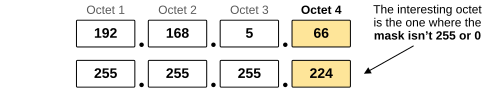
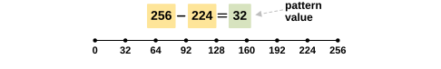
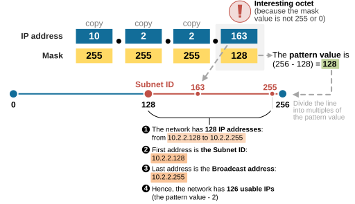
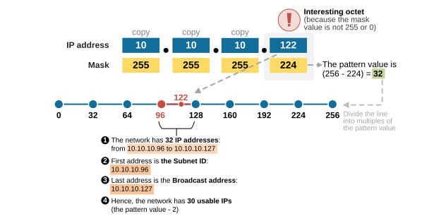
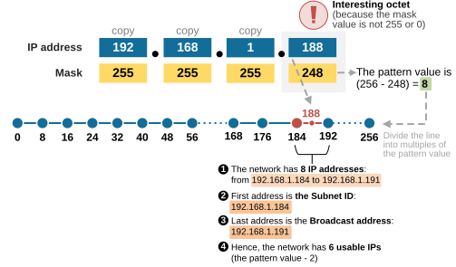
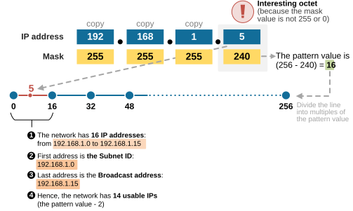
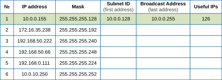

# Find the Subnet ID (Class C)

<!-- nav -->
⬅ [Subnetting without Binary](13-subnetting-without-binary.md) · [Course index](00_Index.md) · [Find the Subnet ID (Class B)](15-find-subnet-id-class-b.md) ➡
<!-- nav -->

*IP Subnetting · Lesson · Source: https://www.networkacademy.io/ccna/ip-subnetting/find-subnet-id-class-c*

In this lesson, we will learn how to find the subnet ID, the broadcast address, and the number of usable addresses given an IP address and subnet mask without using any binary math.

## The toolset

First, let's introduce two terms we'll use throughout the lesson. For context, recall that an IP address is made of four octets. Each octet holds eight bits. A subnet mask follows the exact same structure.

In decimal, this means that an IP address is made of four decimal values between 0 and 255.

### Interesting Octet

The ****interesting octet**** is the only octet in the subnet mask that is not 255 or 0, as shown in the diagram below.



*Figure 1. What is the interesting octet?*

To understand the concept even further, let's walk through several examples:

- In 255.255.224.0, the third octet is the interesting one.
- In 255.255.255.192, the fourth octet is the interesting one.
- In 255.192.0.0, the second octet is the interesting one.

### Pattern Value

The ****pattern value**** comes from the formula 256 minus the value of the interesting octet, as shown in the diagram below.



*Figure 2. What is the pattern value?*

Once we calculate the pattern value, we divide the numbers between 0 and 256 into multiples of the pattern value, as shown in the diagram above.

For example, with mask 255.255.224.0, the pattern value is 256 − 224 = 32. With 255.255.255.240, the pattern value is 256 − 240 = 16.

## The rules

With these two terms in mind, the process of finding the subnet ID involves applying the following three rules to the IP address and mask.

- **Rule 1.** If the mask octet is 255, we copy the IP's octet decimal value.
- **Rule 2.**If the mask octet is 0, we change the IP's octet decimal value to 0.
- **Rule 3.** If the mask octet is neither 255 nor 0:
  - **Step 3a.**Calculate the pattern value as (256 – the interesting octet's decimal value).
  - **Step 3b.** Set the Subnet ID’s value to the multiple of the pattern value closest to the IP address without going over.

The process might seem confusing at first, but it is actually very easy and efficient. Let's walk through several examples and examine each step in finding the subnet ID (and, subsequently, the broadcast address).

## Finding the Subnet ID

### Example 1: Find the Subnet ID of 10.2.2.163/25

In this example, we want to find the subnet ID, the broadcast address, and the number of usable hosts for the IP address 10.2.2.163 with a mask of 255.255.255.128.

- First, we locate **the interesting octet**. This is the octet that is not 0 or 255. Here, it is **the fourth octet** because the mask's decimal value is 128.
- Next, we find **the pattern value**. We use the formula **256 – subnet mask value**. This gives us 256 – 128 = 128, so the pattern value is 128.

Next, we divide a line from 0 to 256 into multiples of the pattern value (128). Then we find where the IP's fourth octet value is located on the line, as shown in the diagram below.



*Figure 3. Find the Subnet ID of 10.2.2.163/25.*

Now we can find the subnet ID. It is the multiple on the line which is closest to the IP's fourth octet value (163) without going over it. In this case, the closest pattern value without going over is 128, as illustrated in the diagram above. Therefore, the subnet ID is:

```text
Subnet ID: 10.2.2.128 / 255.255.255.128
CIDR representation: 10.2.2.128/25
```

Additionally, we can find the broadcast IP - the last number on the line before going over the next pattern value. In this case, it is:

```text
Broadcast IP: 10.2.2.255
```

We can also find the number of usable IP addresses in the subnet using the formula:

```text
Usable IPs in the subnet = the pattern value - 2 
128 - 2 = 126
```

In the end, we found the subnet ID, the broadcast address, and the number of usable IP addresses, **without using any binary math**!

### Example 2

Let's see another example. Let's find the subnet ID, the broadcast address, and the number of usable hosts for the IP address 10.10.10.122 with a mask of 255.255.255.224.

- First, we locate **the interesting octet**. This is the octet that is not 0 or 255. Here, it is **the fourth octet** because the mask's decimal value is 224.
- Next, we find **the pattern value**. We use the formula **256 – subnet mask value**. This gives us 256 – 224 = 32, so the pattern value is 32.

Next, we divide a line from 0 to 256 into multiples of the pattern value (32). Then we find where the IP's fourth octet value is located on the line, as shown in the diagram below.



*Figure 4. Finding the Subnet ID, example 2.*

Now we can easily see that the subnet ID is the pattern value of the line closest to the IP's fourth octet (122), without going over it. In this case, the closest pattern value without going over is 96, as illustrated in the diagram above. Therefore, the subnet ID is:

```text
Subnet ID: 10.10.10.92 / 255.255.255.224
CIDR representation: 10.10.10.96/27
```

Additionally, we can find the broadcast IP - the last number on the line before going over the next pattern value. In this case, it is:

```text
Broadcast IP: 10.10.10.127
```

We can also find the number of usable IP addresses in the subnet using the formula:

```text
Usable IPs in the subnet = the pattern value - 2 
32 - 2 = 30
```

Again, we didn't use any binary math.

### Example 3

In this example, we want to find the subnet ID, the broadcast address, and the number of usable hosts for the IP address 192.168.1.188 with a mask of 255.255.255.248.

- First, we locate **the interesting octet**. This is the octet that is not 0 or 255. Here, it is **the fourth octet** because the mask's decimal value is 128.
- Next, we find **the pattern value**. We use the formula **256 – subnet mask value**. This gives us 256 – 248 = 8, so the pattern value is 8.

Next, we divide a line from 0 to 256 into multiples of the pattern value (8). Then we find where the IP's fourth octet value is located on the line, as shown in the diagram below.



*Figure 5. Find the Subnet ID of 192.168.1.188/29.*

Now we can easily see that the subnet ID is the pattern value of the line closest to the IP's fourth octet (188), without going over it. In this case, the closest pattern value without going over is 184, as illustrated in the diagram above. Therefore, the subnet ID is:

```text
Subnet ID: 192.168.1.184 / 255.255.255.248
CIDR representation: 192.168.1.184/29
```

Additionally, we can find the broadcast IP - the last number on the line before going over the next pattern value. In this case, it is:

```text
Broadcast IP: 192.168.1.191
```

We can also find the number of usable IP addresses in the subnet using the formula:

```text
Usable IPs in the subnet = the pattern value - 2 
8 - 2 = 6
```

Again, we didn't use any binary math.

### Example 4

In this example, we will summarize everything into a single diagram. You should have a pretty good idea how this process works.



*Figure 6. Find the Subnet ID of 192.168.1.5/28.*

## Try it yourself

At this point, you have seen how to calculate the subnet ID, broadcast address, and the number of usable IP addresses without using any binary math. Now it is important to try and test it yourself. Otherwise, you will quickly forget it.

Try to solve the following five examples, shown in the table below, using the method we have shown.



*Table 1. Find the subnet ID, examples table.*

There are many tools available on the Internet that can help you verify your solutions. However, if you think something is not right and want to give us feedback, please leave a comment below.

---

<!-- nav -->
⬅ [Subnetting without Binary](13-subnetting-without-binary.md) · [Course index](00_Index.md) · [Find the Subnet ID (Class B)](15-find-subnet-id-class-b.md) ➡
<!-- nav -->
