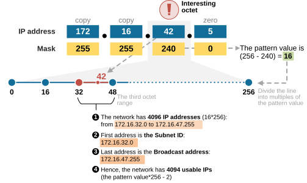
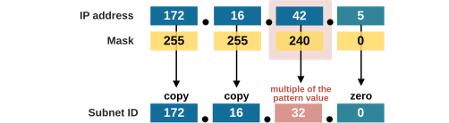
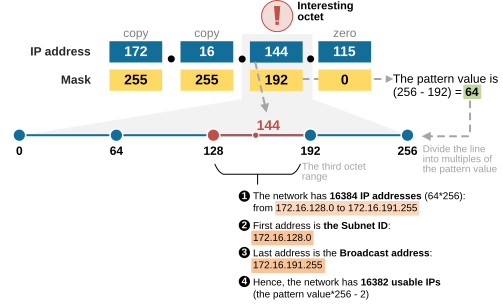
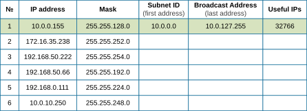

# Find the Subnet ID (Class B)

<!-- nav -->
⬅ [Find the Subnet ID (Class C)](14-find-subnet-id-class-c.md) · [Course index](00_Index.md) · [VLSM without Binary Example 1](16-vlsm-without-binary-example1.md) ➡
<!-- nav -->

*IP Subnetting · Lesson · Source: https://www.networkacademy.io/ccna/ip-subnetting/find-subnet-id-class-b*

We are continuing our examples, doing subnetting without using any binary math. In this lesson, we are going to calculate the subnet ID, broadcast address, and the number of usable addresses given an IP address.

## The toolset

If you are following the lessons in order, you will know that we use two terms for our calculations:

- **The interesting octet** - the IP address's octet where the subnet mask is not 0 or 255.
- **The pattern value** - the result of 256 minus the mask's interesting octet's decimal value.

## The rules

Once you know **the interesting octet** and **the pattern value**, you can apply three simple rules to build the subnet ID from the IP address.

- **Rule 1:** If the mask octet is 255, keep the IP address’s value exactly as it is.
- **Rule 2:** If the mask octet is 0, change that value to 0.
- **Rule 3:** If the mask octet is something in between, you calculate and apply the pattern value.
  - First, find the pattern value with 256 minus the mask’s value.
  - Then choose the multiple of that pattern value that is closest to the IP’s value without going over. That number becomes the subnet ID’s value for that octet.

At first, this may look complex, but it becomes fast and simple with a bit of practice. In the next examples, you will see each step in action as we find the subnet ID and then the broadcast address that follows from it.

## Find the Subnet ID example

### Example 1: Find the Subnet ID of 172.16.42.5/20

The first example we will see is finding the subnet ID for the IP address 172.16.42.5 with a mask of 255.255.240.0. Notice that in this case, the interesting octet is the third one. Then we can find the pattern value using the formula, as shown below.

```text
256 - 240 = 16
```

This means each subnet spans 16 values in the third octet. If we imagine a line from 0 to 256, we mark the multiples of 16, as shown below.

```text
0, 16, 32, 48, 64, 80, 96, 112, 128, 144, 160, 176, 192, 208, 224, 240, 256
```

Now we check where 42 (the third octet of our IP) fits on that line. 42 sits between 32 and 48. The closest lower multiple is 32, so that is the subnet ID value for the third octet, as shown in the diagram below.



*Figure 1. Find the Subnet ID of 172.16.42.5/20.*

Next, we need to see where the IP address's decimal value in the third octet lies on that line (in red). The closest lowest pattern value multiple is the subnet ID. In this example, this is 32. Now we apply the rules.

- If the mask octet is 255, we copy the IP's octet decimal value. These apply to octets 1 and 2, where the mask is 255.
- If the mask octet is 0, we change the IP's octet decimal value to 0. This applies to octet 4, where the 0.



*Figure 2. Applying the rules.*

This gives us the following subnet ID: 172.16.32.0 255.255.240.0, as shown in the diagram above.

From the line with pattern values, we can clearly see that the network begins at 172.16.32.0 and ends at 172.16.47.254 because the next network starts at 172.16.48.0.

This gives us 16 values in the third octet (from 32 to 47). Each value represents 256 addresses because the fourth octet runs from 0 to 255. So 16 × 256 = 4096 total addresses. When you spread 4096 addresses starting at 172.16.32.0 (the subnet ID), the last one becomes 172.16.47.255 (the broadcast IP).

### Example 2: Find the Subnet ID of 172.16.144.115/18

Let’s walk through the same idea for the IP address 172.16.144.115/18. A /18 mask is 255.255.192.0. The interesting octet is again the third one, because that is where the mask is not 255 or 0. To find the pattern value, we use:

```text
256 − 192 = 64
```

This means each subnet spans 64 values in the third octet. If we imagine a line from 0 to 256, we mark the multiples of 64:

```text
0, 64, 128, 192, 256
```

Now we check where 144 (the third octet of our IP) fits on that line. 144 sits between 128 and 192. The closest lower multiple is 128, so that is the subnet ID value for the third octet, as shown in the diagram below.



*Figure 3. Find the Subnet ID of 172.16.144.115/18.*

Next, we apply the mask rules.

- The first two octets stay the same because the mask has 255 there.
- The third octet becomes 128 because that is the block start.
- The fourth octet becomes 0 because the mask is 0 there.


*Figure 4. Applying the rules for example 2.*

So the subnet ID is:

```text
172.16.128.0/18
```

From the pattern line, we can clearly see that the next subnet begins at 172.16.192.0. This means the current subnet must end at 172.16.191.255.

Therefore, the block contains 64 values in the third octet (128 through 191). Each value covers 256 addresses. 
So 64 × 256 = 16384 total addresses.

Spread across the subnet, these run from 172.16.128.0 (subnet ID) to 172.16.191.255 (broadcast address).

## Try it yourself

Now you know how to find the subnet ID, the broadcast address, and the number of usable IP addresses without touching binary math. The best way to keep this skill sharp is to practice it right away. If you skip the practice, you will forget the steps very fast.

Try solving the five examples in the table below using the same method you learned.



*Table 1. Class B examples for practicing.*

You can check your answers with any subnet calculator online. If something looks wrong or you want to share feedback, feel free to leave a comment.

---

<!-- nav -->
⬅ [Find the Subnet ID (Class C)](14-find-subnet-id-class-c.md) · [Course index](00_Index.md) · [VLSM without Binary Example 1](16-vlsm-without-binary-example1.md) ➡
<!-- nav -->
