# VLSM without Binary Example 1

<!-- nav -->
⬅ [Find the Subnet ID (Class B)](15-find-subnet-id-class-b.md) · [Course index](00_Index.md)
<!-- nav -->

*IP Subnetting · Lesson · Source: https://www.networkacademy.io/ccna/ip-subnetting/vlsm-without-binary-example1*

In this lesson, we are continuing with the IP subnetting examples without using any binary math. We will make a VLSM subnetting of a given network to satisfy addressing requirements.

## Why do we need subnetting?

Many students who study subnetting don't really get the bigger picture of why we need to use subnetting in the first place. That's why I want to begin with a few words on IP subnetting in general, which will provide context for the lesson.

Why do organizations need to use subnetting?

First thing to understand is that **IP address space is a valuable resource**. IPv4, in particular, is a scarce resource, as shown in the diagram below. Public IPv4 addresses are finite numbers and are expensive, even impossible to buy in some parts of the world. As with any valuable resource, organizations want to manage it as efficiently as possible.

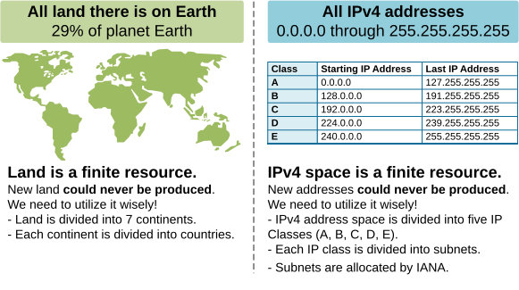

*Figure 1. IPv4 address space as valuable resource.*

In that context, when organizations want to address their network environment, they divide the IP address block they own into smaller networks as efficiently as possible. Let's see a real example to understand how.

## What are FLSM and VLSM?

There are two different approaches to dividing a block of IP addresses into smaller networks: FLSM and VLSM.

- ****FLSM**** means Fixed Length Subnet Mask. In this method, you divide a large IP block into subnets that have the same size and the same subnet mask. It is simple to plan, but it often wastes many IP addresses because small networks still get a large block.
- ****VLSM****means Variable Length Subnet Mask. In this method, you divide a large IP block into subnets of different sizes and subnet masks. You choose a mask based on how many hosts each subnet needs. This saves IP space and makes the design more flexible.

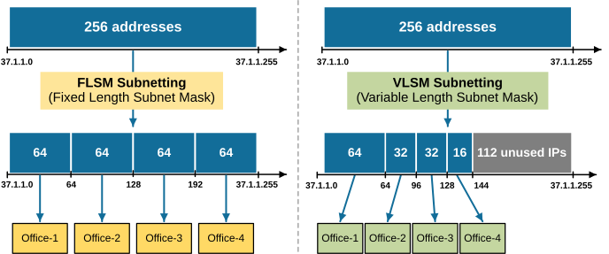

*Figure 2. FLSM vs. VLSM.*

FLSM is easier for beginners and was common in the old days when IPv4 addresses were abundant. VLSM allows more efficient use of IPv4 space. It also makes network design cleaner and more flexible. It is widely used in modern networks and requires routing protocols that support subnet information, like OSPF or EIGRP.

**KEY NOTE:** FLSM values simplicity. VLSM values efficiency.

Now, let's see a couple of examples of how an organization can use VLSM to divide its IP block into smaller, efficient subnets.

## VLSM Example

Suppose a company owns the IPv4 block 37.1.1.0/24. This means it owns 256 IPv4 addresses, as shown in the diagram. All addresses on either side of the company's block are owned by other organizations.

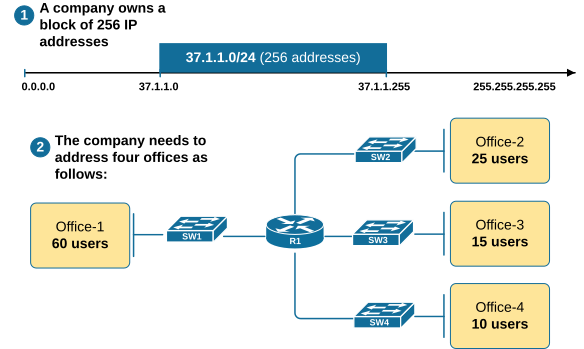

*Figure 3. Example Requirements.*

As you can see, the company has four offices, and each one has a different number of users. We are tasked with dividing the 37.1.1.0/24 block so that each office gets its own network. We also need to ensure the company uses its IP space efficiently, as IPv4 addresses should not be wasted.

In simple words, we need to divide the 37.1.1.0/24 address block into four networks based on the number of users on each site.

The first important thing to remember is that when doing VLSM and choosing the right subnet mask and finding the subnet ID, ****we always start with the location that has the most users****. In this example, this is Office 1. It needs the largest subnet, so we size it first.

### Addressing Office 1

Office 1 has 60 users. Hence, it requires 60 usable IPv4 addresses. We look for **the smallest power of 2 that can hold all the hosts**. Then we subtract 2, because every subnet needs one address for the Subnet ID and one for the Broadcast address. For example, if an office needs 60 users, we test powers of 2 minus two addresses, as follows:

```text
24 = 16 → 16 − 2 = 14, not enough.
```

```text
25 = 32 → 32 − 2 = 30, still not enough.
```

```text
26 = 64 → 64 − 2 = 62, this works.
```

So we pick the subnet size based on 26, which gives us 64 addresses, of which 62 are usable. This satisfies the requirement for 60 users.

Once we know the size, we can set the subnet mask and calculate the subnet ID.

#### Find Office1's Subnet ID and Mask

We found that 64 is the lowest pattern value that satisfies Office 1's requirements. Now, if we divide a line from 0 to 256 into multiples of the pattern value, we can calculate the following:

- The closest low pattern value number is 0 (in red).
- Having the pattern value, we can reverse engineer the subnet mask's fourth octet's decimal value using the formula 256-x=64.

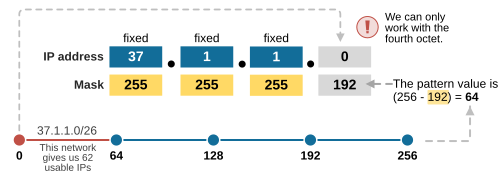

*Figure 4. Finding the right subnet for Office 1.*

Therefore, we found out that the subnet 37.1.1.0/255.255.255.192 has 62 usable IPv4 addresses and satisfies Office 1's requirements, as shown in the diagram below.

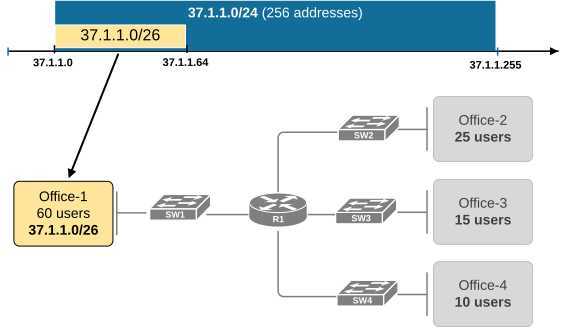

*Figure 5. Addressing Office 1.*

After that, we move to the next largest office and repeat the same steps.

### Addressing Office 2

At this point, it is important to keep in mind that part of the company's IPv4 address block is already taken, as shown in the diagram below. We already allocated the first 64 addresses to Office 1. Therefore, we cannot use that block for other locations.


*Figure 6. Addresses left in the original subnet.*

Therefore, we can work with the addresses that are still unused and cannot touch the ones already allocated.

#### Find Office 2's Subnet ID and Mask

Office 2 has **25 users**. Hence, it requires 25 usable IPv4 addresses. We look for the smallest power of 2 that can hold that number of hosts. Then we subtract 2 for the Subnet ID and the Broadcast address. We test powers of 2 minus two addresses, as follows:

```text
23 = 8 → 8 − 2 = 6, not enough.
```

```text
24 = 16 → 16 − 2 = 14, still not enough.
```

```text
25 = 32 → 32 − 2 = 30, this works.
```

So we pick the subnet size based on 25, which gives us 30 usable addresses. Once we know the size, we can set the subnet mask and calculate the subnet ID, as shown in the diagram below.

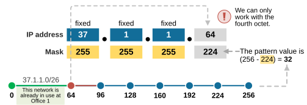

*Figure 7. Finding the Subnet ID for Office 2.*

We divide a line from 64 to 256 into multiples of the pattern value 32. Notice that we don't start from 0 but from 64 (in red) because the first 64 addresses (in green) have already been allocated to Office 1.

Then we reverse engineer the subnet mask's fourth octet value using the formula 256-x=32, which gives us x=224. Hence, the network 37.1.1.0/255.255.255.224 gives us 32 addresses, which we allocated to Office 2, as shown in the diagram below.

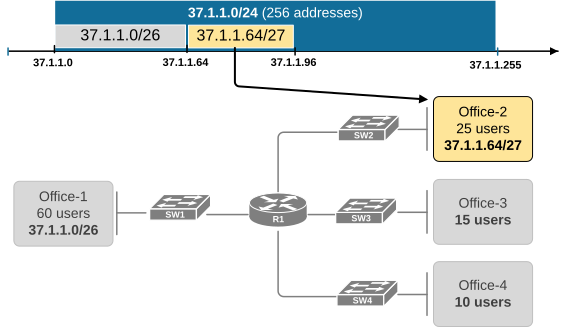

*Figure 8. Addressing Office 2.*

Next, we move to the next largest office and repeat the same process.

### Addressing Office 3

Office 3 requires 15 usable IP addresses. Let's again test which power of 2 minus two satisfies this requirement.

```text
23 = 8 → 8 − 2 = 6, not enough.
```

```text
24 = 16 → 16 − 2 = 14, still not enough. (we need 15!)
```

```text
25 = 32 → 32 − 2 = 30, this works.
```

So we again pick the subnet size based on 25, which gives us 30 usable addresses. Once we know the size, we can set the subnet mask and calculate the subnet ID, as shown in the diagram below.

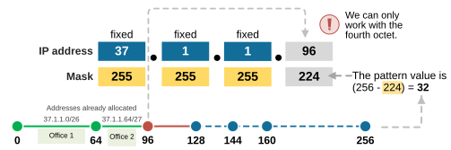

*Figure 9. Finding the Subnet ID for Office 3.*

Notice that we start from 96 because the first 96 addresses (in green) have already been allocated to Offices 1 and 2.

In the end, we allocated subnet 37.1.1.96/255.255.255.224 to Office 3 as shown in the diagram below.

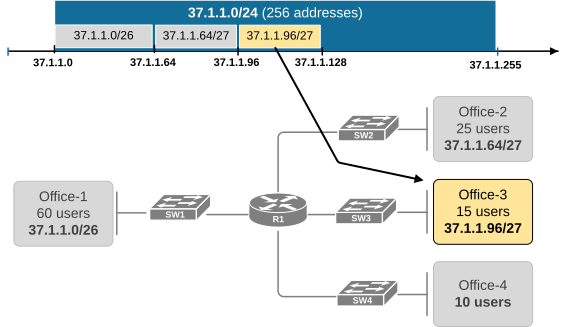

*Figure 10. Finding the Subnet ID for Office 3.*

Lastly, let's address Office 4.

### Addressing Office 4

Office 4 requires 10 host IPv4 addresses. First, let's quickly think which power of 2 minus two gives us more than 10 addresses. It is easy to calculate that it is 24, which is 16-2=14. Therefore, the pattern value is 16.

Next, we can divide a line from 128 (in red) to 256 into multiples of the pattern value and take the lowest one as the subnet ID, as shown in the diagram below.

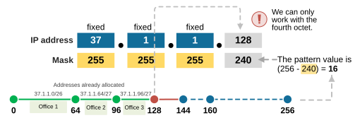

*Figure 11. Finding the Subnet ID for Office 4.*

Again, notice that we don't start from 0 because the addresses from 0 through 128 (in green) have already been allocated. This gives us the network 37.1.1.128/255.255.255.240 as a subnet for Office 4, as shown in the diagram below.

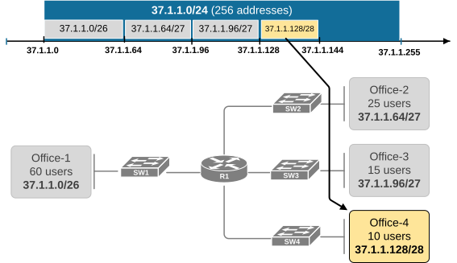

*Figure 12. Finding the Subnet ID for Office 4.*

Now, all four offices have IPv4 subnets of optimal size from an address-allocation perspective. Notice that the IPv4 addresses from 37.1.1.144 through 37.1.1.255 are left unused and can be allocated to other locations in the future.

## Key Takeaways

This example showed how to make a Variable Length Subnet Mask (VLSM) without using binary math.

- **Subnetting**is needed to conserve IPv4 space and organize networks.
- **FLSM**uses equal-size subnets but can waste addresses.
- **VLSM**uses different mask lengths to match host needs and save space.
- Always start VLSM planning with **the subnet that needs the most hosts**.
- Use powers of 2 to size each subnet. Subnet size = 2ⁿ, **usable hosts = 2ⁿ − 2**.
- After allocating a subnet, remove it from the pool before sizing the next one.
- 37.1.1.0/24 was split into subnets sized for 60, 25, 15, and 10 hosts.
- Each subnet mask is found from a **256 − pattern value**.
- Proper VLSM design avoids waste and leaves room for growth.

---

<!-- nav -->
⬅ [Find the Subnet ID (Class B)](15-find-subnet-id-class-b.md) · [Course index](00_Index.md)
<!-- nav -->
