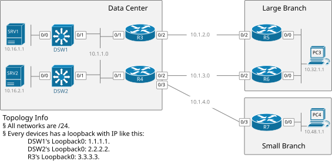
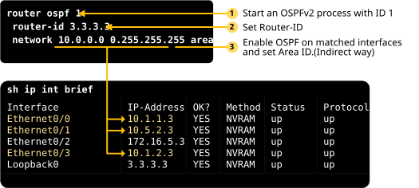
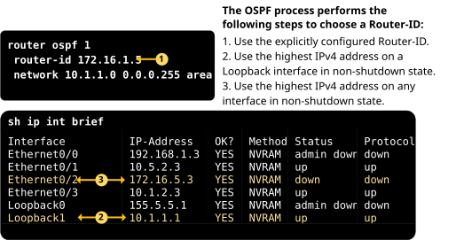
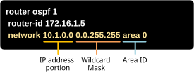
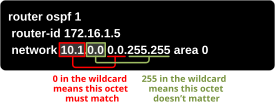
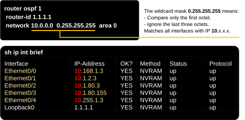
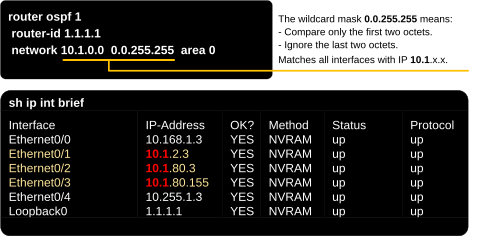
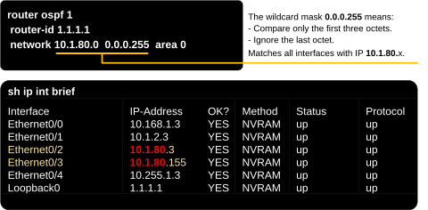
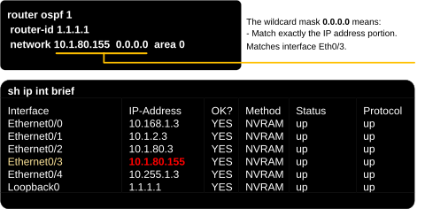
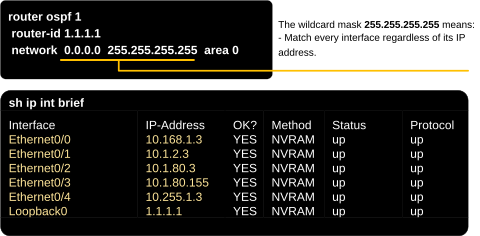

# Lab #1. Configuring Single-Area OSPF network

<!-- nav -->
⬅ [OSPF DR and BDR](06-dr-and-bdr.md) · [Course index](00_Index.md) · [Test #1 - OSPF Fundamentals](08-test-ospf-fundamentals.md) ➡
<!-- nav -->

*OSPF Fundamentals · Lesson · Source: https://www.networkacademy.io/ccna/ospf/configuring-single-area-ospf*

After introducing the most fundamental aspects of OSPF in the previous lesson, we now start with our practical examples. This lesson demonstrates how to configure a basic single-area OSPFv2 network from scratch, walking through the most important parts of the configuration process.

At the end of the lesson, you will find the Download section, where you can download the EVE-NG file we've used in this example and all the configs.

## Lab Initial State

We use the topology shown in the diagram below. Seven network devices are located at three locations: the data center, large, and small branches.



*Figure 1. Initial Topology*

All devices are configured with basic IP settings. All networks are /24 in length. Every device has a configured loopback address that replicates its hostname number. For example, DSW1 has a loopback with address 1.1.1.1, R4 has 4.4.4.4, R7 has 7.7.7.7 and so on. Everything else is by default.

## Lab Requirements

We are tasked to configure the network in such a way that it satisfies the following requirements:

- The topology must be fully reachable. All networks must be able to reach each other.
- We must use OSPFv2 with a process ID of 1.
- The entire network must be OSPFv2 Area 0.
- On R7, the OSPFv2 process ID must be 5.
- On R7, it is not allowed to use the network command under the OSPFv2 process.
- Every router must have an explicitly configured Router ID.
- On the shared segment 10.1.1.0/24, DSW1 must be the DR, while DSW2 must be the BDR.
- In the end, PC3 and PC4 must be able to ping both servers - SRV1 and SRV2.

## Configuration Workflow

Although designing an OSPF network can be a complex task that requires extensive knowledge and experience, configuring a basic single-area OSPFv2 network can be as easy as entering three commands on each router.

The following diagram outlines the steps required to enable the OSPFv2 process on a router.



*Figure 2. Configuration Workflow*

- **Step 1.** Enable the OSPFv2 process on the device.
- **Step 2.** Configure a Router ID.
- **Step 3.**Enable the routing on selected interfaces.

From a configuration point of view, this is pretty much enough to make the routing process work and achieve full IP reachability across the topology. Let's go through each step in more detail.

### Step 1. Enabling the OSPF process.

The first step is to enable the OSPFv2 process on the router by defining a process ID. The process ID is a locally significant number between 1 and 65535 (216-1), as shown below.

```text
DSW1(config)# router ospf ?
 <1-65535>  Process ID
```

The OSPFv2 process ID is only locally significant to the router. **Different routers in the same OSPF network can use different process IDs** without affecting their routing protocol operations. However, it is a best practice to use the same process ID across the entire network.

The process ID allows multiple instances of OSPF to run on the same device. Each OSPF instance can be configured independently with its own set of parameters, areas, and interfaces.

In our example, we must configure process ID 1 on all devices except R7, where we must configure process ID 5. Let's do it.

```text
! We configrue this on DSW1, DSW2, R3, R4, R5, R6.
DSW1(config)# router ospf 1
DSW1(config-router)#
```

```text
! We configrue this on R7.
R7(config)# router ospf 5
R7(config-router)#
```

Now, we can go to the next step.

### Step 2. Specify Router ID (RID)

Once the OSPF process is enabled, the first thing it tries to do is to assign a Router ID (RID). Without a RID, the OSPF process cannot operate.

OSPF uses the following three steps to choose a RID:

- **Step 1.** First, the router tries to use **the explicitly configured RID** via the router-id command under the OSPF process.
- **Step 2**. If the RID isn't defined explicitly, the router tries to use **the highest IPv4 address assigned on a non-shutdown Loopback** interface.
- **Step 3**. If the router cannot assign an RID at step 2, it tries to use **the highest IPv4 address on any non-shutdown interface**.

Let's walk through the example shown in the diagram below.



*Figure 3. Steps when choosing an OSPF RID*

- Since a router-id is configured explicitly under the OSPF process, the router chooses the RID 172.16.1.5.
- If router-id hadn't been configured, the router would have chosen RID 10.1.1.1 because this is the highest IPv4 address on a Loopback interface **that is not shut down**.
  - Notice that Loopback0 has a higher address but is in an administrative shutdown state.
- If the router hadn't had loopback addresses, it would have chosen RID 172.16.5.3 because it is the highest IPv4 address on a non-loopback interface that is not shut down. Notice a few important aspects here:
  - Eth0/0 has a higher address than Eth0/2 but is shut down.
  - Eth0/2 is in a down/down state, but its address is still used as RID since it is not shut down.

You can see that the steps of choosing the RID are fairly simple. However, notice some additional aspects of the process:

- **The RID looks like an IPv4 address but it is not!**It is simply a 32-bit identifier.**The RID doesn't need to be advertised** by the device nor reachable by remote devices.
- When the OSPF restarts, **it goes through the steps again** and can choose different RIDs if interfaces have changed.
- If a router's RID changes, **all devices in the area must run the SPF** because, from the remote router's perspective, a new RID looks like a new device.
- However, if the RID is explicitly set using the router-id command, **the RID never changes**. That's why it is the recommended approach.

Going back to our example, we explicitly configure the RID on all devices as follows:

```text
DSW1(config)# router ospf 1
DSW1(config-router)# router-id 1.1.1.1
---------------------------------------------
DSW2(config)# router ospf 1
DSW2(config-router)# router-id 2.2.2.2
---------------------------------------------
R3(config)# router ospf 1
R3(config-router)# router-id 3.3.3.3
---------------------------------------------
R4(config)# router ospf 1
R4(config-router)# router-id 4.4.4.4
---------------------------------------------
R5(config)# router ospf 1
R5(config-router)# router-id 5.5.5.5
---------------------------------------------
R6(config)# router ospf 1
R6(config-router)# router-id 6.6.6.6
---------------------------------------------
R7(config)# router ospf 5
R7(config-router)# router-id 7.7.7.7
```

### Step 3. Enable OSPF on selected interfaces

The third step in enabling the OSPFv2 operation on a router is to select the interfaces that will participate in the routing process. But how do we select which interfaces to be OSPF-enabled? There are two ways to enable an interface: directly and indirectly, which is more scalable.

#### The Network Command (Indirectly selecting interfaces)

Using the network command under the OSPF process indirectly enables the routing process on multiple interfaces. Understanding the network command is key to understanding the OSPFv2 routing.

The network command **determines which interfaces will participate in the routing process**. It has the following syntaxis:



*Figure 4. The network command syntaxis*

- **The IP address portion**: This is the IP address of the network you want to include in the routing process. It usually represents a subnet or an interface's IP address.
- **The Wildcard Mask**: This mask specifies which bits of the IP address are relevant. It is the inverse of the subnet mask. For example, a subnet mask of 255.255.255.0 (or /24) would correspond to a wildcard mask of 0.0.0.255.
- **The Area ID**: This specifies the Area in which the matched interfaces should reside.

The network command is all about the wildcard mask. Let's zoom into it a bit more.

#### Understanding the Wildcard Mask

In short, the wildcard mask is the inverse of the subnet mask. The OSPFv2 process uses it to determine which bits/octets of the IP address portion to examine for a match.



*Figure 5. The Wildcard Mask*

For example, a 0 in the first octet in the wildcard mask means that the first octet in the IP address must match, while a 255 in the wildcard mask means it doesn't matter.

#### Examples

Let's walk through several examples of matching interfaces with different network commands and wildcard masks.

**Example 1:**We have the command **network 10.0.0.0 0.255.255.255 area 0**. It matches all interfaces with IP addresses starting with 10.x.x.x, as shown below.



*Figure 6. The network command - Example 1*

**Example 2:**We have the command **network 10.1.0.0 0.0.255.255 area 0**. It matches all interfaces with IP addresses starting with 10.1.x.x, as shown below.



*Figure 7. The network command - Example 2*

**Example 3:**We have the command **network 10.1.80.0 0.0.0.255 area 0**. It matches all interfaces with IP addresses starting with 10.1.80.x, as shown below.



*Figure 8. The network command - Example 3*

**Example 4:**We have the command **network 10.1.80.155 0.0.0.0 area 0**. It matches exactly the interface with IP address 10.1.80.155, as shown below.



*Figure 9. The network command - Example 5*

It is very common in production environments to match every interface with an exact match using the wildcat mask 0.0.0.0. This provides the ultimate control over which interfaces are OSPF-enabled. For example, with the interfaces shown in the examples above, to enable the OSPFv2 process on all interfaces, the network commands will look like this:

```text
router ospf 1
 router-id 1.1.1.1
 network 10.168.1.3 0.0.0.0 area 0
 network 10.1.2.3 0.0.0.0 area 0
 network 10.1.80.3 0.0.0.0 area 0
 network 10.1.80.155 0.0.0.0 area 0
 network 10.255.1.3 0.0.0.0 area 0
 network 1.1.1.1 0.0.0.0 area 0
```

Every network command enables one particular interface. We have many network commands as interfaces on the device.

**Example 5:**We have the command **network 0.0.0.0 255.255.255.255 area 0**. It matches all interfaces regardless of IP address because every IP matches that wildcard mask, as shown below.



*Figure 10. The network command - Example 5*

The wildcard mask can be used to match more complex IP address patterns. For example, you can only match odd or even IP addresses, parts of subnet ranges, and so on. However, **this is typically never necessary in the network command** under the OSPFv2 process. Complex wildcards are generally used in Access Control Lists (ACLs).

In summary, the router uses the network command and the wildcard mask **as a tool for matching its own interfaces at scale**. The following table summarizes the most used wildcard masks in OSPF.

| **IP address** | **Wildcard Mask** | **What it does** |
|---|---|---|
| a.b.c.d | 0.0.0.0 | Compare all four octets in the IP address portion. Match exactly the IP address**a.b.c.d.** |
| a.b.c.d | 0.0.0.255 | Compare only the first three octets **a.b.c**.; Ignore the last octet **d.** |
| a.b.c.d | 0.0.255.255 | Compare only the first two octets **a.b.**; Ignore the last two octets **c.d.** |
| a.b.c.d | 0.255.255.255 | Compare only the first octet **a.**; Ignore the last three octets **b.c.d.** |
| a.b.c.d | 255.255.255.255 | Match every address. |

#### The Interface Command (Direct selecting interfaces)

There is another way to enable the OSPF process on an interface. You can directly configure the **ip ospf [process-id] area [area-id]** command under the interfaces on which the routing process must be enabled. For example, we have a router with five physical interfaces, as shown in the example in the figures above. We can enable the OSPFv2 process directly under each interface without using the network command.

```text
router ospf 1
 router-id 1.1.1.1
 !
interface Ethernet0/0
 ip ospf 1 area 0
 !
interface Ethernet0/1
 ip ospf 1 area 0
 !
...
```

For the scope of the CCNA, there is no difference between the network command and the interface command to enable the routing process on an interface.

Once the OSPFv2 process is enabled on all interfaces that must participate, the device starts sending Hello packets, forming neighborships, and exchanging the link-state database.

Returning to our example, let's configure all devices except R7 with the network command. Since all links in our example topology have an IP address that starts with 10.x.x.x, we will use the following network command to enable the routing process on all interfaces.

```text
! We configrue this on DSW1, DSW2, R3, R4, R5, R6.
! Notice that the loopback IP is different on the different devices.
DSW1(config)# router ospf 1
DSW1(config-router)# network 10.0.0.0 0.255.255.255 area 0
DSW1(config-router)# network 1.1.1.1 0.0.0.0 area 0
```

As per our requirements, on R7, we must not use the network command, so we will enable the routing process on R7's Eth0/3 directly under the interface, as shown in the output below. Notice that the OSPFv2 process ID is 5 (and not 1 like on the other devices)

```text
! We configrue this on R7.
R7(config)# interface Ethernet0/0
R7(config-if)# ip ospf 5 area 0
!
R7(config)# interface Ethernet0/3
R7(config-if)# ip ospf 5 area 0
!
R7(config)# interface Loopback0
R7(config-if)# ip ospf 5 area 0
!
```

Now, let's jump into the verification section and see how we verify that the routing protocol is configured and working correctly.

---

<!-- nav -->
⬅ [OSPF DR and BDR](06-dr-and-bdr.md) · [Course index](00_Index.md) · [Test #1 - OSPF Fundamentals](08-test-ospf-fundamentals.md) ➡
<!-- nav -->
