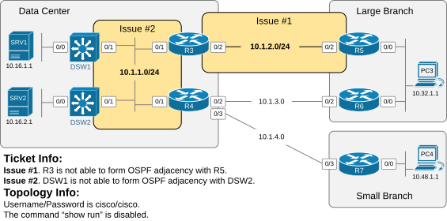
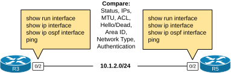

# Troubleshooting Ticket #1

<!-- nav -->
⬅ [Neighbor Adjacencies](16-troubleshooting-ospf-adjacencies.md) · [Course index](00_Index.md) · [Troubleshooting Ticket #2](18-troubleshooting-ticket-2.md) ➡
<!-- nav -->

*OSPF Fundamentals · Lesson · Source: https://www.networkacademy.io/ccna/ospf/troubleshooting-ticket-1*

In this series of troubleshooting tickets, we will find and fix problems with the OSPF adjacency between routers.

At the end of the lesson, you can download the EVE-NG file and try to troubleshoot the ticket yourself. Then, you can review the lesson and see if you used the same approach.

## Ticket Topology

For this ticket, we are going to use the following initial topology.

*Figure 1. Ticket Initial Topology.*

All devices run OSPF in Area 0 and must establish adjacency with their neighboring routers.

## Ticket Issues

Suppose you are a network engineer supporting a big enterprise company. You have received a ticket with the following two reported issues:

- ****Issue #1****- R3 cannot form OSPF adjacency with R5.
- ****Issue #2****- DSW1 cannot form OSPF adjacency with DSW2.

You are given the "cisco/cisco" credentials. However, they do not have the highest privilege level, so you cannot use the **show run** command. Therefore, you must resolve the issues without looking at the routers' configurations.

## Troubleshooting OSPF Adjacency Issues

Okay, let's start with the troubleshooting process. What is the workflow for troubleshooting an OSPF adjacency problem?

Some educators unnecessarily overcomplicate the troubleshooting process, and students have the impression that it is something complex that you need to have "*talent*" to do. In reality, it is pretty simple and straghtforward. ****You****just execute a few show commands on both sides and compare them****, as shown in the diagram below.That's it.

*Figure 2. Neighbor Adjacency Troubleshooting Workflow*

The process is simply to compare the physical and OSPF settings of two connected interfaces. You execute **show ip ospf interface** on both sides, compare the output, and find what is mismatched. 99% of the time, that's what troubleshooting OSPF adjacency problems look like. You just need to know what to look for.

I always break down the troubleshooting workflow into two main steps.

- First, I ensure that general interface settings like port status, ACL, or MTU are working correctly.
- Then, I verify the OSPF-specific settings of the interfaces on both sides.

### Step 1 - Interface Settings

Remember that the OSPF neighborship works per interface. So, I always start by verifying the general IP settings of the interface connecting to the neighbor we troubleshoot. The first things that I always check are:

**Table 1. IP connectivity requirements.**

| **Check** | **Best show command** | **Alternative** |
|---|---|---|
| Is the interface UP/UP? | show ip interface brief | show ip interface |
| Is there an incoming ACL on the interface? | show run | show ip interface |
| What is the MTU? | show run | show ip interface |
| Are the IPs in the same subnet? | show run | show ip interface |
| Is there IP connectivity between the two devices? | ping |  |

The easiest way to check all these facts in exam environments is to use the **show ip interface** command. It gives a long output containing all the information we need. However, in the real world, engineers typically use a combination of **show run** and **show ip interface brief** to crosscheck the same information.

In the end, I always throw some pings between the routers that must become neighbors. This ensures that there is IP connectivity, and the problem is most likely in the OSPF configuration rather than in the network segment between the devices.

### Step 2  -  OSPF Settings

The OSPF settings that prevent two routers from becoming neighbors are not that many. The following table summarizes the requirements that must be met.

**Table 2. OSPF configuration requirements.**

| **Check** | **Best show command** |
|---|---|
| Hello/Dead timers match? | show ip ospf interface |
| Area ID match? | show ip ospf interface |
| Are RIDs unique? | show ip ospf interface |
| Authentication pass? | show ip ospf interface |
| Passive-interface? | show ip ospf interface |
| OSPF Process is shutdown? | show ip ospf |

**It is also a good practice to check the device's syslog.** Routers generate syslog messages to report the most common OSPF misconfiguration. In exam environments, the logging may be intentionally disabled to make troubleshooting more difficult. However, in real-world networks, it is always good practice to check the syslog.

## Issue #1

With his troubleshooting workflow in hand, let's go ahead and start with our first issue.

---

<!-- nav -->
⬅ [Neighbor Adjacencies](16-troubleshooting-ospf-adjacencies.md) · [Course index](00_Index.md) · [Troubleshooting Ticket #2](18-troubleshooting-ticket-2.md) ➡
<!-- nav -->
