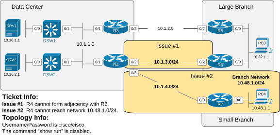

# Troubleshooting Ticket #2

<!-- nav -->
⬅ [Troubleshooting Ticket #1](17-troubleshooting-ticket-1.md) · [Course index](00_Index.md) · [Troubleshooting Ticket #3](19-troubleshooting-ticket-3.md) ➡
<!-- nav -->

*OSPF Fundamentals · Lesson · Source: https://www.networkacademy.io/ccna/ospf/troubleshooting-ticket-2*

In this series of troubleshooting tickets, we will find and fix problems with the OSPF adjacency between routers.

At the end of the lesson, you can download the EVE-NG file and try to troubleshoot the ticket yourself. Then, you can review the lesson and see if you used the same approach.

## Ticket Topology

For this ticket, we are going to use the following initial topology, highlighting the issues that we are going to troubleshoot.

*Figure 1. Ticket Initial Topology.*

All devices run OSPF in Area 0 and must establish adjacency with their neighboring routers.

## Ticket Issues

Suppose you are a network engineer supporting a big enterprise company. You have received a ticket with the following two reported issues, which are highlighted in the diagram above:

- ****Issue #1**** - R4 cannot form OSPF adjacency with R6.
- ****Issue #2****- R4 cannot reach network 10.48.1.0/24 at the small branch.

You are given the "cisco/cisco" credentials. However, you cannot use the show run command for company security reasons. Therefore, you must resolve the issues without looking at the routers' configurations.

## Troubleshooting Workflow

Let's troubleshoot both issues using the approach we used in the previous ticket.

### Issue #1

The issue is reported as "*R4 cannot form OSPF adjacency with R6*". First, let's verify that the routers are not neighbors indeed.

---

<!-- nav -->
⬅ [Troubleshooting Ticket #1](17-troubleshooting-ticket-1.md) · [Course index](00_Index.md) · [Troubleshooting Ticket #3](19-troubleshooting-ticket-3.md) ➡
<!-- nav -->
