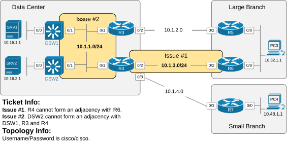

# Troubleshooting Ticket #3

<!-- nav -->
⬅ [Troubleshooting Ticket #2](18-troubleshooting-ticket-2.md) · [Course index](00_Index.md) · [Troubleshooting Ticket #4](20-troubleshooting-ticket-4.md) ➡
<!-- nav -->

*OSPF Fundamentals · Lesson · Source: https://www.networkacademy.io/ccna/ospf/troubleshooting-ticket-3*

In this series of troubleshooting tickets, we will find and fix problems with the OSPF adjacency between routers.

At the end of the lesson, you can download the EVE-NG file. You can begin by downloading the ticket and trying to troubleshoot it yourself. Then, you can review the lesson and see if you used the same approach.

## Ticket Topology

For this ticket, we will use the following initial topology, highlighting the issues we will troubleshoot.



*Figure 1. Ticket 3 Initial Topology.*

All devices run OSPF in Area 0 and must establish adjacency with their neighboring routers. The network must also have full IP reachability.

## Ticket Issues

Suppose you are a network engineer supporting a big enterprise company. You have received a ticket with the following two reported issues, which are highlighted in the diagram above:

- ****Issue #1**** - R4 cannot form OSPF adjacency with R6.
- ****Issue #2**** - DSW2 cannot establish OSPF neighborship with the routers in the LAN 10.1.1.0/24.

You are given the "cisco/cisco" credentials. However, they do not have the highest privilege level, so you cannot use the show run command. Therefore, you must resolve the issues without looking at the routers' configurations.

## Troubleshooting Workflow

Let's troubleshoot both issues using the approach we used in the previous tickets - first, comparing the interface settings and then checking the OSPF configuration.

### Issue #1

The issue is reported as "*R4 cannot form OSPF adjacency with R6.*" First, let's verify that the routers are not neighbors.

From the output of the show ip ospf neighbor command, we can see that R4 is not an OSPF neighbor with R6 (6.6.6.6).

```text
R4# sh ip ospf neighbor 
Neighbor ID     Pri   State           Dead Time   Address         Interface
7.7.7.7           1   FULL/DR         00:00:37    10.1.4.7        Ethernet0/3
1.1.1.1           1   FULL/DROTHER    00:00:36    10.1.1.1        Ethernet0/1
3.3.3.3           1   FULL/BDR        00:00:39    10.1.1.3        Ethernet0/1
```

Okay, let's verify the interface settings on both sides and then the OSPF settings.

#### Step 1 - Interface settings

We execute the **show ip interface** command on both sides and compare the output. We expect both interfaces to be UP/UP, IP addresses to be in the same subnet, MTU to be 1500, and ACL to not block OSPF messages.

```text
R4# sh ip interface ethernet0/2
Ethernet0/2 is up, line protocol is up
  Internet address is 10.1.3.4/24
  Broadcast address is 255.255.255.255
  Address determined by non-volatile memory
  MTU is 1500 bytes
  Helper address is not set
  Directed broadcast forwarding is disabled
  Multicast reserved groups joined: 224.0.0.5 224.0.0.6
  Outgoing Common access list is not set 
  Outgoing access list is not set
  Inbound Common access list is not set 
  Inbound  access list is DENY_OSPF
  Proxy ARP is enabled
  Local Proxy ARP is disabled
  Security level is default
  Split horizon is enabled
  <lines omitted for brevity>
```

```text
R6# sh ip interface ethernet0/2
Ethernet0/2 is up, line protocol is up
  Internet address is 10.1.3.6/24
  Broadcast address is 255.255.255.255
  Address determined by non-volatile memory
  MTU is 1500 bytes
  Helper address is not set
  Directed broadcast forwarding is disabled
  Multicast reserved groups joined: 224.0.0.5 224.0.0.6
  Outgoing Common access list is not set 
  Outgoing access list is not set
  Inbound Common access list is not set 
  Inbound  access list is not set
  Proxy ARP is enabled
  Local Proxy ARP is disabled
  Security level is default
  Split horizon is enabled
  <lines omitted for brevity>
```

However, we can immediately see that an ACL is applied on R4's interface (highlighted in red). Let's check the content of the ACL.

```text
R4# sh ip access-lists 
Extended IP access list DENY_OSPF
    10 deny ospf any any (47 matches)
    20 permit ip any any
```

There are two ways to fix this problem. We can remove the ACL altogether or just edit line 10 and permit OSPF messages. If this is a task in an exam environment, you must carefully analyze how the requirement is written. In our case, we will just remove the ACL.

```text
R4# conf t
Enter configuration commands, one per line.  End with CNTL/Z.
R4(config)# int e0/2
R4(config-if)# no ip access-group DENY_OSPF in
R4(config-if)# end
```

Now, if we check the neighbor table of R4, we can see that it formed an adjacency with R6.

```text
R4# sh ip ospf neighbor 
Neighbor ID     Pri   State           Dead Time   Address         Interface
7.7.7.7           1   FULL/DR         00:00:31    10.1.4.7        Ethernet0/3
6.6.6.6           1   FULL/DR         00:00:39    10.1.3.6        Ethernet0/2
1.1.1.1           1   FULL/DROTHER    00:00:31    10.1.1.1        Ethernet0/1
3.3.3.3           1   FULL/BDR        00:00:39    10.1.1.3        Ethernet0/1
```

With that, issue number 1 is resolved.

### Issue #2

The issue is reported as "*DSW2 cannot establish OSPF neighborship with the routers in the LAN 10.1.1.0/24.*" Let's check the neighbors of DSW2 to get a general idea of what is going on.

```text
DSW2# sh ip ospf neighbor
```

DSW2 has no OSPF neighbors. Let's check the interface settings and then the OSPF config and find out why.

#### Step 1 - Interface Settings

Let's check the output of the **show ip interface** command.

```text
DSW2# sh ip interface e0/1
Ethernet0/1 is up, line protocol is up
  Internet address is 10.1.1.2/24
  Broadcast address is 255.255.255.255
  Address determined by non-volatile memory
  MTU is 1500 bytes
  Helper address is not set
  Directed broadcast forwarding is disabled
  Multicast reserved groups joined: 224.0.0.5
  Outgoing Common access list is not set 
  Outgoing access list is not set
  Inbound Common access list is not set 
  Inbound  access list is not set
  Proxy ARP is enabled
  Local Proxy ARP is disabled
  Security level is default
  Split horizon is enabled
  <lines omitted for brevity>
```

Everything seems to be ok from an interface point of view. The interface is up/up, the IP is from the correct subnet, no ACL is applied, and MTU is the default value of 1500 bytes.

#### Step 2- OSPF Settings

Now, let's execute the show ip ospf interface command and see what we can find from the output.

```text
DSW2# sh ip ospf interface e0/1
Ethernet0/1 is up, line protocol is up 
  Internet Address 10.1.1.2/24, Interface ID 3, Area 0
  Attached via Network Statement
  Process ID 1, Router ID 2.2.2.2, Network Type BROADCAST, Cost: 10
  Topology-MTID    Cost    Disabled    Shutdown      Topology Name
        0           10        no          no            Base
  Transmit Delay is 1 sec, State DOWN, Priority 1
  No designated router on this network
  No backup designated router on this network
  Timer intervals configured, Hello 10, Dead 40, Wait 40, Retransmit 5
    oob-resync timeout 40
```

The first thing you notice is that the output is shorter than usual. You can crosscheck it with another interface to see the difference.

Then, there are a few more clues about what might be happening:

- The interface is up/up and "Attached via Network Statement," meaning it is OSPF-enabled, which excludes a problem with the network statement under the OSPF process.
- The network type is Broadcast, but there is no DR/BDR.
- The most obvious one is that the State of the interface is Down (highlighted in red). Hence, the interface is OSPF-enabled, but the OSPF state is down.

Let's check the details of the OSPF process using the following command.

```text
DSW2# sh ip ospf 
 Routing Process "ospf 1" with ID 2.2.2.2
 Start time: 00:00:05.008, Time elapsed: 00:16:44.580
 Routing Process is shutdown
 Supports only single TOS(TOS0) routes
 Supports opaque LSA
 Supports Link-local Signaling (LLS)
 Supports area transit capability
 Supports NSSA (compatible with RFC 3101)
 Supports Database Exchange Summary List Optimization (RFC 5243)
 Maximum number of non self-generated LSA allowed 50000
    Current number of non self-generated LSA 0
    Threshold for warning message 75%
    Ignore-time 5 minutes, reset-time 10 minutes
    Ignore-count allowed 5, current ignore-count 0
 <lines omitted for brevity>
```

The output directly shows us the problem - the OSPF routing process is explicitly stopped. This means that the OSPF process is shutdown on the router by a network administrator, as shown in the following output.

```text
DSW2# sh run | s router ospf
router ospf 1
 router-id 2.2.2.2
 shutdown
 network 2.2.2.2 0.0.0.0 area 0
 network 10.0.0.0 0.255.255.255 area 0
```

This is easier to spot using the **show ip ospf interface brief** command. If all OSPF-enabled interfaces are listed as DOWN, as shown in the output below, it clearly indicates that the OSPF process is shut down.

```text
DSW2# sh ip ospf interface brief 
Interface    PID   Area            IP Address/Mask    Cost  State Nbrs F/C
Lo0          1     0               2.2.2.2/32         1     DOWN  0/0
Et0/1        1     0               10.1.1.2/24        10    DOWN  0/0
Et0/0        1     0               10.16.2.254/24     10    DOWN  0/0
```

Let's re-enable the OSPF process and see if it fixes the problem.

```text
DSW2# conf t
Enter configuration commands, one per line.  End with CNTL/Z.
DSW2(config)# router ospf 1
DSW2(config-router)# no shutdown 
DSW2(config-router)# end
```

Indeed, it does. The router establishes OSPF adjacency with all three routers in this segment.

```text
DSW2# sh ip ospf neighbor 
Neighbor ID     Pri   State           Dead Time   Address         Interface
1.1.1.1           1   2WAY/DROTHER    00:00:32    10.1.1.1        Ethernet0/1
3.3.3.3           1   FULL/BDR        00:00:37    10.1.1.3        Ethernet0/1
4.4.4.4           1   FULL/DR         00:00:32    10.1.1.4        Ethernet0/1
```

With that, issue number 2 is also resolved.

#### When is the OSPF Process Shutting Down useful?

Similarly to administratively shutting down an interface, the router allows the OSPF process to be shut down and unshut. When the OSPF process is shut down, the router 
does the following:

- It immediately brings down all OSPF adjacencies **by sending a "goodbye" message to its OSPF neighbors**. This is an OSPF Hello packet with an empty neighbor list and the E-bit (External bit) set to 0, indicating that the router no longer participates in the OSPF routing. Upon receiving this goodbye message, neighboring routers immediately bring down their OSPF adjacency, with the router shutting down **without waiting for the dead timer to expire**. **This results in a faster and more predictable convergence process** since the neighbors are immediately aware of the change in the OSPF topology.
- The router **flushes its LSAs from the OSPF database**.
- It also **clears the OSPF routes from its routing table**.

At the same time, shutting down the OSPF has the following advantages:

- The router **maintains all OSPF configurations**in the running config.
- It still lists all OSPF interfaces in **show ip ospf interface brief** output but in a DOWN state, as seen in the outputs above.

For example, suppose you want to do a scheduled maintenance activity on a device (clear the FANs, test power circuits, or do a planned restart). In that case, you can shut down the OSPF process to gracefully move all traffic away from the router and then do the planned work without affecting user traffic. When the planned activity is over, you just unshut the routing process, and the router starts participating in the traffic forwarding.

---

<!-- nav -->
⬅ [Troubleshooting Ticket #2](18-troubleshooting-ticket-2.md) · [Course index](00_Index.md) · [Troubleshooting Ticket #4](20-troubleshooting-ticket-4.md) ➡
<!-- nav -->
