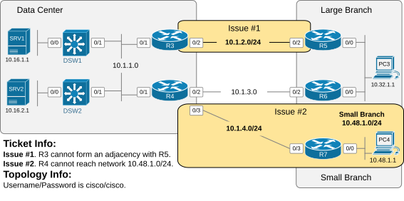

# Troubleshooting Ticket #4

<!-- nav -->
⬅ [Troubleshooting Ticket #3](19-troubleshooting-ticket-3.md) · [Course index](00_Index.md) · [Troubleshooting Ticket #5](21-troubleshooting-ticket-5.md) ➡
<!-- nav -->

*OSPF Fundamentals · Lesson · Source: https://www.networkacademy.io/ccna/ospf/troubleshooting-ticket-4*

This is the fourth ticket in the OSPF troubleshooting series, in which we investigate and fix issues with the OSPF adjacency between routers.

At the end of the lesson, you can download the EVE-NG file. You can begin by downloading the ticket and trying to troubleshoot it yourself. Then, you can review the lesson and see if you used the same approach.

## Ticket Topology

This ticket uses the following initial topology, highlighting the issues we investigate.



*Figure 1. Ticket Initial Topology.*

All devices are in Area 0. They must establish OSPF adjacency with their neighboring routers, and the network must have full IP reachability.

## Ticket Issues

Suppose you are a network engineer supporting a big enterprise company. You have received a ticket with the following two reported issues, which are highlighted in the diagram above:

- ****Issue #1**** - R3 cannot form OSPF adjacency with R5.
- ****Issue #2**** - R4 cannot reach network 10.48.1.0/24, which is at the small branch.

You are given the "cisco/cisco" credentials. However, the company's security policy does not allow using the **show run** command. Therefore, you must resolve the issues without looking at the routers' configurations.

## Troubleshooting Workflow

Let's troubleshoot both issues using the approach we have used so far in this series. First, we compare the interface settings. Then, we check and compare the OSPF configuration on both sides.

### Issue #1

The issue is reported as "R3 cannot form OSPF adjacency with R5." First, let's verify that the routers are not neighbors.

```text
R3# sh ip ospf neighbor 
Neighbor ID     Pri   State           Dead Time   Address         Interface
1.1.1.1           1   FULL/DROTHER    00:00:37    10.1.1.1        Ethernet0/1
2.2.2.2           1   FULL/DROTHER    00:00:37    10.1.1.2        Ethernet0/1
4.4.4.4           1   FULL/DR         00:00:30    10.1.1.4        Ethernet0/1
```

From the output of the **show ip ospf neighbor** command, we can see that R3 is not an OSPF neighbor with R5 (5.5.5.5).

Okay, let's start with verifying the interface settings on both sides. Then, we will check the OSPF settings.

#### Step 1 - Interface settings

We execute the **show ip interface** command on both sides and compare the output. We expect both interfaces to be UP/UP, IP addresses in the same subnet, MTU to be 1500, and ACL must not block the OSPF messages.

---

<!-- nav -->
⬅ [Troubleshooting Ticket #3](19-troubleshooting-ticket-3.md) · [Course index](00_Index.md) · [Troubleshooting Ticket #5](21-troubleshooting-ticket-5.md) ➡
<!-- nav -->
