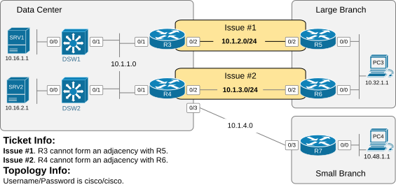

# Troubleshooting Ticket #5

<!-- nav -->
⬅ [Troubleshooting Ticket #4](20-troubleshooting-ticket-4.md) · [Course index](00_Index.md) · [OSPF Best-Path Selection](22-ospf-best-path-selection.md) ➡
<!-- nav -->

*OSPF Fundamentals · Lesson · Source: https://www.networkacademy.io/ccna/ospf/troubleshooting-ticket-5*

This is the fifth ticket in this OSPF troubleshooting series, in which we investigate and fix issues with the OSPF adjacency between routers.

At the end of the lesson, you can download the EVE-NG file. You can try to troubleshoot the ticket yourself. Then, you can review the lesson and see if you used the same approach and concluded the same results.

## Ticket Topology

The following diagram shows the topology we are going to use for this ticket, highlighting the issues we are investigating.

*Figure 1. Ticket5 Initial Topology.*

All devices run OSPFv2 in a single area - Area 0. By design, all devices must establish OSPF adjacency with their directly connected neighbors, and there must be full IP reachability across the network.

## Ticket Issues

You are a network engineer supporting the network of an enterprise company. You have received a ticket with the following two reported issues, which are highlighted in the diagram above:

- ****Issue #1**** - R3 cannot form OSPF adjacency with R5.
- ****Issue #2**** - R4 cannot form OSPF adjacency with R6.

You are given the "cisco/cisco" credentials. Contrary to the previous tickets, the **show run** command is allowed in this one.

## Troubleshooting Workflow

So far in the series, we used the following approach to troubleshoot the issues. First, we compare the interface settings. Then, we check and compare the OSPF configuration on both sides.

### Issue #1

The first issue is "*R3 cannot form OSPF adjacency with R5.*" Let's verify that the routers are not neighbors.

---

<!-- nav -->
⬅ [Troubleshooting Ticket #4](20-troubleshooting-ticket-4.md) · [Course index](00_Index.md) · [OSPF Best-Path Selection](22-ospf-best-path-selection.md) ➡
<!-- nav -->
