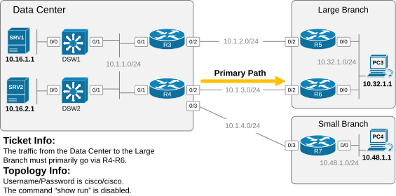

# Configuration Ticket #1

<!-- nav -->
⬅ [OSPF Best-Path Selection](22-ospf-best-path-selection.md) · [Course index](00_Index.md) · [Advanced OSPF (CCNP scope)](24-advanced-ospf-ccnp-scope.md) ➡
<!-- nav -->

*OSPF Fundamentals · Lesson · Source: https://www.networkacademy.io/ccna/ospf/configuration-ticket-1*

This lab lesson demonstrates how we can manipulate the OSPF traffic paths across the network using the three available methods that we have seen in the previous lesson:

- Changing the Reference Bandwidth value of all routers in the topology using the **auto-cost reference-bandwidth** command.
- Changing the OSPF cost of a particular link using the **ip ospf cost** command.
- Changing the Link Bandwidth of a particular link using the **bandwidth**command.

At the end of the lesson, you can download the initial EVE-NG file and try to solve the requirements yourself. Then, you can go back and review our solution.

## Ticket Initial State

The customer's network is shown in the diagram below. It runs a single-area OSPF.

*Figure 1. Initial Topology.*

All devices run OSPF process 1. There is full IP reachability between all networks. All links are up/up, and all devices are fully operational.

## Ticket Requirements

An engineer configured the customer network but didn't manage to finish. The customer has contacted you to finish the configuration based on the requirements. There is no information on the current state of the configuration.

- **Requirements 1**: The traffic from the data center destined for the large branch must primarily go via the link between routers R4-R6.
- **Requirements 2**: You are only allowed to do configuration changes on the large branch's routers R5 and R6.
- **Requirements 3**: You are not allowed to use the **ip ospf cost** command.
- **Requirements 4**: As proof of successful reconfiguration of the network, you must present a traceroute from SRV1 (10.16.1.1) to PC3 (10.32.1.1) that goes via R4-R6.

You are given the credentials "cisco/cisco," which don't have the highest privilege level. For security concerns - protecting against configuration leaks, the customer has disabled the **show run** command on your account. You must manage to find the information you need using alternative CLI commands and outputs.

## Approaching the requirements

Let's analyze the current topology and plan how to make the traffic path from the data center to the branch via R4-R6 more preferred while satisfying all requirements.

---

<!-- nav -->
⬅ [OSPF Best-Path Selection](22-ospf-best-path-selection.md) · [Course index](00_Index.md) · [Advanced OSPF (CCNP scope)](24-advanced-ospf-ccnp-scope.md) ➡
<!-- nav -->
