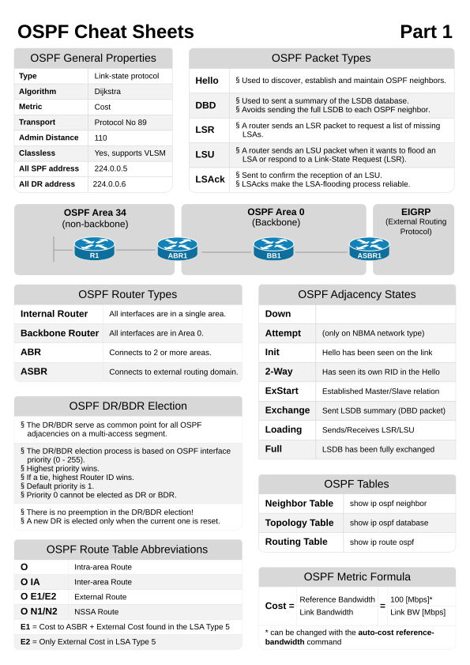
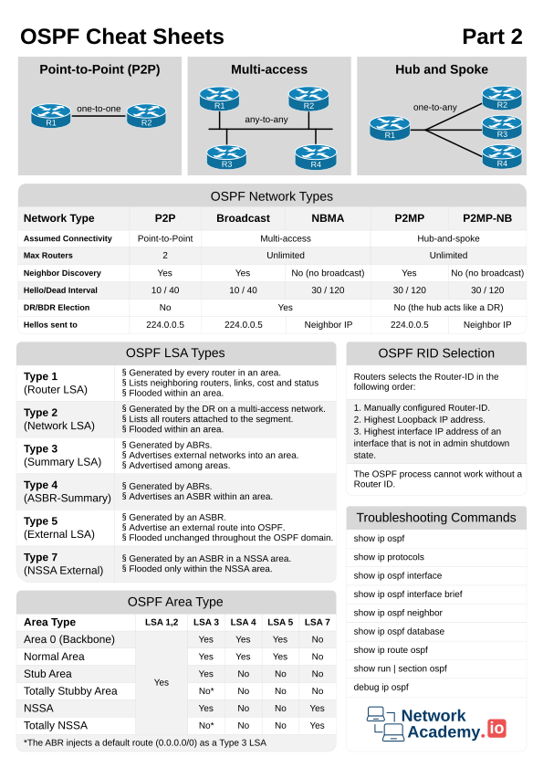

# Course Summary | Cheat Sheets

<!-- nav -->
⬅ [Course Summary](31-course-summary.md) · [Course index](00_Index.md) · [Final OSPF Configuration Lab](33-final-ospf-configuration-lab.md) ➡
<!-- nav -->

*OSPF Fundamentals · Lesson · Source: https://www.networkacademy.io/ccna/ospf/course-summary-cheat-sheet*

This lesson summarizes the OSPF theory we have learned in our course. It is structured as Study Notes | Cheat Sheets in two parts. Each is formatted as a high-quality image on A4 paper, so you can print it and use it for quick reference.

The following image is the OSPF Cheat Sheets Part 1.

*OSPF Cheat Sheets Part 1*

The following image is the OSPF Cheat Sheets Part 2.

*OSPF Cheat Sheets Part 2*

Enjoy!

---

<!-- nav -->
⬅ [Course Summary](31-course-summary.md) · [Course index](00_Index.md) · [Final OSPF Configuration Lab](33-final-ospf-configuration-lab.md) ➡
<!-- nav -->
