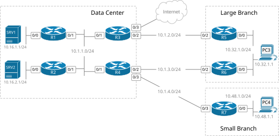
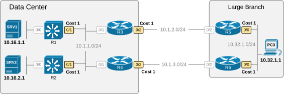

# Final OSPF Configuration Lab

<!-- nav -->
⬅ [Course Summary | Cheat Sheets](32-course-summary-cheat-sheet.md) · [Course index](00_Index.md) · [Final Practice Exam](34-ospf-final-practice-exam.md) ➡
<!-- nav -->

*OSPF Fundamentals · Lesson · Source: https://www.networkacademy.io/ccna/ospf/final-ospf-configuration-lab*

This is the final configuration lab, designed to check whether you have understood all the OSPF concepts we have seen in the course. If you successfully complete all configuration tasks, you are more than ready to pass the OSPF portion of the CCNA exam.

At the end of the lesson, there is a link to download the initial EVE-NG file. Complete all tasks yourself, and then review our solution to see if you've done everything correctly.

## Lab Initial State

A customer has a small corporate network that includes seven routers located at three locations: a data center and a large and small branch, as shown in the diagram below.



*Figure 1. Lab Initial Topology.*

The network is a greenfield installation that has yet to be fully configured and put into operation.

## Configuration Tasks

An engineer configured the customer network but didn't manage to finish the OSPF portion. The customer has contacted you to finish the configuration. Here are the tasks that haven't been completed and are given to you to finish.

- **Task 1:** Enable OSPFv2 on all routers:
  - Routers R1 through R6 must use OSPF process ID 1.
  - Router R7 must use OSPF Process ID 34.
- **Task 2:** Place all interfaces in OSPFv2 Area 0.
  - You must not use the network command on routers R5 and R6 when enabling the routing process on the interfaces.
  - You must use the most specific network command when enabling OSPFv2 on the data center routers R1-R4.
  - R3's interface toward the internet must not be part of the OSPF routing.
- **Task 3:** Modify the OSPFv2 RIDs on all routers according to Table 1.
  - Ensure the changes take effect and routers establish adjacencies using the new RIDs.
- **Task 4:** Ensure R1 is elected the Designated Router (DR) on network 10.1.1.0/24.
  - R2 must be elected as the backup designated router (BDR).
  - Ensure the changes take effect.
- **Task 5:** Ensure no DR/BDR election occurs on subnets 10.1.2.0/24 and 10.1.3.0/24.
- **Task 6:** Change the default reference bandwidth value (100Mbps) to 1Gbps on all OSPFv2 nodes.
- **Task 7:** Disable the OSPFv2 Hello packets on all interfaces connected to 10.16.1.0/24 and 10.16.2.0/24.
  - Ensure the networks are advertised in the OSPFv2 domain.
- **Task 8:** Change the Hello and Dead intervals on subnet 10.1.4.0/24 to 1 and 4 seconds, respectively.
- **Task 9:** Enable clear text authentication between R3 and R5 using the password "Cisco."
- **Task 10**: Ensure that SRV1 and SRV2 connect to the large branch via the link R4-R6.
  - You are not allowed to use the **ip ospf cost** command.
  - You are not allowed to change the **bandwidth**of links 10.1.2.0/24 and 10.1.3.0/24.
- **Task 11:** Add an additional loopback interface on router R1.
  - Configure the IP address 1.1.1.250/25.
  - Enable OSPFv2 using the most specific network command possible.
  - The loopback must be advertised into OSPF with its real subnet mask (/24).
- **Task 12:** Configure R3 to inject a default route (0.0.0.0/0) in the OSPF domain.
  - R3 must inject a default route even when the Internet connection is down.

### Verifications

To prove that all tasks are completed successfully, the network must behave in the following ways:

- SRV1 and SRV2 must be able to ping PC3 and PC4.
- The traceroute from SRV1/SRV2 to PC3 must show that the traffic goes via R4-R6.
- All devices must be able to ping 8.8.8.8 (address on the Internet).
- The **show ip ospf neighbor** command on R3 must show that R1 is the DR on network 10.1.1.0/24.
- The **show ip ospf neighbor** command on R3/R4 must show that no DR/BDR exists on networks 10.1.2.0/24 and 10.1.3.0/24.
- The **show ip ospf interface**command on R4 must show that the Hello/Dead intervals on 10.1.4.0/24 are 1/4 seconds.
- The **show ip route 1.1.1.250** on R7 must show that the network 1.1.1.128/25 is in the routing table.

If all verification steps are successful, the project is considered successfully completed. Otherwise, the project is considered unsuccessful.

### Additional Info

There is some additional info alongside the network diagram shown in Figure 1 above.

#### RIDs

The following table lists the Router-IDs of all devices that we are going to need in Task 3.

**Table 1. Router IDs of all routers.**

| **Device** | **RID** |
|---|---|
| R1 | 1.1.1.1 |
| R2 | 2.2.2.2 |
| R3 | 3.3.3.3 |
| R4 | 4.4.4.4 |
| R5 | 5.5.5.5 |
| R6 | 6.6.6.6 |
| R7 | 7.7.7.7 |

#### IP Addressing

The following table lists the IP addresses on all devices in the network.

**Table 2. IP addressing**

| **Device** | **Interface** | **IP address** |
|---|---|---|
| R1 | Eth0/0 | 10.16.1.254 |
| Eth0/1 | 10.1.1.1 |  |
| R2 | Eth0/0 | 10.16.2.254 |
| Eth0/1 | 10.1.1.2 |  |
| R3 | Eth0/1 | 10.1.1.3 |
| Eth0/2 | 10.1.2.3 |  |
| Eth0/3 | 172.16.1.3 |  |
| R4 | Eth0/1 | 10.1.1.4 |
| Eth0/2 | 10.1.3.4 |  |
| Eth0/3 | 10.1.4.4 |  |
| R5 | Eth0/0 | 10.32.1.5 (VIP:10.32.1.254) |
| Eth0/2 | 10.1.2.5 |  |
| R6 | Eth0/0 | 10.32.1.6 (VIP:10.32.1.254) |
| Eth0/2 | 10.1.3.6 |  |
| R7 | Eth0/0 | 10.48.1.7 (VIP:10.48.1.254) |
| Eth0/3 | 10.1.4.7 |  |

## Configuration Lab Solution

If you plan to do the configuration lab independently, you must stop here, do it yourself, and then return to check the solution.

### Configurations

First, we start with the configuration portion, following all tasks in sequential order.

#### Task 1 and Task 2

We are going to configure tasks 1 and 2 together because they are actually related to the process of enabling the routing protocol on all devices. The tasks are as follows:

- Task 1: Enable OSPFv2 on all routers:
  - Routers R1 through R6 must use OSPFv2 process ID 1.
  - Router R7 must use OSPFv2 Process ID 34.
- Task 2: Place all interfaces in OSPFv2 Area 0.
  - You must not use the network command on routers R5 and R6 when enabling the routing process on the interfaces.
  - You must use the most specific network command when enabling OSPFv2 on the data center routers R1-R4.
  - R3's interface toward the internet must not be part of the OSPFv2 routing.

Let's directly start configuring the routers. We will break down the requirements along the way.

What does it mean - "*You must use the most specific network command.*" It means we must use the exact interface IP address with wildcard mask 0.0.0.0 in the network command. Okay, with that in mind, let's start with R1.

```text
R1# sh ip int brief 
Interface              IP-Address      OK? Method Status                Protocol
Ethernet0/0            10.16.1.254     YES NVRAM  up                    up      
Ethernet0/1            10.1.1.1        YES NVRAM  up                    up      
Ethernet0/2            unassigned      YES NVRAM  administratively down down    
Ethernet0/3            unassigned      YES NVRAM  administratively down down 
```

```text
R1# conf t
Enter configuration commands, one per line.  End with CNTL/Z.
R1(config)# router ospf 1
R1(config-router)# network 10.16.1.254 0.0.0.0 area 0
R1(config-router)# network 10.1.1.1 0.0.0.0 area 0
R1(config-router)# end
R1#
```

Pay attention to the network commands. We use the wildcard mask of all zeros, which only matches the interfaces with the exact IP address. That's why we must configure separate network commands for every interface.

Let's do the same for R2.

```text
R2# sh ip int brief 
Interface              IP-Address      OK? Method Status                Protocol
Ethernet0/0            10.16.2.254     YES NVRAM  up                    up      
Ethernet0/1            10.1.1.2        YES NVRAM  up                    up      
Ethernet0/2            unassigned      YES NVRAM  administratively down down    
Ethernet0/3            unassigned      YES NVRAM  administratively down down    
```

```text
R2# conf t
Enter configuration commands, one per line.  End with CNTL/Z.
R2(config)# router ospf 1
R2(config-router)# network 10.16.2.254 0.0.0.0 area 0
R2(config-router)# network 10.1.1.2 0.0.0.0 area 0
R2(config-router)# end
```

On router R3, we must make sure that we do not enable the OSPFv2 process towards the Internet. This means interface Eth0/3 must not be included in the routing process.

```text
R3# sh ip int brief  
Interface              IP-Address      OK? Method Status                Protocol
Ethernet0/0            unassigned      YES NVRAM  administratively down down    
Ethernet0/1            10.1.1.3        YES NVRAM  up                    up      
Ethernet0/2            10.1.2.3        YES NVRAM  up                    up      
Ethernet0/3            172.16.1.1      YES NVRAM  up                    up     
```

```text
R3# conf t
Enter configuration commands, one per line.  End with CNTL/Z.
R3(config)# router ospf 1
R3(config-router)# network 10.1.1.3 0.0.0.0 area 0
R3(config-router)# network 10.1.2.3 0.0.0.0 area 0
R3(config-router)# end
```

We do the same procedure on router R4.

```text
R4# show ip int brief 
Interface              IP-Address      OK? Method Status                Protocol
Ethernet0/0            unassigned      YES NVRAM  administratively down down    
Ethernet0/1            10.1.1.4        YES NVRAM  up                    up      
Ethernet0/2            10.1.3.4        YES NVRAM  up                    up      
Ethernet0/3            10.1.4.4        YES NVRAM  up                    up      
```

```text
R4# conf t
Enter configuration commands, one per line.  End with CNTL/Z.
R4(config)# router ospf 1
R4(config-router)# network 10.1.1.4 0.0.0.0 area 0
R4(config-router)# network 10.1.3.4 0.0.0.0 area 0
R4(config-router)# network 10.1.4.4 0.0.0.0 area 0
R4(config-router)# end
```

Now, let's move on to routers R5 and R6.

One additional requirement is that we must not use the **network**command under the OSPF process on routers R5 and R6 when we enable the routing process on the interfaces. Hence, we must use the **ip ospf [process-id] area [area-id]** command under the interfaces.

```text
R5# show ip int brief 
Interface              IP-Address      OK? Method Status                Protocol
Ethernet0/0            10.32.1.5       YES NVRAM  up                    up      
Ethernet0/1            unassigned      YES NVRAM  administratively down down    
Ethernet0/2            10.1.2.5        YES NVRAM  up                    up      
Ethernet0/3            unassigned      YES NVRAM  administratively down down    
```

```text
R5# conf t
Enter configuration commands, one per line.  End with CNTL/Z.
R5(config)# router ospf 1
R5(config-router)# exit
!
R5(config)# interface Eth0/0
R5(config-if)# ip ospf 1 area 0
R5(config-if)# exit
!
R5(config)# interface Eth0/2
R5(config-if)# ip ospf 1 area 0
R5(config-if)# end
```

Notice how we enable the routing process on the interfaces using the interface level command.

```text
R6# show ip int brief 
Interface              IP-Address      OK? Method Status                Protocol
Ethernet0/0            10.32.1.6       YES NVRAM  administratively down down    
Ethernet0/1            unassigned      YES NVRAM  administratively down down    
Ethernet0/2            10.1.3.6        YES NVRAM  up                    up      
Ethernet0/3            unassigned      YES NVRAM  administratively down down    
```

```text
R6# conf t
Enter configuration commands, one per line.  End with CNTL/Z.
R6(config)# router ospf 1 
R6(config-router)# exit
!
R6(config)# interface Eth0/0
R6(config-if)# ip ospf 1 area 0
R6(config-if)# exit
!
R6(config)# interface Eth0/2
R6(config-if)# ip ospf 1 area 0
R6(config-if)# end
R6#
```

Moving on to R7, another requirement is to use OSPFv2 Process ID 34. Keep in mind that the OSPF process ID is a locally significant process identifier. The router uses it to distinguish between multiple processes (if configured). However, it is not advertised to neighbors and does not matter when establishing adjacency with other OSPF-enabled routers.

With that in mind, let's configure R7 with process ID 34 and enable the routing on all interfaces.

```text
R7# show ip int brief
Interface              IP-Address      OK? Method Status                Protocol
Ethernet0/0            10.48.1.7       YES NVRAM  up                    up      
Ethernet0/1            unassigned      YES NVRAM  administratively down down    
Ethernet0/2            unassigned      YES NVRAM  administratively down down    
Ethernet0/3            10.1.4.7        YES NVRAM  up                    up      
```

```text
R7# conf t
Enter configuration commands, one per line.  End with CNTL/Z.
R7(config)# router ospf 34
R7(config-router)# network 10.0.0.0 0.255.255.255 area 0
R7(config-router)# end
R7#
```

Since there are no specific requirements regarding R7, we can enable the OSPFv2 process on all interfaces with one more general network command, as you can see in the output above.

With that, Tasks 1 and 2 are done.

#### Task 3

Moving on to the third task, let's see what it requires.

- **Task 3:** Modify the OSPF RIDs on all routers according to Table 1.
  - Ensure the changes take effect and routers establish adjacencies using the new RIDs.

Recall that after changing the router-id of a device, the change only takes effect after the OSPF process restarts. Hence, to ensure that the device uses the new RID, we must manually clear the OSPF process, as shown in the output below.

```text
R1# conf t
Enter configuration commands, one per line.  End with CNTL/Z.
R1(config)# router ospf 1
R1(config-router)# router-id 1.1.1.1
% OSPF: Reload or use "clear ip ospf process" command, for this to take effect
R1(config-router)# end
R1# clear ip ospf process
Reset ALL OSPF processes? [no]: yes
R1#
```

There is no need to show how we reconfigure every device in the network because the action is the same for each one.

#### Task 4

The task has the following requirements:

- **Task 4:** Ensure R1 is elected the Designated Router (DR) on network 10.1.1.0/24.
  - R2 must be elected as the backup designated router (BDR).
  - Ensure the changes take effect.

Let's first check the state of network 10.1.1.0/24 at the moment.

```text
R1# sh ip ospf neighbor 
Neighbor ID     Pri   State           Dead Time   Address         Interface
2.2.2.2           1   2WAY/DROTHER    00:00:35    10.1.1.2        Ethernet0/1
3.3.3.3           1   FULL/BDR        00:00:36    10.1.1.3        Ethernet0/1
4.4.4.4           1   FULL/DR         00:00:36    10.1.1.4        Ethernet0/1
```

We can see two things:

- All routers have the same default priority of 1.
- R4 is the DR, while R3 is the BDR.

To make R1 the DR, we must configure a higher priority. Let's configure priority 10 on R1 and 5 on R2 so it can become the BDR.

```text
R1# conf t
Enter configuration commands, one per line.  End with CNTL/Z.
R1(config)# int e0/1
R1(config-if)# ip ospf priority 10
R1(config-if)# end
```

```text
R2# conf t
Enter configuration commands, one per line.  End with CNTL/Z.
R2(config)# int e0/1
R2(config-if)# ip ospf priority 5
R2(config-if)# end
```

However, remember that there is no preemption process with the designated routers. Even if a router with higher priority connects to the segment, it can become a DR only when the current DR restarts. To ensure the changes take effect, let's clear the ospf process on routers R1-R4.

```text
R4# clear ip ospf process 
Reset ALL OSPF processes? [no]: yes
```

Now, if we check the neighbors in the segment, we can see that R1 is the DR and R2 is the BDR.

```text
R4# sh ip ospf neighbor 
Neighbor ID     Pri   State           Dead Time   Address         Interface
7.7.7.7           1   FULL/DR         00:00:36    10.1.4.7        Ethernet0/3
6.6.6.6           1   FULL/DR         00:00:36    10.1.3.6        Ethernet0/2
1.1.1.1          10   FULL/DR         00:00:36    10.1.1.1        Ethernet0/1
2.2.2.2           5   FULL/BDR        00:00:36    10.1.1.2        Ethernet0/1
3.3.3.3           1   2WAY/DROTHER    00:00:35    10.1.1.3        Ethernet0/1
```

Now, let's move on to the next task.

#### Task 5

It has the following requirements:

- **Task 5:** Ensure no DR/BDR election occurs on subnets 10.1.2.0/24 and 10.1.3.0/24.

Recall that the DR/BDR election takes place on the Broadcast network type, which is the default one on Ethernet interfaces because this is a multi-access media. To complete the task, we must change the network type on links R3-R5 and R4-R6 to one that does not have DR/BDR election - for example, point-to-point.

The network type is changed on the interface level. Let's first change the network type on R3-R5.

```text
R3# conf t
Enter configuration commands, one per line.  End with CNTL/Z.
R3(config)# int e0/2
R3(config-if)# ip ospf network point-to-point 
R3(config-if)# end
```

```text
R5# conf t
Enter configuration commands, one per line.  End with CNTL/Z.
R5(config)# int e0/2
R5(config-if)# ip ospf network point-to-point 
R5(config-if)# end
```

Now if we check R3's neighbors, we can see that on link 10.1.2.0/24 there is not DR/BDR election.

```text
R3# sh ip ospf neighbor 
Neighbor ID     Pri   State           Dead Time   Address         Interface
5.5.5.5           0   FULL/  -        00:00:37    10.1.2.5        Ethernet0/2
1.1.1.1          10   FULL/DR         00:00:32    10.1.1.1        Ethernet0/1
2.2.2.2           5   FULL/BDR        00:00:36    10.1.1.2        Ethernet0/1
4.4.4.4           1   2WAY/DROTHER    00:00:39    10.1.1.4        Ethernet0/1
```

You do the same for the link R4-R6.

#### Task 6

It has the following requirements:

- **Task 6:** Change the default reference bandwidth value (100Mbps) to 1Gbps on all nodes.

OSPF calculates the cost of each link using the formula:

```text
Cost = Reference Bandwidth [100Mbps] / Interface Bandwidth
```

By default, the reference bandwidth is set to 100Mbps. It was set to this value back in the old days when links barely reached 2Mpbs. However, nowadays, 100Mbps is considered slow. The protocol allows us to change the reference bandwidth using the **auto-cost reference-bandwidth** command. However, it is very important to remember that if you change the reference bandwidth, you must do so **on all routers in the OSPF networks**. Otherwise, routers can calculate suboptimal routing paths across the network.

```text
// We configure this on all routers R1-R7
R1# conf t
Enter configuration commands, one per line.  End with CNTL/Z.
R1(config)# router ospf 1
R1(config-router)# auto-cost reference-bandwidth 1000
% OSPF: Reference bandwidth is changed. 
        Please ensure reference bandwidth is consistent across all routers.
R1(config-router)# end
R1#
```

To verify the reference bandwidth, we use the following command:

```text
R1# sh ip ospf | in Reference
 Reference bandwidth unit is 1000 mbps
```

#### Task 7

It has the following requirements:

- **Task 7:** Disable the OSPF Hello packets on all interfaces connected to 10.16.1.0/24 and 10.16.2.0/24.
  - Ensure the networks are advertised in the OSPF domain.

To achieve this, we must use a feature called a passive interface. A "passive interface" is an OSPF network interface that participates in the OSPF routing process for advertisement purposes but does not send or receive OSPF packets.

```text
// Configure this on R1 and R2
R1# conf t
Enter configuration commands, one per line.  End with CNTL/Z.
R1(config)# router ospf 1
R1(config-router)# passive-interface Ethernet0/0
R1(config-router)# end
```

Now, R1 and R2 do not send OSPF packets toward the hosts in networks 10.6.1.0/24 and 10.16.2.0/24.

#### Task 8

It has the following requirements:

- Task 8: Change the Hello and Dead intervals on subnet 10.1.4.0/24 to 1 and 4 seconds, respectively.

This one is easy. However, remember that the Hello and Dead intervals must match between routers to establish OSPF neighborship. Hence, changing the timers on one side can bring the adjacency down, so be very careful when changing the timers in production environments.

```text
// we configure this on R4's eth0/3 and R7's eth0/3
R4# conf t
Enter configuration commands, one per line.  End with CNTL/Z.
R4(config)# int e0/3
R4(config-if)# ip ospf hello-interval 1
R4(config-if)# ip ospf dead-interval 4
R4(config-if)# end
```

#### Task 9

It has the following requirements:

- Task 9: Enable clear text authentication between R3 and R5 using the password "Cisco."

Configuring plain text authentication is a simple two-step process - first, we enable authentication on the interface, and then we set the password.

```text
// Configure this on R3 and R5's Eth0/2 interface
R3# conf t
Enter configuration commands, one per line.  End with CNTL/Z.
R3(config)# int e0/2
R3(config-if)# ip ospf authentication 
R3(config-if)# ip ospf authentication-key Cisco
R3(config-if)# end
R3#
```

However, make sure you enable authentication on both sides and set the same password.

#### Task 10

It has the following requirements:

- Task 10: Ensure that SRV1 and SRV2 connect to the large branch via the link R4-R6.
  - You are not allowed to use the **ip ospf cost** command.
  - You are not allowed to change the **bandwidth**of links 10.1.2.0/24 and 10.1.3.0/24.

The key to solving this task is to know how the protocol calculates the total cost to a destination in the network. It is very important to remember that **the protocol uses the cost of all OUTGOING interfaces** when calculating the total cost to a destination, including the cost of the last interface that directly connects to the destination network.

Therefore, these are the interfaces that participate in the total cost calculation between SRV1, SRV2, and PC3 (highlighted in yellow).



*Figure 2. Outgoing interfces between SRv1/2 and PC3.*

Another important aspect of the task requirements is that we cannot change the cost of the interface directly. Hence **we must change the bandwidth to influence the cost**. However, by requirement, we cannot change the bandwidth of links R3-R5 and R4-R6, which leaves us with the only option to change the bandwidth on R5 and R6's outgoing interfaces.

Since both have a cost of 1, the only option is to change R5's Eth0/0 interface's bandwidth to a lower bandwidth value so that the cost of R5's outgoing interface becomes higher than 1. This will make the path via R6 more preferred because it will have a lower total cost than the path via R5. Let's do it.

```text
R5# conf t
Enter configuration commands, one per line.  End with CNTL/Z.
R5(config)# interface Eth0/0
R5(config-if)# bandwidth 100
R5(config-if)# end
R5#
```

If we run a traceroute to PC3 on SRV1, we can see that the traffic goes via R4-R6.

```text
SRV1# traceroute 10.32.1.1
Type escape sequence to abort.
Tracing the route to 10.32.1.1
VRF info: (vrf in name/id, vrf out name/id)
  1 10.16.1.254 2002 msec 0 msec 0 msec
  2 10.1.1.4 1 msec 1 msec 47 msec --> R4
  3 10.1.3.6 4 msec 1 msec 1 msec  --> R6
  4 10.32.1.1 2 msec * 
SRV1#
```

You can see how simple the actual configuration is, but you must first know what you want to achieve and how to achieve it. Now let's move on to the next task.

---

<!-- nav -->
⬅ [Course Summary | Cheat Sheets](32-course-summary-cheat-sheet.md) · [Course index](00_Index.md) · [Final Practice Exam](34-ospf-final-practice-exam.md) ➡
<!-- nav -->
