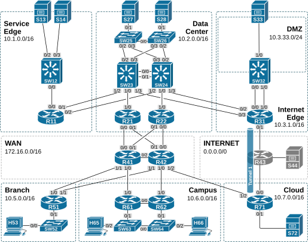
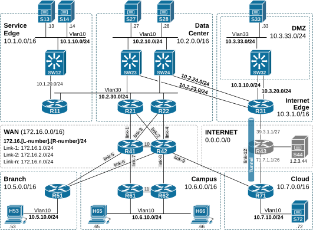
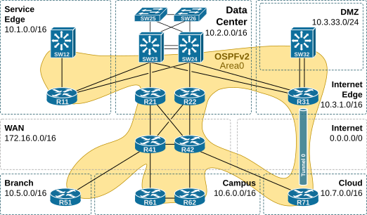
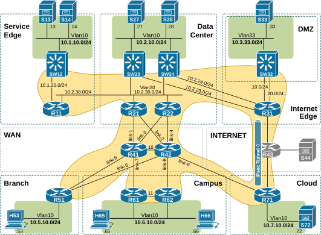

# Lab#1: Build a single-area OSPF

<!-- nav -->
⬅ [Configuration Labs (Premium)](36-config-labs.md) · [Course index](00_Index.md)
<!-- nav -->

*OSPF Fundamentals · Lesson · Source: https://www.networkacademy.io/ccna/ospf/config-labs/build-single-area-ospf-network*

Most OSPF labs online focus almost entirely on the routing protocol itself. They typically use **small, simplified topologies** where OSPF is configured in isolation. That is a good way to learn the basics, but it is not the best way to prepare for hard exams like CCNP/CCIE or to learn real networking skills.

Our approach is different. We make students configure OSPF **inside a realistic network**. This is a much better way to learn how OSPF behaves in the real world. It also forces you to spend more time labbing and learn to focus for longer (which becomes harder and harder due to technology).

In this lab, you will configure OSPFv2 in an enterprise network alongside several related networking concepts. The goal is not simply to make OSPF work, but **to understand how OSPF fits into the surrounding network**.

- **Lab Level:** CCNA
- **Main topics:** OSPFv2, Area 0, Router ID, network statements, interface-level OSPF, passive interfaces, reference bandwidth.
- **Adjacent topics:** Physical vs. Logical topologies, Layer 2 vs. Layer 3 links, Vlan interfaces, Tunnel interfaces.

You can download the EVE-NG and the CML files from the download section at the end of the lab.

## Lab Scenario

You’ve been hired by an enterprise **to enable dynamic routing in their production network**. The network is already up and running, and all network devices have been configured with IP addresses and basic settings. However, the engineer who deployed the network didn't have time to finish the routing part.

The company has decided to use a link-state protocol (OSPFv2) as an IGP. You must deploy OSPF so that all LAN networks can reach each other.

## Lab Topologies

The network topology includes several locations. Some network devices are routers, while others are Layer 3 switches. This means you will need to think carefully about**which interfaces OSPF should run on** and which networks should only be advertised.

### Physical

The physical topology that we are going to use in this OSPF series is our standard CCNA one, which we have used in all real-world CCNA configuration and troubleshooting labs. If you follow the CCNA courses in order, you should already be familiar with it. However, if you start directly from the OSPF course, you can see the topology in the diagram below.



*Figure 1. CCNA Topology - Physical View.*

Notice that the Internet router **R43** belongs to the **ISP** provider and is outside the company’s network.

Also notice that some links are Layer 2 and some are Layer 3. **You cannot tell the logical topology from the physical diagram alone**. You must examine a logical diagram or log in to the devices and check which interfaces are what type.

### Logical

To make things easier, let's also see the logical diagram. Pay attention to the difference between the physical and the logical topology, especially between R11, R21, R22, SW23, and SW24, as shown in the diagram below.



*Figure 2. CCNA Topology - Logical View.*

Notice that R11, R21, R22, SW23, and SW24 are in a shared segment - **VLAN30**, **10.2.30.0/24**. Go back to the physical diagram, check how these devices are connected, and then review the logical topology again. From the physical diagram, it seems that the distribution switches are connected to all routers via p2p links. However, SW23 and SW24's **e1/0** and **e1/2** interfaces are simply access ports in VLAN 30 (more on this later on).

### Main Task

The main task of this lab is **to enable OSPFv2 across the enterprise network**. The following network devices must participate in the OSPF routing. All OSPF-enabled interfaces must belong to Area 0, as highlighted in yellow in the diagram below. In the end, all LAN segments must be able to reach each other.



*Figure 3. OSPFv2 Area 0 Topology View.*

The Internet router R43 must not participate in OSPF. That's why it is not shown in the diagram.

### Tasks

In networking, almost every network requirement can be met with at least a few different approaches. That's why every exam or real-world task has some subtasks or additional requirements that eliminate ambiguity.

#### Task #1 - Process ID.

- You must use ****OSPF process ID 1**** when enabling the routing process **on all devices except R51**. **R51**must use process ID 51.
- The IPsec tunnel over the Internet between **R31** and **R71** must also participate in OSPF so that the Cloud network can reach the rest of the organization. You must not enable OSPF on the physical Internet links between **R31**and **R43**.

#### Task #2 - Use different methods to enable OSPF

You must not configure OSPF in the same way on every device.

- In the data center, on routers **R11, R21, R22, and R31**. **Use the most specific network statements possible**. Each network statement must match only one interface.
- On **R41 and R42**, **use broad network statements wherever possible**. A single statement should match multiple interfaces when the addressing scheme allows it. Be careful not to include interfaces that should not participate in OSPF.
- On **R51, R61, and R62**. **You must not use the network command** to enable OSPF. Enable OSPF directly under each required interface.
- On the**layer 3 switches** (SW12, SW23, SW24, SW32), you may use **only one network command** to enable OSPF on all interfaces.

#### Task #3 - Configure the OSPF Router IDs

Configure the Router IDs manually according to the following address scheme:

```text
OSPFv2 router ID pattern 10.255.255.[device_number]
R11 ---10.255.255.11
SW12 --10.255.255.12
R21 ---10.255.255.21
R22 ---10.255.255.22
SW23 --10.255.255.23
SW24 --10.255.255.24
R31 ---10.255.255.31
SW32 --10.255.255.32
R41 ---10.255.255.41
R42 ---10.255.255.42
R51 ---10.255.255.51
R61 ---10.255.255.61
R62 ---10.255.255.62
R71 ---10.255.255.71
```

Ensure that the new Router IDs actually take effect. When you check the OSPF neighbor tables with **show ip ospf neighbor**, it must show these Router IDs.

### Verifications

All internal LANs, highlighted in green, must be advertised into OSPF and be able to reach each other.



*Figure 4. LAN segments view.*

All LAN networks must appear in the OSPF routing table of all devices. For example, **R71** should learn the following routes:

```text
10.1.10.0/24
10.2.10.0/24
10.3.33.0/24
10.5.10.0/24
10.6.10.0/24
```

Likewise, other sites must learn **10.7.10.0/24** from the Cloud.

##### End-to-end connectivity

The ultimate test is to ping between hosts. The following ping tests must succeed:

```text
H53 → S13
H53 → S27
H65 → S33
S13 → H66
S27 → S72
S72 → H53
```

## Configuration Part

Now,it is time to turn the requirements into OSPF configuration. If you want to get the most from this lab, ****we strongly recommend trying it yourself before reading further****. Troubleshooting your own mistakes is where the real learning happens.

We will work through the tasks one at a time. At each step, pay attention not only to the configuration but also to the key takeaways from the task.

---

<!-- nav -->
⬅ [Configuration Labs (Premium)](36-config-labs.md) · [Course index](00_Index.md)
<!-- nav -->
