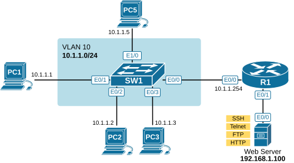
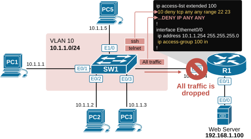
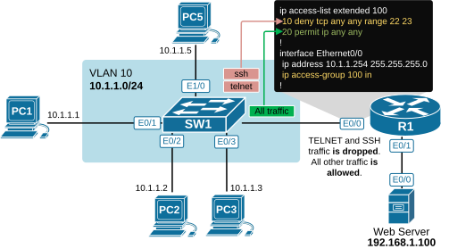
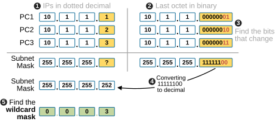
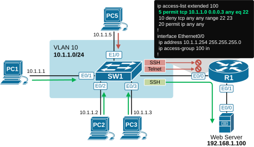
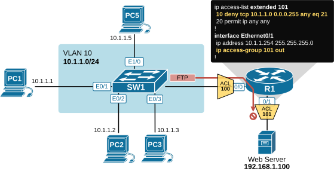

# Lab #3.1 - Implementing Extended Numbered ACL

<!-- nav -->
⬅ [Extended Numbered ACL](11-extended-numbered-acl.md) · [Course index](00_Index.md) · [Layer 2 Security Features](13-layer-2-security-features.md) ➡
<!-- nav -->

*Network Security · Lesson · Source: https://www.networkacademy.io/ccna/network-security/lab-implementing-extended-numbered-acl*

In this lab, we will plan, configure, and verify extended numbered access control lists (ACLs) on Cisco IOS-XE routers. You will learn how ACL order, placement, and matching logic affect traffic. You will also practice reading requirements and translating them into ACL statements that use source, destination, protocol, and port numbers.

At the end of the lesson, you can download the EVE-NG file that we used to create the lesson so that you can practice it on your own.

## Initial Topology

We will use the following topology, which consists of several end hosts, a switch, a router, and a web server. The hosts connect to Vlan 10 (10.1.1.0/24) and use R1's eth0/0 as their default gateway (10.1.1.254). Everything else is by default.



*Figure 1. Initial Topology.*

Each device runs a Cisco IOL image on the EVE-NG Community version. Further down the lesson, you can find the initial configurations of each of the devices.

## Lab Tasks

Your task is to configure the network to complete the following objectives:

- **Task 1:** Deny TELNET and SSH from VLAN 10 to the Web Server. Use only one ACE (access list entry) to perform this task.
- **Task 2:**Allow SSH from PC1, PC2, and PC3 to the web server. Use only one ACE (access list entry) to perform this task.
- **Task 3:**Deny FTP from the local LAN to the web server. You are not allowed to use the same access list as the one used for tasks 1-4. Use a different ACL.

For each task, you are only allowed to use **an extended numbered ACL** configured using the modern subconfiguration mode.

### Initial Configs

For context, let's see the initial configuration of each device. You can see it is mostly basic IP addressing and VLAN config. Nothing else is configured.

#### Hosts (PC1-5)

```text
hostname PC5
!
no ip routing
ip default-gateway 10.1.1.254
!
interface Ethernet0/0
 ip address 10.1.1.5 255.255.255.0
 no shutdown
!
```

#### SW1

```text
hostname SW1
!
vlan 10
 name Users
!
interface range Eth0/0-3, Eth1/0
 switchport access vlan 10
 switchport mode access
 switchport nonegotiate
!
```

#### R1

```text
hostname R1
!
interface Ethernet0/0
 ip address 10.1.1.254 255.255.255.0
!
interface Ethernet0/1
 ip address 192.168.1.254 255.255.255.0
!
```

#### Web Server

```text
hostname Web_server
!
username cisco password 0 cisco
ip domain name Cisco.com
!
interface Ethernet0/0
 ip address 192.168.1.100 255.255.255.0
 no shutdown
!
line vty 0 4
 login local
 transport input all
!
```

### Initial Checks

Lastly, let's verify that there is IP connectivity from Vlan 10 to the web server before we begin configuring and applying access lists on the router.

The following CLI output shows that PC1 can ping the web server.

```text
PC1# ping 192.168.1.100
Type escape sequence to abort.
Sending 5, 100-byte ICMP Echos to 192.168.1.100, timeout is 2 seconds:
!!!!!
Success rate is 100 percent (5/5), round-trip min/avg/max = 1/1/2 ms
```

Now let's start tackling the tasks.

## Lab Solutions

To understand the concepts most effectively, try completing all the objectives **on your own first**, then return and compare your results with our solutions. Remember, some tasks can be done in more than one way. If you come up with a better solution, share it in the comments so we can update the lesson for everyone.

### Extended Numbered ACLs Quick Recap

Before we begin, let's quickly recap what we discussed in the previous lesson.

- Extended numbered ACLs use ranges **100–199** and **2000–2699**.
- They match protocol, source, destination, and port (for TCP/UDP).
- **Order matters.**
  - The first match wins.
  - Action is executed.
  - The evaluation process does not continue further.
- There is an invisible deny ip any any at the end.
- Best practice is to place extended ACLs **close to the source**.

### Task 1

Now, let's start with Task number one, which is listed below:

Deny TELNET and SSH from VLAN 10 to the Web Server. Use only one ACE (access list entry) to perform this task.

Let's first check if TELNET and SSH are working at the moment. We can try from PC1 to the web server as shown in the CLI output below.

```text
PC1# telnet 192.168.1.100
Trying 192.168.1.100 ... Open

User Access Verification
Username: cisco

Password: *****
Web_Server>
```

```text
PC1# ssh -l cisco 192.168.1.100
Password: *****
Web_Server> exit
[Connection to 192.168.1.100 closed by foreign host]
```

We can see that both Telnet and SSH are currently working. Let's consider how we can block both **with a single access list line**.

To do that, you must know on top of your head that **Telnet uses TCP port 23 while SSH uses TCP port 22**. Obviously, both protocols use TCP, with the only difference being the TCP port number. Hence, we can combine the ACL statement into a single line as follows:

```text
ip access-list extended 100
 10 deny tcp any any range 22 23
```

This ACL entry will simultaneously block SSH and Telnet, satisfying the objective.

Next, we need to apply it on R1's e0/0 interface in the inbound direction, as follows:

```text
R1(config)# interface Ethernet0/0
R1(config-if)# ip access-group 100 in
R1(config-if)# end
R1#
```

Now, if we check whether TELNET or SSH works from PC1 to the web server, we can see that they are blocked, as shown below.

```text
PC1# ssh -l cisco 192.168.1.100
% Destination unreachable; gateway or host down
```

```text
PC1# telnet 192.168.1.100
Trying 192.168.1.100 ...
% Destination unreachable; gateway or host down
```

With that, the task is completed. **But is it?**

This is a very common and very dangerous mistake that people make when starting to work with access lists for traffic filtering. Remember the following:

There is an invisible **'deny ip any any'** at the end of every access list.

This means that if you don't explicitly allow some traffic, **everything will be blocked** once you apply the access list on an interface, as shown in the diagram below.



*Figure 2. Traffic dropped by the implicit deny statement.*

We can verify that this is the case if we ping from PC1 to the web server. The ping is obviously not successful, even though we only tried to block SSH and telnet (nothing else).

```text
PC1# ping 192.168.1.100
Type escape sequence to abort.
Sending 5, 100-byte ICMP Echos to 192.168.1.100, timeout is 2 seconds:
U.U.U
Success rate is 0 percent (0/5)
```

This is not a problem in lab environments, but it is a very dangerous situation in production networks. The solution is to add one additional, very loose ACL line at the end of the access list, which **permits all traffic that has not been denied up to that point**, as shown in the CLI block below.

```text
ip access-list extended 100
 10 deny tcp any any range 22 telnet
 20 permit ip any any
```

Now the task objectives are satisfied. Both Telnet and SSH from vlan 10 to the web server are denied, but all other traffic is permitted at the same time, as shown in the diagram below.



*Figure 3. Task 1 - Correct ACL.*

### Task 2

Let's continue with the next task, which is listed as.

Allow SSH from PC1, PC2, and PC3 to the web server. Use only one ACE (access list entry) to perform this task.

Since we have created and applied the ACL100 on R1's Eth0/0, none of the local hosts can SSH or TELNET to the web server. However, we must allow SSH only from PC1, PC2, and PC3 to the web server, which means PC5 and all other IPs in Vlan 10 must be denied SSH access to the server. We must use only one line to accomplish this.

This is where the wildard mask comes in to help.

#### The wildcard mask

The wildcard mask tells the router ****which bits of the IP address to check**** and which bits to ignore when matching traffic. It works like a reverse subnet mask.

It gives flexibility. It defines how much of an IP address must match to apply the rule, allowing you to control anything **from a single host to an entire network range**.

In our instance, we must match IPs 10.1.1.1, 10.1.1.2, and 10.1.1.3 with one network/wildcard mask statement. We won't go into great detail on how to find the wildcard mask. The process is covered in detail in our free [IP subnetting](https://www.networkacademy.io/ccna/ip-subnetting) course. However, the following diagram shows a summary of the process.



*Figure 4. Finding the Wildcard Mask.*

So the network_id/wildcard_mask combination that we are looking for is shown below:

```text
network_id wildcard_mask
10.1.1.0  0.0.0.3
```

It matches the IP addresses **from 10.1.1.0 through 10.1.1.3**, which include PC1, PC2, and PC3, but does not match any other IP address from the VLAN 10 subnet.

#### The ACE entry

Having calculated the wildcard, let's construct an ACE line that allows SSH access from PCs 1 through 3 to the web server. It will look like the following:

```text
permit tcp 10.1.1.0 0.0.0.3 any eq 22
```

However, before I configure it inside the existing ACL 100 from task 1, we need to consider **the order of the entries**. What sequence number should we configure on this line? Currently, we have the following ACL:

```text
R1# sh ip access-lists
Extended IP access list 100
  10 deny tcp any any range 22 telnet
  20 permit ip any any
```

If we configure the entry without specifying any sequence number, it will become number 30 like this:

```text
Extended IP access list 100
  10 deny tcp any any range 22 telnet
  20 permit ip any any
  30 permit tcp 10.1.1.0 0.0.0.3 any eq 22
```

Do you think it will have any effect? Recall that order in ACLs matters. **First match wins**. What will happen is that all SSH traffic will match at seq 10 and will be denied. The process **will not continue further down** and will never match at seq 30. Therefore, line 30 won't have any effect whatsoever.

We need to configure the line above the deny tcp any any range 22 telnet entry, which means we need to assign a sequence number lower than 10 to the new line, as shown in the CLI output below.

```text
R1# conf t
Enter configuration commands, one per line.  End with CNTL/Z.
R1(config)# ip access-list extended 100
R1(config-ext-nacl)# 5 permit tcp 10.1.1.0 0.0.0.3 any eq 22
R1(config-ext-nacl)# end
```

Now, let's test whether we successfully completed the task objective. Let's try to SSH from PC1 and PC5 to the web server.

```text
PC1# ssh -l cisco 192.168.1.100
Password:

Web_Server> exit
[Connection to 192.168.1.100 closed by foreign host]
```

```text
PC5# ssh -l cisco 192.168.1.100
% Destination unreachable; gateway or host down
```

You can see that PC1 can SSH while PC5 can't, which is the expected behavior.

The following diagram shows the access control list that we have configured and summarizes the effect it has.



*Figure 5. Task 2 - Correct access list.*

With that, the task is completed. Notice that we didn't need to reapply the ACL to R1's Eth0/0 interface. It was applied in task 1, and now we have only edited it.

### Task 3

Next, let's complete the last task, which is listed as follows:

Deny FTP from the local LAN to the web server. You are not allowed to use the same access list as the one used for tasks 1-4. Use a different ACL.

Here, the important nuance of the task is that we must use a different ACL; we cannot use the one (number 100) we created and applied in tasks 1 and 2.

#### Number of allowed ACLs

Remember that on Cisco devices, you can apply ****only one access list per interface per direction****. This means that on any given interface, you can attach:

- One ACL inbound (traffic entering the router through that interface)
- One ACL outbound (traffic leaving the router through that interface)

If you try to apply another ACL in the same direction, **the new one will replace the old one**. Therefore, we are not allowed to apply another inbound ACL on R1's E0/0 interface. That leaves us with three alternative choices to apply a new ACL:.

- Outbound on R1's Eth0/0
- Inbound on R1's Eth0/1
- Outbound on R1's Eth0/1

Where do you think is most appropriate and in which direction?

Let's configure a new extended ACL number 101 and apply it to R1's E0/1 interface in the outbound direction, as follows:

```text
R1# conf t
Enter configuration commands, one per line.  End with CNTL/Z.
R1(config)# ip access-list extended 101
R1(config-ext-nacl)# deny tcp 10.1.1.0 0.0.0.255 any eq 21
R1(config-ext-nacl)# permit ip any any
```

```text
R1(config)# interface Ethernet0/1
R1(config-if)# ip access-group 101 out
R1(config-if)# end
```

Note the following things:

- We create a new ACL number 101.
- To match VLAN 10's subnet, we use the 0.0.0.255 wildcard mask.
- We match FTP by TCP destination port 21.
- We include the permit ip any any line at the bottom so that all other traffic (apart from FTP) can pass through. Otherwise, it will hit the implicit deny at the end.
- We apply the ACL to R1's Eth0/1 interface in our direction.

The following diagram illustrates the access control list that we have configured and summarizes its effect.



*Figure 6. Task 3 - Correct ACL.*

We can use Telnet on port 21 to test whether the ACL is functioning properly. The telnet must be unsuccessful as follows:

```text
PC1# telnet 192.168.1.100 ftp
Trying 192.168.1.100, 21 ...
% Destination unreachable; gateway or host down
```

With that, all lab objectives are completed. Let's summarize the key points that you must practice and remember.

## Key takeaways

- ACLs follow a top-down evaluation process. ****The first match wins****, and no further lines are checked.
- Every ACL has an implicit deny ip any any at the end, even if it is not visible.
- Always add a permit ip any any (or other needed permits) after your denies to avoid blocking all traffic.
- It is best to place extended ACLs **close to the source** of the traffic you want to control.
- You can apply **only one ACL per interface per direction** (one inbound and one outbound). Applying a new ACL in the same direction replaces the previous one.
- Use wildcard masks to group IP addresses efficiently. Example: 0.0.0.3 matches four addresses, 10.1.1.0–10.1.1.3.
- The ****order of entries inside an ACL matters****. Place specific permits before broad denies to avoid blocking valid traffic.
- Use the range keyword to combine multiple port numbers in a single ACE, such as deny tcp any any range 22 23 to block both SSH and Telnet.
- In real networks, test ACLs carefully before applying them in production—misplaced or incomplete rules ****can block critical traffic****.

---

<!-- nav -->
⬅ [Extended Numbered ACL](11-extended-numbered-acl.md) · [Course index](00_Index.md) · [Layer 2 Security Features](13-layer-2-security-features.md) ➡
<!-- nav -->
