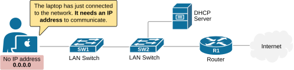
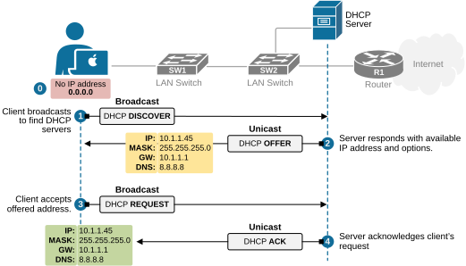
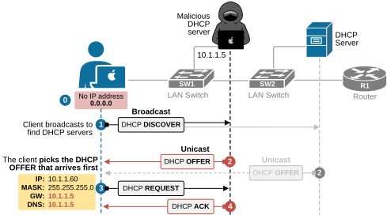
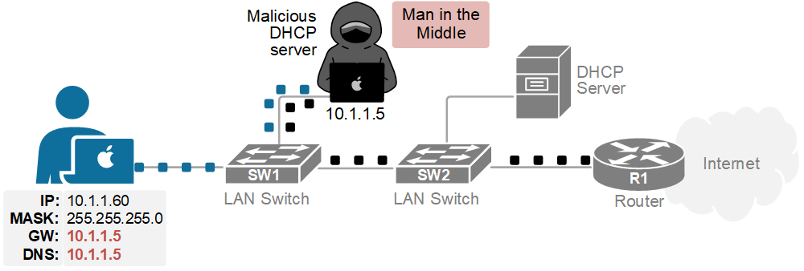
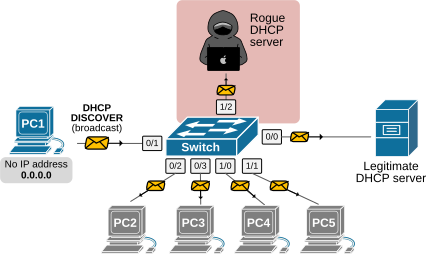
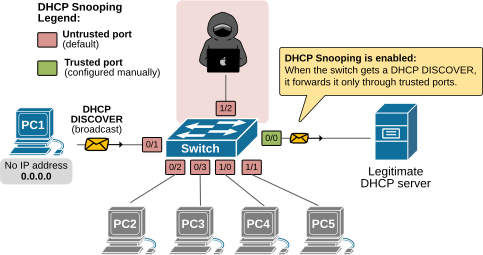
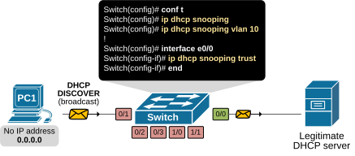

# DHCP Snooping

<!-- nav -->
⬅ [Switchport Port-Security](14-port-security.md) · [Course index](00_Index.md) · [IEEE 802.1x](16-ieee-802-1x.md) ➡
<!-- nav -->

*Network Security · Lesson · Source: https://www.networkacademy.io/ccna/network-security/dhcp-snooping*

In this lesson, we discuss what DHCP snooping is and how it protects the network from rogue IP settings. But before we talk about the security side of things, let’s rewind a bit and make sure we understand what DHCP actually is.

## What is DHCP?

When you plug your laptop into a switch or connect it to the Wi-Fi, your device **doesn’t know what IP address to use**, as shown in the diagram below.



*Figure 1. Client just connects to the network.*

That's where the Dynamic Host Configuration Protocol comes in, automatically providing IP settings such as IP address, Network Mask, Default Gateway, and DNS. Let's recall how it works.

### How does DHCP work?

DHCP is the service that automatically gives IP addresses and network settings to devices. It is very simple and works using a quick four-step process, as shown in the diagram below.



*Figure 2. How does DHCP work?*

- **Step 1:** When you connect your laptop to the network, it simply **yells to everybody**, “*Hey, is there a DHCP server out there? Can someone give me an IP?*” Remember that this is **a broadcast message that reaches every device in the local LAN**. The laptop doesn't know if there is a local server in the LAN, so it floods and learns.
- **Step 2:**Eventually, the local DHCP server hears that broadcast, and it replies, “*Sure, here’s an IP you can use, along with your subnet mask, default gateway, and DNS servers.*”
- **Step 3:** The client accepts the offered IP settings by sending a Request message back to the server.
- **Step 4:** Finally, the server acknowledges the client's request, indicating the device is online and ready to communicate on the network.

You can see how simple and powerful the process is, **but there’s a big problem**. DHCP was invented in times when security was not a primary concern. Therefore, it doesn't implement any security by default. **It assumes everyone in the network is friendly**. And we all know that’s not always the case nowadays.

## Why do we need DHCP Snooping?

Now let's look at the same example but from another perspective. Imagine this is an office network, with hundreds of people. There’s one official DHCP server that assigns IP addresses.

Now imagine an attacker who wants to steal sensitive corporate data. They connect a laptop to the office network and run a fake DHCP server tool, as shown in the diagram below.



*Figure 3. Rogue DHCP server example.*

In that case, the hacker's DHCP tool responds to clients’ DHCPDISCOVER messages **faster than the real server.** At the same time, clients accept the first DHCPOFFER message they receive. So what happens is that the client gets a malicious IP address, default gateway, and DNS servers from the hacker, as shown in the diagram above.The ultimate goal of the hacker is to give the client **a fake gateway that points to them**. In our example, the hacker assigns its own IP address, 10.1.1.5, as the client's default gateway.

The result is that the client connects to the Internet through them. All your traffic flows through the attacker’s machine, as shown in the diagram below. That’s called **a man-in-the-middle attack**.



*Figure 4. DHCP Man in the Middle Attack.*

This is why we need DHCP snooping—a feature that controls who’s allowed to hand out IP addresses and who’s not.

## What is DHCP snooping?

DHCP snooping is a feature that prevents unauthorized servers from providing IP settings to the host. Although DHCP is a Layer 3 service, **DHCP snooping works at Layer 2** — on switches. It is best understood via an example, so let's look at the simplest possible topology with only one switch.



*Figure 5. DHCP at layer 2 without Snooping.*

PC1 has just been connected to the network. It sends out a DHCPDISCOVER message. When the switch receives a DISCOVER message, **it forwards it on all its ports because it is a broadcast**. Ultimately, the rogue server receives the DHCPDISCOVER and replies back with a DHCPOFFER, compromising the network security.

Now, let's look at the same example, but with the switch configured to perform DHCP Snooping. When the feature is enabled, the switch starts treating every port as either trusted or untrusted:

- ****Trusted ports**** connect to real DHCP servers or routers. These ports **can send and receive all DHCP messages**, like DHCPOFFER and DHCPACK.
- ****Untrusted ports**** connect to regular users or end devices. They **can only receive DHCPDISCOVER messages**(asking for an IP). They cannot receive DHCPOFFER or DHCPACK.

By default, all ports are untrusted until the network admin marks them as trusted.

Let's see how our example differs when the snooping feature is enabled and the port toward the legitimate server is marked as trusted. Now, when PC1 sends the DHCPOFFER message, the switch only sends it out the port that connects to the real server. The attacker doesn't receive the message at all, as shown in the diagram below.



*Figure 6. DHCP at layer 2 with Snooping enabled.*

Even if the attacker receives the DHCPDISCOVER, when they reply back with DHCPOFFER, the switch drops the message because it doesn't accept DHCPOFFERS on untrusted ports.

In short, DHCP snooping separates trusted (known) servers from unknown servers and ensures that only trusted servers can hand out network settings.

## Configuring DHCP Snooping

Now let's shift the focus to the configuration side of things. Configuring DHCP Snooping is pretty straightforward. The following diagram summarizes how we enable the feature on the simple topology we use as an example.



*Figure 7. DHCP Snooping configuration example.*

Before we look into each configuration step separately, let's first verify that the feature is disabled globally by default.

```text
Switch# show ip dhcp snooping
Switch DHCP snooping is disabled
Switch DHCP gleaning is disabled
DHCP snooping is configured on following VLANs:
none
DHCP snooping is operational on following VLANs:
none
 Proxy bridge is configured on following VLANs:
none
 Proxy bridge is operational on following VLANs:
none
DHCP snooping is configured on the following L3 Interfaces:

Insertion of option 82 is enabled
   circuit-id default format: vlan-mod-port
   remote-id: aabb.cc00.9000 (MAC)
Option 82 on untrusted port is not allowed
Verification of hwaddr field is enabled
Verification of giaddr field is enabled
DHCP snooping trust/rate is configured on the following Interfaces:

Interface                  Trusted    Allow option    Rate limit (pps)
-----------------------    -------    ------------    ----------------
```

Remember that by default, every Cisco switch allows all DHCP messages on all ports (no security at all).

### Step 1. Enable DHCP snooping on a switch

First, we need to enable DHCP snooping globally on the switch. We go to global config mode and enter:

```text
Switch(config)# ip dhcp snooping
```

Note that just doing this, the switch does NOT start filtering messages yet. We still have to tell it which VLANs to protect.

### Step 2. Enable DHCP snooping for specific VLANs

The next step is to enable the feature for the specific VLANs we want. **DHCP snooping works per VLAN**. If you don’t enable it for a VLAN, that VLAN is not protected. For example, let’s say clients are connected to VLAN10, then we configure the following:

```text
Switch(config)# ip dhcp snooping vlan 10
```

Now the switch will apply DHCP snooping logic to VLAN 10. At this point:

- The switch starts inspecting DHCP traffic on untrusted ports within VLAN 10.
- The switch starts building the DHCP snooping binding table (IP - MAC - port).

However, we still haven't defined trusted ports. Remember that by default, all switchports are untrusted.

### Step 3. Mark trusted and untrusted ports

By default, every port is UNTRUSTED, which means: a device connected to an untrusted port **is allowed to request an IP address** (send DHCPDISCOVER), but it is NOT allowed to respond as a server (send DHCPOFFER or DHCPACK). Those get dropped.

We need to tell the switch which ports we do trust. Normally, these are the uplinks toward the real DHCP server,

In our simple example, the server is connected to port Ethernet0/0. Therefore, we configure it as a trusted port using the CLI command in blue below.

```text
Switch(config)# interface Ethernet0/0
Switch(config-if)# ip dhcp snooping trust
Switch(config-if)# exit
```

Now Ethernet0/0 is trusted. DHCPOFFERS and DHCPACKs from that interface are allowed.

## Verify DHCP snooping

After the config, we should always verify. The following show command is essential for the CCNA exam and for real environments.

```text
Switch# show ip dhcp snooping
Switch DHCP snooping is enabled
Switch DHCP gleaning is disabled
DHCP snooping is configured on following VLANs:
10
DHCP snooping is operational on following VLANs:
10
 Proxy bridge is configured on following VLANs:
none
 Proxy bridge is operational on following VLANs:
none
DHCP snooping is configured on the following L3 Interfaces:

Insertion of option 82 is enabled
   circuit-id default format: vlan-mod-port
   remote-id: aabb.cc00.1000 (MAC)
Option 82 on untrusted port is not allowed
Verification of hwaddr field is enabled
Verification of giaddr field is enabled
DHCP snooping trust/rate is configured on the following Interfaces:

Interface                  Trusted    Allow option    Rate limit (pps)
-----------------------    -------    ------------    ----------------
Ethernet0/0                      yes        yes             unlimited
Interface                  Trusted    Allow option    Rate limit (pps)
-----------------------    -------    ------------    ----------------
  Custom circuit-ids:
```

Notice the lines highlighted in blue. They will tell us:

- Is DHCP snooping enabled? Yes.
- Which VLANs are protected? Vlan 10.
- Which interfaces are trusted? Ethernet 0/0.

---

<!-- nav -->
⬅ [Switchport Port-Security](14-port-security.md) · [Course index](00_Index.md) · [IEEE 802.1x](16-ieee-802-1x.md) ➡
<!-- nav -->
