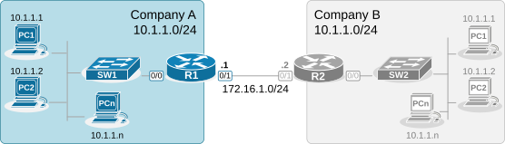
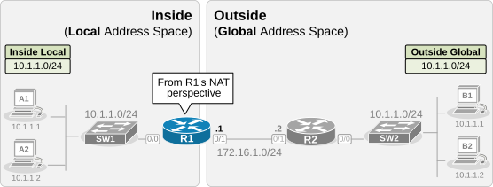
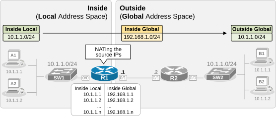

# Lab #2.2 - Overlapping IP ranges

<!-- nav -->
⬅ [Lab #2.1 - Internet access](12-lab-1-internet-access.md) · [Course index](00_Index.md) · [Quality of Service (QoS)](14-quality-of-service-qos.md) ➡
<!-- nav -->

*Network Services · Lesson · Source: https://www.networkacademy.io/ccna/network-services/lab-2-overlapping-ip-ranges*

This configuration ticket demonstrates another real-world scenario where NAT can be used to solve complex network requirements. The scenario shows **two companies merging** and needing to interconnect their networks but having overlapping IP ranges.

At the end of the lesson, you can download the EVE-NG file from the Download section and practice completing all objectives yourself.

## Ticket Initial State

Company A recently merged with Company B and must interconnect their networks. An engineer has already connected the two networks from physical and routing point of view, as shown in the diagram below.



*Figure 1. Ticket Initial Topology.*

However, there is a problem with IP addressing. Both companies use the same private IPv4 address space—10.1.1.0/24. This prevents hosts in Company A from communicating with hosts in Company B.

## Ticket Objectives

The customer has contacted you to resolve the problem with the overlapping IP schemes. They entrusted you with enabling**full communication between the two networks**.

- **Requirement 1:** Hosts in Company A must be able to reach hosts in Company B. For example, host A1 (10.1.1.1) must telnet to host B1 (10.1.1.1).
- **Requirement 2:**You are not allowed to change the IP addresses of any of the hosts in each network.
- **Requirement 3:** You can only make configuration changes on router R1. You cannot make configuration changes on any of the other devices.

Download the EVE-NG file from the download section at the end of the lesson and try to complete the objectives yourself. Then return to cross-check your solution with ours.

## Analyzing the Requirements

It is common to deal with overlapping IP ranges in scenarios such as mergers, acquisitions, and multi-tenant environments. Connecting two networks with overlapping IPs (where both networks have IP ranges that conflict) typically requires using NAT techniques to avoid IP conflicts.

In this lab example, Company A and Company B use the overlapping subnet 10.1.1.0/24. To satisfy the requirement, we will use static NAT with a one-to-one mapping between networks.

### Step 1. Identifying Inside and Outside

The first step in any NAT configuration is identifying NAT Inside and Outside. Since we will reconfigure router R1, the Inside and Outside directions are from R1's perspective.



*Figure 2. Identifying Inside and Outside.*

We configure R1's Eth0/0 interface as inside and the Eth0/1 interface as outside using the commands shown in the output below.

```text
R1(config)#
interface Ethernet0/0
 ip address 10.1.1.254 255.255.255.0
 ip nat inside
!
interface Ethernet0/1
 ip address 172.16.1.1 255.255.254.0
 ip nat outside
!
```

As a general rule of thumb, when working on a more complex NAT setup, it is beneficial to visualize the Inside and Outside zones with the actual addresses of the hosts on the two sides, as shown in the diagram above.

Notice that the real configured IP addresses on the hosts on the Inside are referred to as "Inside Local" addresses, while the configured IPs on the hosts on the Outside are referred to as "Outside Global." **Those addresses are taken for granted from R1's NAT's perspective**. They are already chosen and configured on the hosts.

### Step 2. Static Source NAT at subnet scale

The next step in the process is configuring static one-to-one mapping for the hosts on the Inside. Until now, we have only seen how to configure one-to-one mapping between two IP addresses. However, for this use case, it is not practical to configure mappings for each pair of Inside Local-Inside Global IP addresses. It is much more convenient to configure static mapping at a network scale.



*Figure 3.NATing Inside Local to Inside Global.*

The **ip nat source static** command has a parameter **network** that allows us to map an Inside Local network to an Inside Global network. In our example, we will map the inside network 10.1.1.0/24 to the non-overlapping subnet 192.168.1.0/24. Therefore, **Company B hosts will see Company A traffic coming from 192.168.1.0/24** (instead of 10.1.1.0/24).

```text
R1(config)#
 ip nat inside source static network 10.1.1.0 192.168.1.0 /24
```

Notice the parameters in the command we configure on R1.

- The network 10.1.1.0/24 is the Inside Local subnet of the hosts in Company A. This network is a given. It is already configured on the hosts and cannot be easily changed.
- The network 192.168.1.0/24 is the Inside Global subnet after the router performs the translation. This network can be any arbitrary one that does not overlap with Company B. In our example, we have chosen 192.168.1.0/24. However, it could be any subnet as long as Compnay-B's network has routing to it.

The router maps each IP address from the Inside Local network to one from the Inside Global network in one-to-one sequential order: 10.1.1.1 maps to 192.168.1.1, 10.1.1.2 maps to 192.168.1.2, 10.1.1.3 maps to 192.168.1.3, and so on.

### Step 3. Static Destination NAT at subnet scale

We must perform one more step to allow bidirectional connectivity between the two companies. Translating only the source addresses is not enough. Although hosts on the Outside (in Company B) no longer see any overlapping addresses, the hosts on the Inside still cannot initiate connections to Company B because the destination IP addresses overlap. For example, host A1 (10.1.1.1) can't ping host B1 (10.1.1.1) because, from A1's perspective, it seems like it initiates ping to itself.

To solve this problem, we must translate the destination IPs as well. Hosts in Company A must initiate connections to arbitrary destination IPs that the router replaces with the real IPs of hosts in Company B.

---

<!-- nav -->
⬅ [Lab #2.1 - Internet access](12-lab-1-internet-access.md) · [Course index](00_Index.md) · [Quality of Service (QoS)](14-quality-of-service-qos.md) ➡
<!-- nav -->
