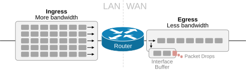
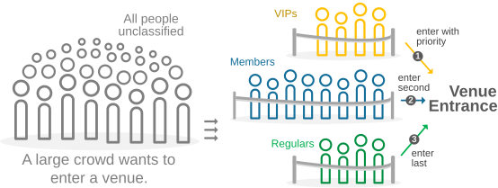
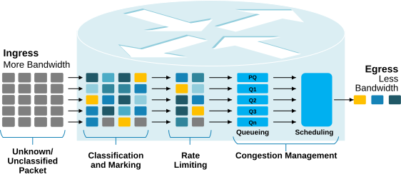

# Why do we need QoS?

<!-- nav -->
⬅ [Quality of Service (QoS)](14-quality-of-service-qos.md) · [Course index](00_Index.md) · [Classification and Marking](16-classification-and-marking.md) ➡
<!-- nav -->

*Network Services · Lesson · Source: https://www.networkacademy.io/ccna/network-services/why-do-we-need-qos*

In a typical IP network, the LAN operates at higher speeds (in the Gigabits range), while WAN interfaces run at slower speeds (in the Megabits range). This creates an interesting problem for the routers that sit on the WAN edge connecting the LAN to the WAN - thousands of packets arrive through the LAN interface, but the WAN interface does not have the capacity to transmit them all.

*Figure 1. Why do we need QoS?*

When there are more packets than the WAN interface can transmit, **some packets must be buffered, and others must be dropped**. But which packets should the router drop? Which packets should it place in the buffer and transmit later? Which packets should it send immediately with priority?

These questions touch on core concepts of Quality of Service (QoS) in networking. QoS refers to the tools routers and switches use **to apply differentiated handling of packets as they move through the network** (hence, the term **DiffServ**- differentiated services). For instance, a WAN edge router can immediately send out the packets that are important to the business. At the same time, it can queue relatively important packets and drop packets that are irrelevant to the organization's business.

The bottom line is that **not all packet flows are equal to the business.** Some are business-critical, and some are business-irrelevant. QoS is the toolset network devices use to treat the packet flows essential to the business differently than the less important ones.

## People congestion vs Packet congestion

Let's compare a venue managing crowd congestion to a router managing packet congestion. This will help you understand most of the QoS concepts at a high level.

Imagine you are managing a venue with thousands of people wanting to enter. You would like to treat different groups of people differently. For example, you want backstage and security staff to enter without waiting, right? You want VIPs to enter with priority. You want members and fast-lane ticket holders to enter with priority over regular ticket holders. You want to prevent overcrowding and ensure safety. What would be the process? How do you do it?

*Figure 2. Managing crowd congestion.*

Generally, the process can be broken down into three steps as follows:

- **Step 1. Classification and Marking** - The first step is to classify the different people into separate groups based on their tickets. When you classify a person as VIP, for example, you mark him with a wristband so that you can easily understand his importance later at any place at any time when required. This process typically takes place far in advance of the actual entrance.
- **Step 2. Rate Limiting** - Then you must control the flow of people to prevent overcrowding and ensure safety. Venues typically set up zig-zag stanchions, fences, and ropes to create orderly lines and direct the flow of people, preventing chaotic crowd movement.
- **Step 3.****Queueing and Scheduling** - Lastly, to treat different people with different priorities, you split them into different waiting queues. Staff and security personnel enter immediately without waiting. VIPs wait in another queue and enter with priority. Fast-lane ticket holders enter with priority over regular ticket holders, etc.

The venue treats different people differently based on their importance. Hence, the process could also be called differentiated services - DiffServ.

## The QoS toolkit

A router using QoS to manage packet flows during congestion is like a venue’s crowd management system. It is important to understand from the beginning that **QoS is not a single tool or feature**. It is a toolkit of different features and capabilities working together to achieve the common goal - ensuring business-critical packet flows arrive on time without packet loss.

*Figure 3. The QoS toolkit.*

The Quality of Service (QoS) workflow is similar to the venue's crowd management. It involves the following processes:

- **Classification and Marking**—The process of classifying packets and marking them with a DSCP value (1 to 63) so that their importance can easily be determined anywhere in the network at any time.
- **Rate Limiting (Shaping and Policing)**—The process of controlling the maximum traffic rate at specific points in the network for particular packet flows.
- **Queuing and Scheduling**—Queuing is the process of placing packets in different queues based on their classification (in step 1). Scheduling determines the order in which packets are transmitted from these queues, typically giving higher priority to business-critical traffic.

If you compare the QoS workflow shown in Figure 3 to the venue's crowd management shown in Figure 2, you can see that at a high level, the logic is very similar. Now, let's shift the focus a little bit and discuss the different traffic characteristics that we want to control with QoS.

## Bandwidth, Delay, Jitter, and Packet Loss

There are four fundamental metrics that impact applications running over the network: Bandwidth, Delay, Jitter, and Packet Loss. Here's a breakdown of each term:

---

<!-- nav -->
⬅ [Quality of Service (QoS)](14-quality-of-service-qos.md) · [Course index](00_Index.md) · [Classification and Marking](16-classification-and-marking.md) ➡
<!-- nav -->
