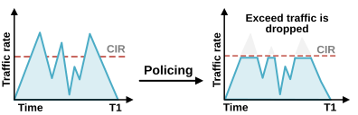
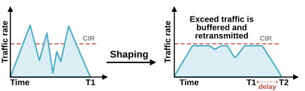
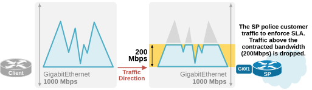
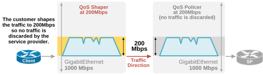

# Policing and Shaping

<!-- nav -->
⬅ [Lab #3.1 - Marking traffic at the access](18-lab1-marking-traffic-at-the-access.md) · [Course index](00_Index.md) · [Queuing and Scheduling](20-queuing-and-scheduling.md) ➡
<!-- nav -->

*Network Services · Lesson · Source: https://www.networkacademy.io/ccna/network-services/policing-and-shaping*

Policing and Shaping are QoS techniques used to manage and control bandwidth usage. Both QoS features monitor the traffic rate of an interface and compare it to the configured rate limit called CIR (Committed Information Rate). When the traffic exceeds the CIR value, they perform a pre-configured action.

## Policing vs Shaping

Packets are transmitted as a series of bits over the communication medium. Bits arrive at a network interface at fluctuating rates, with peaks and valleys. The average rate per second at which the bits arrive is called the traffic rate. It is measured in bits/sec, kilobits/sec, megabits/sec, etc. In short, Kbps, Mbps, Gbps, etc.

### Policing

Policing is a QoS feature that monitors the traffic rate of an interface against a configured policing rate called CIR. When an arriving packet pushes the current traffic rate above the configured policing rate (CIR), the policer takes action. The action is typically to drop the packet, but it can also be looser, like remark the QoS value of the packet.

For example, the following diagram shows a policer that discards traffic that exceeds the CIR rate.

*Figure 1. QoS Policing.*

In summary, policing is a QoS feature that **prevents traffic from exceeding the configured CIR rate** by discarding any packets that push the current traffic rate above the CIR rate.

### Shaping

Shaping is a QoS feature that also prevents traffic from exceeding the configured traffic rate (CIR). However, it uses a different logic. Instead of discarding the packets that push the current traffic rate above the CIR rate, **it buffers and transmits the exceeding traffic over time**.

For example, the following diagram shows a shaper that holds exceeding traffic in a buffer and transmits it over time when the current traffic rate is lower.

*Figure 2. QoS Shaping.*

Notice something very important about shapers - holding of traffic in buffers introduces latency.

## Use cases for QoS Policing and Shaping

You cannot really understand what policing and shaping do and why they exist in the QoS toolset unless we review the use cases for both features.

### Where policing is commonly used?

Policing is one of those features that makes people initially think - *How does dropping packets could be good for the network*? It seems exactly the opposite of what the network must do - reliably transport packets to their destinations.

By far, the most common use case for policing is ****enforcing service level agreements (SLA)**.** For example, you are a service provider that sells connectivity to customers. When you sell 200 Mbps WAN service to a customer, you must ensure that the customer is not sending more traffic than that. A service provider has thousands of customers. If all those customers consistently sent traffic above their agreed bandwidth limit, this could lead to significant congestion in the WAN, potentially overwhelming the SP core. Additionally, customers might exploit the situation by purchasing lower bandwidth limits, knowing their excess traffic would still be forwarded.

So, what does the service provider do? It strictly enforces the agreed bandwidth limits (CIR) **by configuring a QoS policer on the customer-facing interface**, as shown in the diagram below.

*Figure 3. QoS Policer use case.*

When the customer on the left sends more than 200Mbps of traffic, the service provider discards the traffic that exceeds the agreed bandwidth limit. By enforcing the agreed SLAs for all customers, the service provider ensures that no single customer starves others of bandwidth.

Another very common use case is preventing excessive bandwidth usage by specific hosts, applications, or network devices. For example, suppose you know that a host can generate a very high traffic volume that can cause network congestion. In that case, you can apply an ingress QoS policer to the interface that connects to that host and police the traffic bursts exceeding a configured rate.

Another common use of policing is protecting a device's control plane from denial of service (DoS) or other abusive traffic.

**KEY POINT:** Policing can be used inbound and outbound. However, it is most commonly used inbound on customer-facing interfaces.

### Where shaping is commonly used?

QoS shaping is commonly used in scenarios where it is necessary to smooth traffic flows in order to comply with the service provider's SLA. For example, align traffic with the capacity of a WAN link, as shown in the diagram below.

*Figure 4. QoS Shaper use case.*

Service providers always apply ingress traffic policers to enforce the agreed bandwidth limits. That's why **you always shape outbound traffic on the WAN link to the agreed-upon bandwidth** to avoid congestion and packet loss, which policing might introduce at the service provider's edge.

**KEY POINT:**Shaping can only be used outbound. It is most commonly used on WAN links to service providers.

## Key Takeaways

Now, let's compare the two Quality of Service (QoS) capabilities and then dive into a configuration example in the next lesson.

| **Policing** | **Shaping** |
|---|---|
| Measures the current traffic rate over time and compares it against the configured CIR. | Measures the current traffic rate over time and compares it against the configured CIR. |
| If a packet pushes the current traffic rate above the CIR rate, **discards or re-mark the packet**. | If a packet pushes the current traffic rate above the CIR rate, it **buffers the packet and transmits it over time**. |
| Can be applied in **either direction** on an interface. | Can only be applied in **outbound direction** on an interface. |
| Most commonly used in ingress direction. |  |

Now, let's go through some configuration examples.

---

<!-- nav -->
⬅ [Lab #3.1 - Marking traffic at the access](18-lab1-marking-traffic-at-the-access.md) · [Course index](00_Index.md) · [Queuing and Scheduling](20-queuing-and-scheduling.md) ➡
<!-- nav -->
