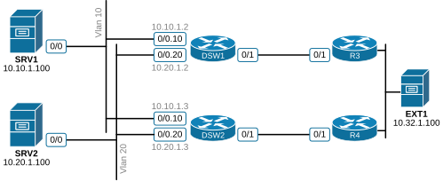
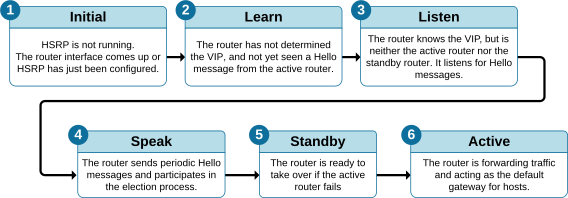
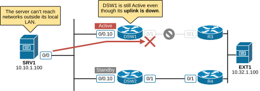
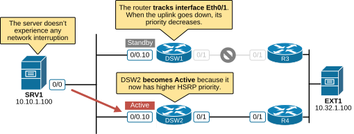
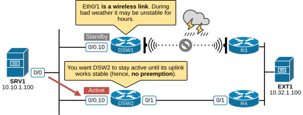

# Lab #4.1 - Configuring HSRP

<!-- nav -->
⬅ [Hot Standby Router Protocol (HSRP)](24-hot-standby-router-protocol-hsrp.md) · [Course index](00_Index.md) · [Virtual Router Redundancy Protocol (VRRP)](26-virtual-router-redundancy-protocol-vrrp.md) ➡
<!-- nav -->

*Network Services · Lesson · Source: https://www.networkacademy.io/ccna/network-services/configuring-hsrp*

In this lesson, we will demonstrate how to configure HSRP on Cisco routers. At the end of the lesson, you can download the EVE-NG file and practice the lab in your home virtualized environment.

## Lab Initial State

The diagram below shows the customer network we will work with. There are two local Vlans: Vlan10 with subnet 10.10.1.0/24 and Vlan 20 with subnet 10.20.1.0/24.



*Figure 1. Lab Initial Topology.*

The hosts in vlan 10 are configured with a default gateway of 10.10.1.1, while those in vlan 20 are configured with 10.20.1.1. There is no first-hop redundancy protocol configured on the local routers.

## Lab Requirements

An engineer configured the customer network but didn't manage to finish. The customer has contacted you to finish the configuration based on the requirements below. There is no information on the current state of the configuration.

- **Requirement 1:** Configure a resilient default gateway address in Vlans 10. Use HSRP as the first-hop redundancy protocol.
  - Use version 1.
  - The group number must be 10.
  - The VIP address must be 10.10.1.1.
  - The Hello interval must be 1 second. The hold timer must be 3 seconds.
  - Preemption must be enabled.
  - Distribution switch DSW1 must be the active router.
- **Requirement 2:** Configure a resilient default gateway address in Vlans 20.
  - Use version 2.
  - The group number must be 20.
  - The VIP address must be 10.20.1.1.
  - The Hello interval must be 2 seconds. The hold timer must be 6 seconds.
  - Preemption must be enabled.
  - Distribution switch DSW2 must be the active router.
- **Requirement 3:** If the active router has an uplink failure, the standby route must immediately take over.
- **Verification 1:** Traceroute from SRV1 (10.10.1.100) to EXT1(10.32.1.100) must go via the path DSW1-R3-EXT1.
- **Verification 2:** Traceroute from SRV2 (10.20.1.100) to EXT1(10.32.1.100) must go via the path DSW2-R4-EXT1.
- **Verification 3:** If DSW1's eth0/1 uplink is shut down, DSW2 must immediately become the Active router for group 10.

Try to complete the objectives yourself and then return to cross-check your solution with ours.

## Lab Configuration

Let's start with the first two requirements and then verify if everything works as expected. Then, we can move to requirement 3 and make all verifications.

### Requirement 1

We need to configure an HSRP group 10 in vlan 10 with VIP address 10.10.1.1. The HSRP timers must be 1-second Hello and 3-second Hold timers. DSW1 must be the active router, and preemption must be enabled.

```text
DSW1# configure terminal
interface Ethernet0/0.10
 ip address 10.10.1.2 255.255.255.0
 standby 10 ip 10.10.1.1
 standby 10 priority 110
 standby 10 timers 1 3
 standby 10 preempt
!
```

The output above shows how we configure DSW1. Notice that we set priority 110 so that it can become the active router. Now, let's configure DSW2 as a standby router.

```text
DSW2# configure terminal
interface Ethernet0/0.10
 ip address 10.10.1.3 255.255.255.0
 standby 10 ip 10.10.1.1
 standby 10 timers 1 3
 standby 10 preempt
!
```

Notice that we don't set any priority. Therefore, DSW2 will have the default priority of 100.

### Requirement 2

Now, let's configure the resilient default gateway in the other vlan - vlan 20. We must use HSRP version 2 with VIP 10.20.1.1 and timers 1 and 3. DSW2 must be the active router.

```text
DSW1# configure terminal
interface Ethernet0/0.20
 ip address 10.20.1.2 255.255.255.0
 standby version 2
 standby 20 ip 10.20.1.1
 standby 20 timers 2 6
 standby 20 preempt
!
```

Notice that we don't configure any priority value for DSW1, so it has the default value of 100.

```text
DSW2# configure terminal
interface Ethernet0/0.20
 ip address 10.20.1.3 255.255.255.0
 standby version 2
 standby 20 ip 10.20.1.1
 standby 20 timers 2 6
 standby 20 priority 110
 standby 20 preempt
!
```

Notice that we set priority 110 on DSW2 so it becomes the active router.

Now, we can check the HSRP state on DSW1 using the show standby brief command, as shown in the output below. Notice that the router reports it is the active router in Vlan 10 and the standby router in vlan 20.

```text
DSW1# show standby brief
                     P indicates configured to preempt.
                     |
Interface   Grp  Pri P State   Active          Standby         Virtual IP
Et0/0.10    10   110 P Active  local           10.10.1.3       10.10.1.1
Et0/0.20    20   100 P Standby 10.20.1.3       local           10.20.1.1
```

If we want to have more details about the HSRP states, we use the show standby command, as shown below.

```text
DSW1# show standby
Ethernet0/0.10 - Group 10
  State is Active
    2 state changes, last state change 00:06:48
  Virtual IP address is 10.10.1.1
  Active virtual MAC address is 0000.0c07.ac0a (MAC In Use)
    Local virtual MAC address is 0000.0c07.ac0a (v1 default)
  Hello time 1 sec, hold time 3 sec
    Next hello sent in 0.576 secs
  Preemption enabled
  Active router is local
  Standby router is 10.10.1.3, priority 100 (expires in 3.264 sec)
  Priority 110 (configured 110)
  Group name is "hsrp-Et0/0.10-10" (default)
  FLAGS: 1/1
  
Ethernet0/0.20 - Group 20 (version 2)
  State is Standby
    4 state changes, last state change 00:00:41
  Virtual IP address is 10.20.1.1
  Active virtual MAC address is 0000.0c9f.f014 (MAC Not In Use)
    Local virtual MAC address is 0000.0c9f.f014 (v2 default)
  Hello time 2 sec, hold time 6 sec
    Next hello sent in 0.864 secs
  Preemption enabled
  Active router is 10.20.1.3, priority 110 (expires in 6.240 sec)
    MAC address is aabb.cc00.9000
  Standby router is local
  Priority 100 (default 100)
  Group name is "hsrp-Et0/0.20-20" (default)
  FLAGS: 0/1
```

We can verify the same for the other router DSW2. It is the standby router for Vlan 10 and active for Vlan 20. Notice that the virtual MAC address is different for the different HSRP groups because group 10 is configured with HSRPv1, and group 20 is configured with HSRPv2.

```text
DSW2# show standby
Ethernet0/0.10 - Group 10
  State is Standby
    1 state change, last state change 00:06:54
  Virtual IP address is 10.10.1.1
  Active virtual MAC address is 0000.0c07.ac0a (MAC Not In Use)
    Local virtual MAC address is 0000.0c07.ac0a (v1 default)
  Hello time 1 sec, hold time 3 sec
    Next hello sent in 0.640 secs
  Preemption enabled
  Active router is 10.10.1.2, priority 110 (expires in 2.912 sec)
  Standby router is local
  Priority 100 (default 100)
  Group name is "hsrp-Et0/0.10-10" (default)
  FLAGS: 0/1
  
Ethernet0/0.20 - Group 20 (version 2)
  State is Active
    2 state changes, last state change 00:02:44
  Virtual IP address is 10.20.1.1
  Active virtual MAC address is 0000.0c9f.f014 (MAC In Use)
    Local virtual MAC address is 0000.0c9f.f014 (v2 default)
  Hello time 2 sec, hold time 6 sec
    Next hello sent in 1.408 secs
  Preemption enabled
  Active router is local
  Standby router is 10.20.1.2, priority 100 (expires in 6.544 sec)
  Priority 110 (configured 110)
  Group name is "hsrp-Et0/0.20-20" (default)
  FLAGS: 1/1
```

### HSRP States

If we enable debugging on one of the routers, we can see the state changes that the protocol goes through (highlighted in green)

```text
*Jan3 10:49: HSRP: Vl10 Interface UP
*Jan3 10:49: HSRP: Vl10 Initialize swsb, Intf state Up
*Jan3 10:49: HSRP: Vl10 Starting minimum intf delay (1 secs) - uptime 1623
*Jan3 10:49: HSRP: Vl10 Grp 1 Set virtual MAC 0000.0c07.ac01 type: v1 default
*Jan3 10:49: HSRP: Vl10 Added 10.10.1.1 to hash table
*Jan3 10:49: HSRP: Vl10 Grp 1 fhrp mac, reserved 0000.0c07.ac01, type: v1 default
*Jan3 10:49: HSRP: Vl10 Grp 1 Disabled -> Init
*Jan3 10:49: HSRP: Vl10 IP Redundancy "hsrp-Vl10-1" update, Disabled -> Init
*Jan3 10:49: HSRP: Vl10 Grp 1 Priority 100 -> 110
*Jan3 10:49: HSRP: Vl10 Intf min delay expired - uptime 1624
*Jan3 10:49: HSRP: Vl10 Grp 1 Init: a/HSRP enabled
*Jan3 10:49: HSRP: Vl10 Grp 1 Init -> Listen
*Jan3 10:49: HSRP: Vl10 Grp 1 Redundancy "hsrp-Vl10-1" state Init -> Backup
*Jan3 10:49: HSRP: Vl10 Grp 1 Listen: d/Standby timer expired (unknown)
*Jan3 10:49: HSRP: Vl10 Grp 1 Listen -> Speak
*Jan3 10:49: HSRP: Vl10 IP Redundancy "hsrp-Vl10-1" update, Backup -> Speak
*Jan3 10:49: HSRP: Vl10 Grp 1 Speak: d/Standby timer expired (unknown)
*Jan3 10:49: HSRP: Vl10 Grp 1 Standby router is local
*Jan3 10:49: HSRP: Vl10 Grp 1 Speak -> Standby
*Jan3 10:49: HSRP: Vl10 Grp 1 Redundancy "hsrp-Vl10-1" state Speak -> Standby
*Jan3 10:49: HSRP: Vl10 IP Redundancy "hsrp-Vl10-1" update, Speak -> Standby
*Jan3 10:49: HSRP: Vl10 Grp 1 Standby: c/Active timer expired (unknown)
*Jan3 10:49: HSRP: Vl10 Grp 1 Active router is local
*Jan3 10:49: HSRP: Vl10 Grp 1 Standby router is unknown, was local
*Jan3 10:49: HSRP: Vl10 Grp 1 Standby -> Active
*Jan3 10:49: %HSRP-5-STATECHANGE: Vlan10 Grp 1 state Standby -> Active
*Jan3 10:49: HSRP: Vl10 Grp 1 Redundancy "hsrp-Vl10-1" state Standby -> Active
*Jan3 10:49: HSRP: Vl10 Grp 1 Added 10.10.1.1 to ARP (0000.0c07.ac01)
*Jan3 10:49: HSRP: Vl10 Grp 1 Activating MAC 0000.0c07.ac01
```

The following diagram visualizes the HSRP states as per the protocol [RFC](https://datatracker.ietf.org/doc/html/rfc2281). However, notice that the Learn state is leapfrogged because the router understands the VIP address during configuration.



*Figure 2. Protocol state-machine.*

### Requirement 3

Now let's focus on requirement 3, which says, "*If the active router has an uplink failure, the standby route must immediately take over.*" Let's first shut down the uplink on DSW1 and see what happens in vlan 10.

```text
DSW1# conf t
Enter configuration commands, one per line.  End with CNTL/Z.
DSW1(config)# int e0/1
DSW1(config-if)#shutdown
DSW1(config-if)#
```

Now, DSW1's uplink is down. If we try to ping the external server (10.32.1.100) from SRV1 (10.10.1.100) we can see that the ping fails.

```text
SRV1# ping 10.32.1.100
Type escape sequence to abort.
Sending 5, 100-byte ICMP Echos to 10.32.1.100, timeout is 2 seconds:
.....
Success rate is 0 percent (0/5)
```

If we run a traceroute, we can see that the connectivity breaks at DSW1, which is the active router on the local network.

```text
SRV1# traceroute 10.32.1.100
Type escape sequence to abort.
Tracing the route to 10.32.1.100
VRF info: (vrf in name/id, vrf out name/id)
  1 10.10.1.2 1002 msec 3 msec 1 msec
  2 10.10.1.2 !H  *  !H
```

What happens? Although DSW1 has an uplink failure and doesn't have connectivity to the external world, **it is still the HSRP active router** in Vlan 10. Therefore, hosts send the traffic to DSW1, which discards it because it doesn't have routing to the external server, as shown in the diagram below.



*Figure 3. Active router has an uplink down.*

The solution to this problem is to use interface tracking with the HSRP protocol.

#### HSRP Interface Tracking

HSRP can track the status of a specific interface and adjust the router's priority based on the interface's operational state. If the tracked interface goes down, the router's priority decreases by a configured amount. This reduction in priority causes the router to lose its active role, allowing a standby router to take over. This ensures that traffic continues to be forwarded in case of uplink failures.

In our case, we can configure a track object (track 10) that monitors the status of Ethernet 0/1. If Eth0/1 goes down, HSRP decreases the router's priority by 50. The configuration is highlighted in green in the output below.

```text
DSW1(config)#
interface Ethernet0/0.10
 encapsulation dot1Q 10
 ip address 10.10.1.2 255.255.255.0
 standby 10 ip 10.10.1.1
 standby 10 priority 110
 standby 10 preempt
 standby 10 track 10 decrement 50
!
track 10 interface Ethernet0/1 line-protocol
!
```

After we configure the interface tracking and shut down DSW1's uplink, the router has a priority of 110-50=60, which is lower than the priority of DSW2. Therefore, as shown in the output below, DSW2 preempts the active role of HSRP group 10.

```text
DSW1(config)# interface Ethernet0/1
DSW1(config-if)# shutdown
*Jan8 17:24:24: %TRACK-6-STATE: 10 interface Et0/1 line-protocol Up -> Down
*Jan8 17:24:25: %HSRP-5-STATECHANGE: Ethernet0/0.10 Grp 10 state Active -> Speak
*Jan8 17:24:26: %LINK-5-CHANGED: Interface Ethernet0/1, changed state to administratively down
*Jan8 17:24:27: %LINEPROTO-5-UPDOWN: Line protocol on Interface Ethernet0/1, changed state to down
*Jan8 17:24:28: %HSRP-5-STATECHANGE: Ethernet0/0.10 Grp 10 state Speak -> Standby
DSW1(config-if)#
```

The following diagram explains the process visually. Notice that the server doesn't experience any network degradation, even though the WAN is experiencing an ongoing failure (DSW1's uplink is down).



*Figure 4. HSRP Track interface.*

Let's verify that SRV1 can reach the external server. You can see that ping is successful.

```text
SRV1# ping 10.32.1.100
Type escape sequence to abort.
Sending 5, 100-byte ICMP Echos to 10.32.1.100, timeout is 2 seconds:
!!!!!
Success rate is 100 percent (5/5), round-trip min/avg/max = 1/1/2 ms
```

If we run a traceroute, we can see that the traffic now goes via DSW2 and R4 before reaching EXT1 (10.32.1.100).

```text
SRV1# traceroute 10.32.1.100
Type escape sequence to abort.
Tracing the route to 10.32.1.100
VRF info: (vrf in name/id, vrf out name/id)
  1 10.10.1.3 1 msec 1 msec 0 msec --> DSW2
  2 10.1.3.2 1 msec 1 msec 0 msec --> R4
  3 10.32.1.100 1 msec *  3 msec
```

## Use cases for HSRP Preemption

Now, let's quickly discuss when it is beneficial to use preemption and when it is not. Preemption determines whether a router with a higher priority can take over as the active router once it becomes available.

In most cases, preemption only benefits the HSRP group. The network becomes predictable—in normal circumstances, we always know which router is active and forwards the traffic. Additionally, it makes triggering a manual switchover easier. You just change the priority of the standby router to a higher value, and it preempts the active role.

However, there are scenarios when it might be better not to use preemption. For example, imagine the scenario shown in the diagram below.



*Figure 5.HSRP with preemption disbled.*

In normal circumstances, DSW1 is the active router and tracks its uplink. However, the uplink is a wireless link. During bad weather such as lighting storm, **the wireless link can be unstable for hours**. In such scenarios, if the uplink flaps and triggers a switchover to the other router, you don't want DSW1 to become active again after the uplink recovers because it will likely flap again and trigger another switchover and then again and again for hours.

The network will be much more stable if we do not use preemption in this case. When DSW1's uplink flaps the first time and triggers a switchover, DSW2 **will take over and remain the active router** until a manual intervention by the network admin or its uplink goes down.

Keep in mind that if you are using tracking without preemption, you cannot use the standby 10 track 10 decrement 50 command because **decrementing the priority won't trigger a switchover**(because preemption is disabled). That's why there is another tracking option - shutdown, as shown in the output below.

```text
DSW1(config-subif)# standby 10 track 10 ?
  decrement  Priority decrement
  shutdown   Shutdown group
  <cr>       
```

When the tracked interface is down, you can shut down the HSRP group, which triggers a switch over to the other router.

---

<!-- nav -->
⬅ [Hot Standby Router Protocol (HSRP)](24-hot-standby-router-protocol-hsrp.md) · [Course index](00_Index.md) · [Virtual Router Redundancy Protocol (VRRP)](26-virtual-router-redundancy-protocol-vrrp.md) ➡
<!-- nav -->
